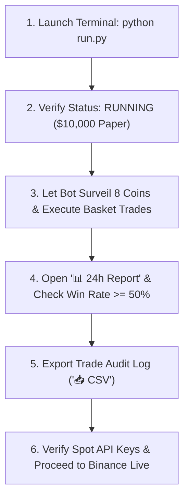

# 🌐 NEPTUNE TRADER — Autonomous Quantitative Day Trading Terminal

An institutional-grade, multi-bot algorithmic crypto trading terminal built in Python. Designed for automated multi-coin surveillance, multi-position basket execution, local adaptive machine learning, 24-hour benchmark evaluation, and seamless transition to real-money Spot trading on Binance.

---

## ⚡ Current System Status & Telemetry Report

| Metric | Current Operational Status |
| :--- | :--- |
| **Engine Status** | `RUNNING` (Automated setup detection & execution active) |
| **Web Dashboard** | `http://localhost:8000` (Localhost ASGI Server) |
| **Mode** | `PAPER` Simulation (Zero-Risk Live Market Benchmark) |
| **Simulated Capital** | **$10,000.00 USDT** Starting Capital |
| **Surveillance Fleet** | **8 High-Volume Coins** (`BTC`, `ETH`, `SOL`, `BNB`, `SUI`, `DOGE`, `XRP`, `PEPE`) |
| **Basket Capacity** | **Up to 5 Concurrent Positions** ($100 allocated per position) |
| **Ingestion Cadence** | **1-Second Live Price Ticks / 15-Second Quantitative Radar Pulses** |
| **Stream Architecture** | **Binance Multiplex WebSocket** (`stream?streams=...`) with auto-reconnect |
| **Data & Storage** | **100% Local & Offline-Safe** (`paper_state.json`, `local_learning_memory.json`) |

---

## 📋 Comprehensive Implementation Report

### Phase 1: Quantitative Core & Autonomous Fleet Strategy
* **5 Quantitative Sub-Bot Engines** ([strategies.py](file:///d:/Project%202026/Trading_bot/strategies.py)):
  1. **Opening Range Breakout (ORB)**: Evaluates the high/low of the opening 15-minute range and triggers on high-volume momentum breakouts with stops at range midpoints.
  2. **Bull Flag Momentum**: Identifies high-volume impulse flags followed by tight consolidation channels.
  3. **Oversold Bounce (RSI Mean Reversion)**: Detects capitulation bottoms where RSI(14) drops below 30 followed by a bullish reversal candle.
  4. **20-MA Reclaim**: Fires when price crosses back above the 20-period moving average supported by volume surges $\ge 1.2\times$.
  5. **EMA 9/21 Trend Rider**: Golden Cross momentum tracker filtering for shallow pullback bounces on EMA 9 support.
* **Neptune Fleet Master Strategy**:
  Runs all 5 algorithms concurrently across all watched pairs, ranking setups by confidence, Bayesian success expectancy, and risk-reward ratios.
* **Mathematical Indicator Engine** ([indicators.py](file:///d:/Project%202026/Trading_bot/indicators.py)):
  High-performance vectorized indicator calculations for EMA 9, EMA 21, RSI 14, Bollinger Bands (20, 2), Average True Range (ATR 14), and rolling volume surge ratios.

---

### Phase 2: Local Adaptive Machine Learning Engine
* **Local Memory Persistence** ([learning_engine.py](file:///d:/Project%202026/Trading_bot/learning_engine.py)):
  Stores every closed trade outcome, setup pattern, hold time, and market regime locally in `local_learning_memory.json`. No proprietary trading data is sent to external cloud servers.
* **Bayesian Reinforcement Sizing**:
  Dynamically scales setup multiplier weights between **$0.65\times$ and $1.35\times$**:
  - Setups winning consistently in current market regimes gain higher priority and larger sizing.
  - Setups struggling in choppy or adverse regimes are dampened automatically to shield equity.
* **Safety & State Controls**:
  One-click memory reset via `/api/bot/reset-learning` and `/api/bot/reset-paper` to clear or re-baseline learning memory at any time.

---

### Phase 3: Multi-Coin Automated Surveillance & Multiplex WebSocket
* **Automated Surveillance Across Top Volume Coins** ([binance_service.py](file:///d:/Project%202026/Trading_bot/binance_service.py)):
  Upgraded from single-pair monitoring (`BTC/USDT`) to a multi-coin fleet watching 8 high-volume Binance spot markets:
  `BTC/USDT`, `ETH/USDT`, `SOL/USDT`, `BNB/USDT`, `SUI/USDT`, `DOGE/USDT`, `XRP/USDT`, and `PEPE/USDT`.
* **Multiplex WebSocket Stream**:
  Constructs combined WebSocket URLs (`wss://stream.binance.com:9443/stream?streams=btcusdt@kline_1m/ethusdt@kline_1m/...`) with dynamic payload demultiplexing, allowing real-time candle updates and price streaming across all 8 coins over a single connection.
* **Automated Fallback Architecture**:
  Seamless fallback between `stream.binance.com` and `data-stream.binance.vision` with exponential backoff and a 3-second auto-reconnect loop.

---

### Phase 4: Multi-Position Basket Architecture & Risk Management
* **Simultaneous Portfolio Basket** ([paper_exchange.py](file:///d:/Project%202026/Trading_bot/paper_exchange.py)):
  Transformed the execution engine from single-position locking into a flexible multi-position basket supporting up to **5 concurrent open positions**.
* **Capital Protection & Cash Buffer**:
  - Base simulated capital set to **$10,000.00 USDT**.
  - Default trade size is set to **$100.00 USDT per position**, leaving a healthy cash buffer of ~$9,500.00 to prevent over-allocation.
* **Independent Bracket Management** ([bot_engine.py](file:///d:/Project%202026/Trading_bot/bot_engine.py)):
  Each coin in the basket maintains independent bracket rules:
  - **Stop Loss**: 1.5% below entry price (or ATR-based support).
  - **Take Profit**: 3.0% above entry price (2R reward-to-risk ratio).
  - **Trailing Stop**: 1.0% trailing threshold to lock in gains as favorable momentum extends.
* **Granular Liquidation Controls** ([server.py](file:///d:/Project%202026/Trading_bot/server.py)):
  - Dedicated `/api/bot/close-position` endpoint allowing 1-click liquidation of any individual coin in the basket.
  - Master `/api/bot/panic` endpoint for emergency liquidation of all basket positions simultaneously.

---

### Phase 5: Cyber-Oceanic Terminal UI & Responsive Layout
* **Visual Excellence & Brand Identity** ([index.html](file:///d:/Project%202026/Trading_bot/web/index.html) & [style.css](file:///d:/Project%202026/Trading_bot/web/style.css)):
  Custom-crafted dark cyber-oceanic glassmorphic design featuring the Neptune Planetary Globe emblem with orbiting planetary rings and glowing cyan/deep-blue accents.
* **Multi-Coin Watchlist Ticker Tape**:
  Horizontal ticker bar positioned at the top of the terminal displaying live prices, green/red flash animations, and `HELD` position badges across all 8 coins.
* **1-Click Market Switching**:
  Clicking any coin pill (e.g. `ETH`, `SOL`, `SUI`, `DOGE`) immediately switches the candlestick chart, indicator HUD, and quantitative radar to that asset.
* **Active Basket Tray**:
  Grid beneath the main chart displaying every open position with live mark price, cost, unrealized PnL ($ and %), and an individual **Close** action button.
* **Full Mobile & Tablet Responsiveness**:
  Media queries (<768px and <1024px) with flexible grid wrapping ensure the dashboard scales cleanly from smartphones to multi-monitor trading desks.
* **24-Hour Benchmark Session Tracking**:
  - Live session timer (`24H RUN: Xh Ym`) in the navbar.
  - Interactive **📊 24h Report** modal displaying win rate, profit factor, drawdown, and sub-bot performance breakdowns.
  - 1-Click **📥 CSV** export (`neptune_trades_report.csv`) for trade audit logs.

---

## 🤖 The 5 Neptune Sub-Bot Algorithms

| Sub-Bot | Quantitative Setup | Entry Trigger | Guarded Exit Plan |
| :--- | :--- | :--- | :--- |
| **ORB Breakout** | Opening Range Breakout | First candle close breaking above 15m range high. | Stop at range midpoint (`or-mid`); Target at **2R**. |
| **Bull Flag** | Momentum Continuation | High-volume impulse run followed by a tight channel breakout. | Stop below flag base; Target at flag pole projection. |
| **Oversold Bounce** | RSI Mean Reversion | RSI(14) capitulation below 30 with a bullish confirmation candle. | Stop below reversal low; Target at 20-SMA / 50 RSI. |
| **20-MA Reclaim** | Moving Average Support | Price reclaiming the 20-period SMA accompanied by volume surge $\ge 1.2\times$. | Stop below 20-MA reclaim candle; Target at **2R**. |
| **EMA 9/21 Trend** | Momentum Trend Follower | Golden Cross (EMA 9 > EMA 21) with shallow pullback support touches. | Stop at EMA 21; Target at upper Bollinger Band or 2R. |

---

## 🧠 Local Learning & Data Storage Architecture

All state, learning data, and configuration parameters are stored **100% locally** on your machine:

```
Trading_bot/
├── config.json                   # Watchlist (8 coins), risk brackets, trade sizes & API keys
├── paper_state.json              # Paper balance ($10,000), active basket positions, equity & trades
├── local_learning_memory.json    # Local Bayesian setup weights, win rates & regime history
```

### Learning Feedback Loop:
1. **Trade Recording**: When a position is closed (Take Profit, Stop Loss, Trailing Stop, or Manual Close), trade metrics are forwarded to `LocalLearningEngine`.
2. **Bayesian Score Update**: Computes rolling win rate, profit factor, average win, average loss, and consecutive streak counts for the responsible setup.
3. **Adaptive Prioritization**:
   - Winning setups in favorable market regimes receive up to a **$1.35\times$ priority boost**.
   - Underperforming setups in adverse market regimes are throttled down to **$0.65\times$** to preserve capital.

---

## 📁 Repository Structure & Module Overview

```
Trading_bot/
├── run.py                 # One-Click launcher: auto-finds free port & launches browser
├── server.py              # FastAPI ASGI server: REST API & high-frequency WebSocket gateway
├── bot_engine.py          # Master Engine: multi-coin market coordinator & telemetry broadcaster
├── binance_service.py     # Binance multiplexed WebSocket client & CCXT execution wrapper
├── paper_exchange.py      # Multi-position basket paper exchange simulator & trade ledger
├── learning_engine.py     # Local adaptive Bayesian reinforcement learning module
├── strategies.py          # Strategy algorithms for ORB, Bull Flag, Bounce, 20-MA, & EMA Trend
├── day_trader_skills.py   # Day trader radar scanner, exit planner & Monte Carlo Time Machine
├── indicators.py          # Technical indicator math (EMA, RSI, Bollinger Bands, ATR)
├── config.json            # Active bot configuration & risk settings
├── paper_state.json       # Persistent paper trading wallet & trade records
├── web/
│   ├── index.html         # Cyber-oceanic responsive dashboard single-page terminal
│   ├── style.css          # Glassmorphic layout, ticker tape, basket tray, & responsive CSS
│   ├── app.js             # Real-time WebSocket handler, Lightweight Charts v5 & UI controller
│   └── static/js/         # Local Lightweight Charts library bundle
```

---

## ⏱️ 24-Hour Benchmark Workflow

Before trading with real capital, run Neptune Bot for 24 hours in Paper mode to establish statistical performance:



1. **Launch Bot**: Run `python run.py`. The dashboard opens automatically at `http://localhost:8000`.
2. **Monitor the Fleet**: The top Watchlist Ticker Tape shows streaming prices across all 8 coins. The bot automatically enters positions when setups trigger.
3. **Evaluate Results**: Open the **`📊 24h Report`** modal to inspect your Win Rate (target: $\ge 50\%$) and Profit Factor (target: $\ge 1.30$).
4. **Audit Trades**: Click **`📥 CSV`** to download `neptune_trades_report.csv` for analysis in Excel or Google Sheets.

---

## 🚀 Transitioning to Real Money (`BINANCE_LIVE`)

When your 24-hour benchmark results meet your profitability targets:

1. Click **`Proceed to Real Money`** in the 24h Report modal (or open Settings ⚙️).
2. Select the **`Binance Live (Real Money)`** tab.
3. Create an API Key in your **Binance Account > API Management**:
   > [!IMPORTANT]
   > ### 🛡️ STRICT FUND SAFETY PROTOCOL
   > * Check **"Enable Spot & Margin Trading"** only.
   > * Keep **"Enable Withdrawals" STRICTLY UNCHECKED**. The bot can only execute spot trades; funds can NEVER leave your account.
   > * IP Whitelisting is highly recommended on Binance for automated trading bots.
4. Enter your API Key and Secret, then click **`Verify API Connection & Balance`**.
5. The terminal tests the connection and displays your actual free USDT spot balance.
6. Set your **Trade Amount (USDT)** conservatively ($100 – $300) and click **`START BOT`** to trade live.

---

## 💻 Quick Commands

```powershell
# Navigate to project folder
cd "d:\Project 2026\Trading_bot"

# Launch Neptune Trader
python run.py
```

* **Dashboard**: `http://localhost:8000`
* **Switch Coin Chart**: Click any coin pill (`BTC`, `ETH`, `SOL`, `BNB`, `SUI`, `DOGE`, `XRP`, `PEPE`) in the top tape.
* **Test Trade**: Click **`TEST BUY`** to verify instant order execution, chart markers, and sound cues.
* **Liquidate Single Position**: Click **`Close`** on any card in the Active Basket Tray.
* **Emergency Stop**: Click **`PANIC EXIT`** to immediately liquidate all open basket positions and pause the bot.
