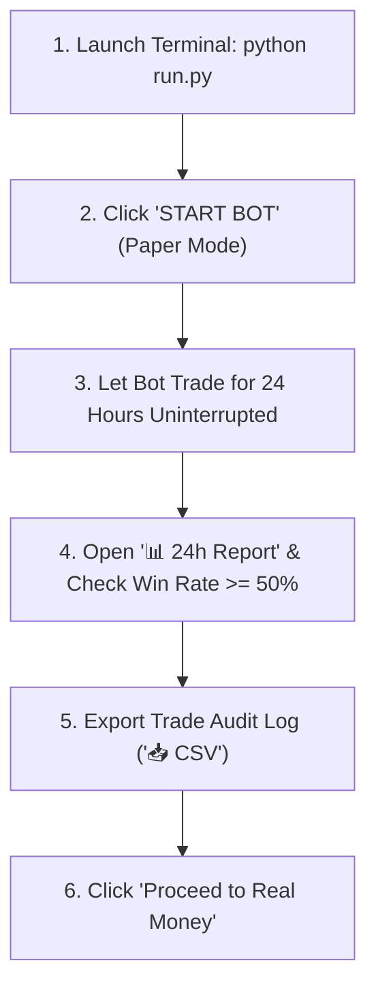

# 🌐 NEPTUNE TRADER — Autonomous Quantitative Day Trading Terminal

An institutional-grade, multi-bot algorithmic crypto trading platform built in Python. Designed for hands-free 24-hour benchmark evaluation, local adaptive machine learning, and seamless transition to real-money Spot trading on Binance.

---

## 🌟 Key Architecture & Highlights

* **Autonomous Multi-Bot Fleet**: Runs 5 quantitative algorithms simultaneously, continuously scanning market structure every second and picking high-probability setups.
* **Local Learning & Adaptive Memory Engine (`learning_engine.py`)**: Stores all trade history, market conditions, and setup statistics locally in `local_learning_memory.json`. Dynamically adjusts Bayesian setup weights ($0.65\times$ to $1.35\times$) to prioritize strategies that are actively winning in current market regimes.
* **24-Hour Autonomous Benchmark Mode**: Built for uninterrupted 24-hour test runs with automatic Binance WebSocket reconnection, state persistence (`paper_state.json`), and live session time tracking.
* **Daily Performance Analytics Modal**: Real-time evaluation of 24h Net Realized PnL, Win Rate %, Profit Factor, Max Drawdown %, and sub-bot scorecards.
* **1-Click Audit Export**: Instant CSV spreadsheet download (`neptune_trades_report.csv`) of every executed trade with timestamps, execution prices, fees, and exit triggers.
* **Binance Live Real Money Integration**: Direct Spot market execution via official Binance Spot API with real-time credential verification and strict safety protocols.
* **Cyber-Oceanic Glassmorphic Terminal**: TradingView Lightweight Charts v5 with real-time candle streaming, multi-timeframe trend matrix, Monte Carlo Time Machine path visualizer, audio cues, and live system console.

---

## 🤖 The 5 Neptune Sub-Bot Algorithms

| Sub-Bot | Quantitative Setup | Entry Trigger | Guarded Exit Plan |
| :--- | :--- | :--- | :--- |
| **ORB Breakout** | Opening Range Breakout | First candle close breaking above 15m range high. | Stop at range midpoint (`or-mid`); Target at **2R**. |
| **Bull Flag** | Momentum Continuation | High-volume impulse run followed by a tight channel breakout. | Stop below flag base; Target at flag pole projection. |
| **Oversold Bounce** | RSI Mean Reversion | RSI(14) capitulation below 30 with a bullish confirmation candle. | Stop below reversal low; Target at 20-SMA / 50 RSI. |
| **20-MA Reclaim** | Moving Average Support | Price reclaiming the 20-period SMA accompanied by volume surge $\ge 1.2\times$. | Stop below 20-MA reclaim candle; Target at **2R**. |
| **EMA 9/21 Trend** | Momentum Trend Follower | Golden Cross (EMA 9 > EMA 21) with shallow pullback support touches. | Stop at EMA 21; Target at upper Bollinger Band or 2R. |

---

## 🧠 Local Learning & Data Storage

Neptune Bot stores all trading data and algorithmic memory **100% locally** on your machine:

```
Trading_bot/
├── local_learning_memory.json    # Local adaptive Bayesian memory & setup weights
├── paper_state.json              # Persistent wallet balance, equity peak, & trade history
├── config.json                   # User configuration, risk gates, & API keys
```

### How the Local Learning Engine Works:
1. **Trade Recording**: When any position closes (via 2R Target, Stop Loss, or Trailing Stop), the exact trade parameters (setup, PnL, PnL %, hold duration) are saved locally.
2. **Bayesian Win Rate & Expectancy**: Computes rolling win rate, profit factor, average win, average loss, and consecutive win/loss streaks for each setup.
3. **Adaptive Strategy Weighting**:
   - If a setup achieves strong returns in current market conditions, its weight automatically increases up to **$1.35\times$**, granting it higher priority.
   - If a setup suffers consecutive losses during choppy regimes, its weight automatically dampens down to **$0.65\times$**, shielding capital.
4. **Data Privacy**: No data is sent to external cloud servers; all learning is kept strictly private on local storage.

---

## ⏱️ 24-Hour Test Session Workflow

Before trading with real capital, run Neptune Bot for 24 hours in Paper mode to gather statistical proof:



1. **Launch Bot**: Run `python run.py`. The terminal opens at `http://localhost:8000`.
2. **Start Autonomous Trading**: Click **`START BOT`**. The top navbar will display `24H RUN: 0h 0m` and track elapsed time.
3. **Automatic Reconnection**: If Binance resets connections after 24 hours, the built-in reconnect loop restores the stream within 3 seconds.
4. **Evaluate Results**: Open the **`📊 24h Report`** modal. Check your Win Rate (target: $\ge 50\%$) and Profit Factor (target: $\ge 1.30$).
5. **Download CSV**: Click **`📥 CSV`** to review all trade executions in Excel or Google Sheets.

---

## 🚀 Transitioning to Real Money (`BINANCE_LIVE`)

When your 24-hour test session results are profitable and meet your standards:

1. Click **`Proceed to Real Money`** inside the 24h Report modal (or open Settings ⚙️).
2. Select the **`Binance Live (Real Money)`** tab.
3. Create an API Key in your **Binance Account > API Management**:
   > [!IMPORTANT]
   > ### 🛡️ STRICT FUND SAFETY PROTOCOL
   > * Check **"Enable Spot & Margin Trading"** only.
   > * Keep **"Enable Withdrawals" STRICTLY UNCHECKED**. The bot can only execute spot trades; funds can NEVER leave your account.
   > * IP Whitelisting is highly recommended for live trading bots on Binance.
4. Enter your API Key and Secret, then click **`Verify API Connection & Balance`**.
5. The terminal tests the connection and displays your actual free USDT spot balance.
6. Set your **Trade Amount (USDT)** conservatively ($100 – $300) and click **`START BOT`** to trade live.

---

## 📁 Repository Structure

* **`run.py`**: Automatic launcher with port auto-discovery and automatic browser launch.
* **`server.py`**: FastAPI backend server, REST endpoints, and high-frequency WebSocket gateway.
* **`bot_engine.py`**: Master orchestration engine managing 1s live ticks, 15s radar pulses, risk gates, and execution.
* **`learning_engine.py`**: Local autonomous learning memory, trade outcome analyzer, and Bayesian weight updater.
* **`strategies.py`**: Implementation of the 5 quantitative sub-bots and the Neptune Fleet selector.
* **`paper_exchange.py`**: Virtual wallet simulator with fees, slippage, trade history, 24h reporting, and CSV generation.
* **`binance_service.py`**: Persistent Binance WebSocket client and CCXT execution wrapper (Testnet & Live Spot).
* **`indicators.py`**: Mathematical enrichment for EMA 9/21, RSI 14, Bollinger Bands, ATR, and Volume ratios.
* **`day_trader_skills.py`**: Day trader setup scanner, bracket exit planner, and Monte Carlo Time Machine simulator.
* **`web/`**: Institutional cyber-oceanic web terminal (HTML, CSS, JS, Lightweight Charts).

---

## 💻 Quick Start Command

```powershell
# Navigate to directory
cd "d:\Project 2026\Trading_bot"

# Launch Neptune Trader
python run.py
```

* Dashboard: **`http://localhost:8000`**
* Test Trade: Click **`TEST BUY`** to verify instant order execution, chart markers, and audio cues.
* Emergency Stop: Click **`PANIC EXIT`** to liquidate any active position immediately and pause the bot.
