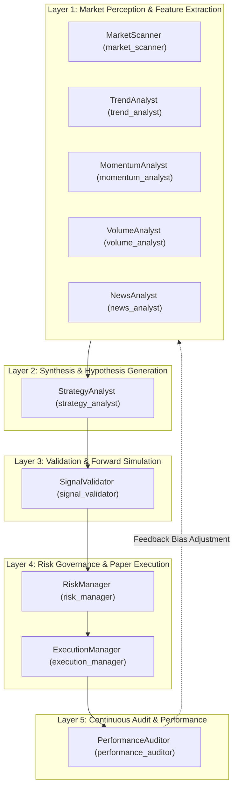

# NEPTUNE Specialist Agent Specification

## Document Information
- **Project**: NEPTUNE — Autonomous Market Intelligence & Paper Trading Platform
- **Document Version**: 1.0.0
- **Status**: Approved / Technical Specification
- **Author**: Neptune Autonomous Agents & Multi-Agent Systems Team
- **Date**: 2026-11-01

---

## 1. Overview & Multi-Agent Architecture

NEPTUNE distributes market perception, hypothesis generation, quantitative validation, risk gatekeeping, and paper execution across **ten specialist agents**.

Each agent is an autonomous, strongly-typed asynchronous software worker implementing the `BaseAgent` contract. Agents have dedicated input and output schemas, isolated execution contexts, bounded execution time budgets, and well-defined error recovery procedures.



---

## 2. Detailed Specifications for All 10 Specialist Agents

---

### Agent 1: MarketScanner (`market_scanner`)

#### 1. Responsibility
Continuously monitors all active cryptocurrency symbols to detect volatility regime shifts, market compression (squeezes), and structural state transitions (trending vs. ranging). Provides global market context to the Central Brain.

#### 2. Mathematical Indicators & Formulas
- **Average True Range (ATR)**:
  $$TR_t = \max(H_t - L_t, |H_t - C_{t-1}|, |L_t - C_{t-1}|)$$
  $$ATR_t = \frac{ATR_{t-1} \times (n - 1) + TR_t}{n} \quad (n=14)$$
- **Bollinger Bands**:
  $$\text{Middle} = SMA_{20}(C), \quad \text{Upper} = Middle + 2\sigma, \quad \text{Lower} = Middle - 2\sigma$$
  $$\text{Bandwidth} = \frac{\text{Upper} - \text{Lower}}{\text{Middle}}$$
- **Keltner Channels & Squeeze**:
  $$\text{Center} = EMA_{20}(C), \quad \text{Upper} = Center + 1.5 \times ATR_{10}, \quad \text{Lower} = Center - 1.5 \times ATR_{10}$$
  $$\text{is\_squeeze} = (BB_{\text{upper}} < KC_{\text{upper}}) \land (BB_{\text{lower}} > KC_{\text{lower}})$$
- **Regime Classification Logic**:
  - `VOLATILE`: $ATR_{\text{ratio}} > 1.8$ or Bandwidth $> 0.12$.
  - `RANGING`: $\text{is\_squeeze} = \text{True}$ or $ADX < 20$.
  - `TRENDING_BULL`: $ADX \ge 25 \land Close > EMA_{50} \land +DI > -DI$.
  - `TRENDING_BEAR`: $ADX \ge 25 \land Close < EMA_{50} \land -DI > +DI$.
  - `UNCERTAIN`: Conflicting directional movement or transitional state ($20 \le ADX < 25$).

#### 3. Input Contract (`MarketScannerInput`)
```python
class MarketScannerInput(BaseModel):
    timestamp: str                        # ISO 8601 UTC string (ADR-012)
    symbols: List[str]                    # e.g., ["BTCUSDT", "ETHUSDT", "BNBUSDT"]
    timeframe: str = "15m"                # Primary evaluation timeframe
    candles_by_symbol: Dict[str, List[ValidatedCandle]]
    atr_period: int = 14
    bb_period: int = 20
    adx_period: int = 14
```

#### 4. Output Contract (`MarketScannerOutput`)
```python
class SymbolRegimeState(BaseModel):
    symbol: str
    timeframe: str
    current_price: float
    regime: str                           # TRENDING_BULL, TRENDING_BEAR, RANGING, VOLATILE, UNCERTAIN
    confidence: float                     # 0.0 to 1.0
    atr_14: Optional[float] = None
    atr_ratio: Optional[float] = None     # Current ATR / 50-period rolling ATR mean
    bollinger_bandwidth: Optional[float] = None
    is_squeeze: bool = False
    adx_14: Optional[float] = None
    explanation: str
    supporting_metrics: Dict[str, Any] = {}

class MarketScannerOutput(BaseModel):
    timestamp: str
    timeframe: str
    symbols_evaluated: int
    regimes: Dict[str, SymbolRegimeState]
    global_market_state: str              # NORMAL, COMPRESSED, HIGH_VOLATILITY, UNCERTAIN
    explanation: str
```

#### 5. Warm-up Requirements & Limitations
- **Minimum Warm-up**: Requires $\ge 30$ closed candles. With fewer than 30 candles, outputs `regime = "UNCERTAIN"` with `confidence = 0.0`.
- **Optimal History**: 100 closed candles for full 50-period rolling ATR baseline.
- **Rule A-09**: Exclusively evaluates closed candles; in-progress ticks are rejected.

#### 4. Execution Trigger
- **Mode**: Hybrid (Event-driven on new 1m/5m candle close + scheduled heartbeat every 10 seconds).

#### 5. Dependencies
- Reads from: `In-Memory Ring Buffer` / `IMarketDataRepository`.

#### 6. Error Behavior
- If data is missing for a symbol, skips that symbol, marks it as `UNKNOWN_REGIME`, logs a warning, and continues scanning remaining symbols. Never crashes the scanner.

#### 7. Performance Constraints
- Maximum execution latency budget: **$\le 50$ ms** for up to 10 symbols.

---

### Agent 2: TrendAnalyst (`trend_analyst`)

#### 1. Responsibility
Performs directional bias, moving average stack alignment, and trend stability analysis:
- Exponential Moving Average (EMA) 20, 50, 200 stacks
- Directional Movement Index (+DI, -DI) and Average Directional Index (ADX 14)
- Trend strength scoring and distance from 200 EMA
- Confidence discounting during warm-up periods.

#### 2. Mathematical Indicators & Formulas
- **Exponential Moving Average (EMA)**:
  $$\alpha = \frac{2}{\text{period} + 1}$$
  $$EMA_t = (C_t \times \alpha) + (EMA_{t-1} \times (1 - \alpha)), \quad EMA_{\text{seed}} = SMA(C, \text{period})$$
- **Directional Movement (+DI / -DI / ADX)**:
  $$+DM = H_t - H_{t-1} \text{ if } (H_t - H_{t-1} > L_{t-1} - L_t \land > 0) \text{ else } 0$$
  $$-DM = L_{t-1} - L_t \text{ if } (L_{t-1} - L_t > H_t - H_{t-1} \land > 0) \text{ else } 0$$
  $$+DI = 100 \times \frac{\text{Smoothed } +DM}{ATR}, \quad -DI = 100 \times \frac{\text{Smoothed } -DM}{ATR}$$
  $$DX = 100 \times \frac{|+DI - -DI|}{+DI + -DI}, \quad ADX = \text{WilderSmooth}(DX, 14)$$
- **Distance from 200 EMA**:
  $$\text{dist\_200\_pct} = \frac{Close - EMA_{200}}{EMA_{200}} \times 100$$
- **EMA Stack Order**:
  - Bullish Stack: $EMA_{20} > EMA_{50} > EMA_{200}$
  - Bearish Stack: $EMA_{20} < EMA_{50} < EMA_{200}$

#### 3. Input Contract (`TrendAnalystInput`)
```python
class TrendAnalystInput(BaseModel):
    timestamp: str                        # ISO 8601 UTC string (ADR-012)
    symbol: str
    timeframe: str = "15m"
    candles: List[ValidatedCandle]
    ema_lengths: List[int] = [20, 50, 200]
    adx_period: int = 14
```

#### 4. Output Contract (`TrendAnalystOutput`)
```python
class TrendAnalystOutput(BaseModel):
    timestamp: str
    symbol: str
    timeframe: str
    composite_bias: str                   # BULLISH, BEARISH, NEUTRAL, UNCERTAIN
    trend_strength_score: float           # 0.0 to 1.0 (confidence)
    ema_values: Dict[str, Optional[float]]
    ema_stack_ordered: bool
    adx_value: Optional[float] = None
    plus_di: Optional[float] = None
    minus_di: Optional[float] = None
    adx_slope: float = 0.0                # Change over last 3 bars
    distance_from_200_ema_pct: Optional[float] = None
    confidence_discount: float = 0.0      # 0.5 if <200 bars
    explanation: str
```

#### 5. Warm-up Requirements & Limitations
- **Full Warm-up**: Requires $\ge 200$ candles for EMA 200.
- **Partial History (50–199 candles)**: Computes EMA 20 and 50, sets `ema_200 = None`, applies `confidence_discount = 0.5`.
- **Insufficient History (<20 candles)**: Returns `composite_bias = "UNCERTAIN"` with `trend_strength_score = 0.0`.

#### 4. Execution Trigger
- **Mode**: Event-driven on candle close (`1m`, `5m`, `15m`).

#### 5. Dependencies
- Reads from: `IMarketDataRepository` (historical closed candles).

#### 6. Error Behavior
- Requires at least 200 candles for EMA 200 calculation. If fewer are available, falls back to EMA 20/50 and marks output `confidence_discount = 0.5`.

#### 7. Performance Constraints
- Execution latency budget: **$\le 25$ ms** per symbol.

---

### Agent 3: MomentumAnalyst (`momentum_analyst`)

#### 1. Responsibility
Measures the velocity and acceleration of price moves, detects MACD convergence/divergence dynamics, and flags potential momentum exhaustion and regular divergences without treating overbought/oversold levels as automatic trade signals.

#### 2. Mathematical Indicators & Formulas
- **Relative Strength Index (RSI 14)**:
  $$U_t = \max(C_t - C_{t-1}, 0), \quad D_t = \max(C_{t-1} - C_t, 0)$$
  $$\text{AvgGain}_t = \frac{\text{AvgGain}_{t-1} \times 13 + U_t}{14}, \quad \text{AvgLoss}_t = \frac{\text{AvgLoss}_{t-1} \times 13 + D_t}{14}$$
  $$RS = \frac{\text{AvgGain}}{\text{AvgLoss}}, \quad RSI = 100 - \frac{100}{1 + RS}$$
- **Moving Average Convergence Divergence (MACD 12, 26, 9)**:
  $$MACD_{\text{line}} = EMA_{12}(C) - EMA_{26}(C)$$
  $$Signal_{\text{line}} = EMA_{9}(MACD_{\text{line}})$$
  $$Histogram = MACD_{\text{line}} - Signal_{\text{line}}$$
  $$Histogram_{\text{slope}} = Histogram_t - Histogram_{t-1}$$
- **Exhaustion & Divergence Detection**:
  - Regular Bearish Divergence: Price forms higher high across recent swing window while RSI forms lower high.
  - Regular Bullish Divergence: Price forms lower low while RSI forms higher low.
  - Momentum Exhaustion: $RSI \ge 70$ with decelerating MACD histogram ($Histogram_{\text{slope}} < 0$).

#### 3. Input Contract (`MomentumAnalystInput`)
```python
class MomentumAnalystInput(BaseModel):
    timestamp: str                        # ISO 8601 UTC string (ADR-012)
    symbol: str
    timeframe: str = "15m"
    candles: List[ValidatedCandle]
    rsi_period: int = 14
    macd_fast: int = 12
    macd_slow: int = 26
    macd_signal: int = 9
```

#### 4. Output Contract (`MomentumAnalystOutput`)
```python
class MomentumAnalystOutput(BaseModel):
    timestamp: str
    symbol: str
    timeframe: str
    rsi: Optional[float] = None           # 0.0 to 100.0
    macd_line: Optional[float] = None
    macd_signal_line: Optional[float] = None
    macd_histogram: Optional[float] = None
    macd_histogram_slope: float = 0.0
    momentum_direction: str               # BULLISH, BEARISH, NEUTRAL, UNCERTAIN
    momentum_score: float                 # Normalized -1.0 to +1.0
    exhaustion_risk: bool = False
    divergence: str = "NONE"              # NONE, BULLISH_DIVERGENCE, BEARISH_DIVERGENCE
    explanation: str
```

#### 5. Warm-up Requirements & Limitations
- **Minimum Warm-up**: Requires $\ge 35$ candles (slow EMA 26 + signal EMA 9).
- **Rule of Non-Automatic Execution**: High RSI (>70) or low RSI (<30) indicates regime context, never an autonomous entry trigger.

---

### Agent 4: VolumeAnalyst (`volume_analyst`)

#### 1. Responsibility
Analyzes volume distribution, Volume-Weighted Average Price (VWAP) benchmarks, volume anomalies ($> 2.5\sigma$ surges), On-Balance-Volume (OBV) trend, and institutional participation strength.

#### 2. Mathematical Indicators & Formulas
- **Relative Volume**:
  $$\text{Volume SMA}_{20} = \frac{1}{20} \sum_{i=0}^{19} V_{t-i}, \quad \text{Volume Ratio} = \frac{V_t}{\text{Volume SMA}_{20}}$$
- **Volume Anomaly**:
  $$\text{is\_volume\_anomaly} = V_t > (\mu_{V} + 2.5 \sigma_{V})$$
- **Volume-Weighted Average Price (VWAP)**:
  $$TP_t = \frac{H_t + L_t + C_t}{3}, \quad VWAP_t = \frac{\sum_{i=0}^t (TP_i \times V_i)}{\sum_{i=0}^t V_i}$$
  $$\text{dist\_vwap\_pct} = \frac{C_t - VWAP_t}{VWAP_t} \times 100$$
- **On-Balance Volume (OBV)**:
  $$OBV_t = OBV_{t-1} + \begin{cases} +V_t & \text{if } C_t > C_{t-1} \\ -V_t & \text{if } C_t < C_{t-1} \\ 0 & \text{if } C_t = C_{t-1} \end{cases}$$

#### 3. Input Contract (`VolumeAnalystInput`)
```python
class VolumeAnalystInput(BaseModel):
    timestamp: str                        # ISO 8601 UTC string (ADR-012)
    symbol: str
    timeframe: str = "15m"
    candles: List[ValidatedCandle]
    volume_ma_period: int = 20
    anomaly_std_threshold: float = 2.5
```

#### 4. Output Contract (`VolumeAnalystOutput`)
```python
class VolumeAnalystOutput(BaseModel):
    timestamp: str
    symbol: str
    timeframe: str
    current_volume: float
    volume_ma: Optional[float] = None
    volume_ratio: Optional[float] = None
    is_volume_anomaly: bool = False
    vwap: Optional[float] = None
    distance_from_vwap_pct: Optional[float] = None
    obv: Optional[float] = None
    obv_trend: str = "NEUTRAL"            # ACCUMULATION, DISTRIBUTION, NEUTRAL, INSUFFICIENT_DATA
    participation_strength: str           # STRONG, NORMAL, WEAK, INSUFFICIENT_DATA
    volume_score: float                   # -1.0 to +1.0
    explanation: str
```

#### 5. Warm-up Requirements & Limitations
- **Minimum Warm-up**: Requires $\ge 20$ candles for Volume SMA.
- **Zero-Volume Defense**: Zero volume periods set `volume_ratio = 1.0` and `is_volume_anomaly = False` to prevent division-by-zero.

#### 4. Execution Trigger
- **Mode**: Event-driven on candle close or high-volume intra-candle spike notification.

#### 5. Dependencies
- Reads from: `In-Memory Ring Buffer` (100 recent bars + cumulative ticks for VWAP).

#### 6. Error Behavior
- Zero-volume periods (rare on top crypto pairs) are caught to prevent division-by-zero, setting `volume_ratio = 1.0` and `is_volume_anomaly = False`.

#### 7. Performance Constraints
- Execution latency budget: **$\le 15$ ms**.

---

### Agent 5: NewsAnalyst (`news_analyst`)

#### 1. Responsibility
Provides deterministic macro environment scoring and scheduled event alerts (e.g. CPI prints, FOMC meetings, crypto funding resets) without external non-deterministic LLM calls in v1.

#### 2. Input Contract (`NewsAnalystInput`)
```python
class NewsAnalystInput(BaseModel):
    timestamp: int
    symbols: list[str]
```

#### 3. Output Contract (`NewsAnalystOutput`)
```python
class MacroEventAlert(BaseModel):
    event_name: str
    event_timestamp: int
    time_to_event_minutes: int
    expected_volatility_impact: str       # "LOW", "MEDIUM", "HIGH"

class NewsAnalystOutput(BaseModel):
    timestamp: int
    macro_sentiment_score: float          # -1.0 (bearish) to +1.0 (bullish)
    sentiment_bias: str                   # "BULLISH", "NEUTRAL", "BEARISH"
    high_impact_event_imminent: bool      # True if high-impact event < 30m away
    active_alerts: list[MacroEventAlert]
```

#### 4. Execution Trigger
- **Mode**: Scheduled timer running every 60 seconds or upon external calendar file reload.

#### 5. Dependencies
- Reads from: Local static calendar JSON / deterministic sentiment rule tables.

#### 6. Error Behavior
- If calendar data file cannot be read, defaults to `macro_sentiment_score = 0.0` (neutral) and `high_impact_event_imminent = False`.

#### 7. Performance Constraints
- Execution latency budget: **$\le 5$ ms**.

---

### Agent 6: StrategyAnalyst (`strategy_analyst`)

#### 1. Responsibility
Synthesizes market features across Market Scanner, Trend, Momentum, and Volume analysts:
- Consumes closed, validated candles only (Rule A-09).
- Evaluates multi-factor confluence across all four analytical domains.
- Detects conflicting indicators and strictly yields `NO_SIGNAL`.
- Computes candidate stop-loss and take-profit targets using Python `Decimal` (Rule A-01) satisfying minimum 1.5:1 reward-to-risk ratio.
- Emits raw research hypothesis candidates (never executes orders; Rule S-01, S-04).

#### 2. Multi-Factor Confluence & Conflict Rules
- **Rule of Non-Atomic Execution**: No single indicator crossing a threshold can trigger a trade candidate.
- **Conflict Invalidation**:
  - `VOLATILE` or `UNCERTAIN` regime $\rightarrow$ `NO_SIGNAL`
  - Trend / Momentum direction mismatch $\rightarrow$ `NO_SIGNAL`
  - Exhaustion risk or regular divergence opposing trend $\rightarrow$ `NO_SIGNAL`
  - Volume distribution during bullish trend or accumulation during bearish trend $\rightarrow$ `NO_SIGNAL`
- **LONG Candidate Requirements**:
  1. Regime is `TRENDING_BULL` (confidence $\ge 0.50$).
  2. Trend bias is `BULLISH` (strength $\ge 0.40$, EMA 20 > EMA 50).
  3. Momentum score $\ge +0.15$, RSI between 40 and 68, zero exhaustion risk.
  4. Volume participation is `NORMAL` or `STRONG`, OBV not in distribution.
- **SHORT Candidate Requirements**:
  1. Regime is `TRENDING_BEAR` (confidence $\ge 0.50$).
  2. Trend bias is `BEARISH` (strength $\ge 0.40$, EMA 20 < EMA 50).
  3. Momentum score $\le -0.15$, RSI between 32 and 60, zero exhaustion risk.
  4. Volume participation is `NORMAL` or `STRONG`, OBV not in accumulation.

#### 3. Monetary Level Calculations (Rule A-01)
$$\text{Risk} = \text{Decimal}(ATR_{14}) \times \text{Decimal}(\text{multiplier})$$
$$\text{Stop}_{\text{long}} = \text{Entry} - \text{Risk}, \quad \text{Target}_{\text{long}} = \text{Entry} + (\text{Risk} \times \text{Decimal}(R:R))$$
$$\text{Stop}_{\text{short}} = \text{Entry} + \text{Risk}, \quad \text{Target}_{\text{short}} = \text{Entry} - (\text{Risk} \times \text{Decimal}(R:R))$$

#### 4. Input Contract (`StrategyAnalystInput`)
```python
class StrategyAnalystInput(BaseModel):
    timestamp: str                        # ISO 8601 UTC string (ADR-012)
    symbol: str
    timeframe: str
    candles: List[ValidatedCandle]        # Strictly closed candles (Rule A-09)
    regime_data: SymbolRegimeState
    trend_data: TrendAnalystOutput
    momentum_data: MomentumAnalystOutput
    volume_data: VolumeAnalystOutput
    active_strategies: Optional[List[str]] = None
    min_reward_risk_ratio: float = 1.5
    atr_multiplier_stop: float = 2.0
```

#### 5. Output Contract (`StrategyAnalystOutput`)
```python
class RawCandidateSignal(BaseModel):
    signal_id: str                        # Deterministic UUIDv4
    timestamp: str                        # ISO 8601 UTC string
    strategy_id: str
    symbol: str
    timeframe: str
    direction: str                        # "LONG" or "SHORT"
    entry_price: float
    suggested_stop_loss: float
    suggested_take_profit: float
    risk_reward_ratio: float              # Minimum 1.5
    raw_confidence: float                 # 0.0 to 1.0
    rationale: str
    invalidation_rules: List[str]
    metadata: Dict[str, Any]

class StrategyAnalystOutput(BaseModel):
    timestamp: str
    symbol: str
    timeframe: str
    evaluation_outcome: str               # "LONG", "SHORT", "NO_SIGNAL"
    candidates: List[RawCandidateSignal]
    conflicting_factors: List[str] = []
    explanation: str
```

#### 4. Execution Trigger
- **Mode**: Event-driven when all perception agent outputs for a closed candle are bundled by the Central Brain.

#### 5. Dependencies
- Reads from: Outputs of Agents 1–5; loads strategy rules from `app.strategies.registry`.

#### 6. Error Behavior
- If an individual strategy calculation raises an error, that specific strategy is skipped, logged, and other strategies continue evaluation.

#### 7. Performance Constraints
- Execution latency budget: **$\le 35$ ms**.

---

### Agent 7: SignalValidator (`signal_validator`)

#### 1. Responsibility
Cross-validates raw candidate signals against higher-timeframe trends, support/resistance levels, false-breakout filters, and historical signal reliability scores. Eliminates low-probability signals before expensive forward simulations.

#### 2. Input Contract (`SignalValidatorInput`)
```python
class SignalValidatorInput(BaseModel):
    timestamp: int
    candidate_signal: RawCandidateSignal
    higher_timeframe_context: dict[str, Any]
    active_market_regime: str
```

#### 3. Output Contract (`SignalValidatorOutput`)
```python
class SignalValidatorOutput(BaseModel):
    timestamp: int
    signal_id: str
    is_valid: bool
    rejection_reason: str | None          # None if is_valid is True
    confluence_score: float               # 0.0 to 1.0
    rules_passed: list[str]               # e.g., ["HTF_ALIGNMENT", "MIN_RR_RATIO", "VOLUME_CONFIRMED"]
    rules_failed: list[str]
    simulation_recommended: bool          # True if confluence_score >= 0.75
```

#### 4. Execution Trigger
- **Mode**: Event-driven upon emission of a `RawCandidateSignal`.

#### 5. Dependencies
- Reads from: `StrategyAnalyst` signal output and multi-timeframe candles in SQLite / buffer.

#### 6. Error Behavior
- If higher-timeframe data is unavailable, validation fails conservatively (`is_valid = False`, `rejection_reason = "INSUFFICIENT_HTF_DATA"`).

#### 7. Performance Constraints
- Execution latency budget: **$\le 25$ ms**.

---

### Agent 8: RiskManager (`risk_manager`)

#### 1. Responsibility
Acts as the **sole authorization authority** for order placement. Enforces the 5 strict risk invariants (drawdown breaker, daily loss limit, position limits, correlation exposure, and minimum 1.5:1 R:R). Calculates deterministic position sizing based on account equity and stop-loss distance.

#### 2. Input Contract (`RiskManagerInput`)
```python
class RiskManagerInput(BaseModel):
    timestamp: int
    validated_signal: RawCandidateSignal
    confluence_score: float
    simulation_metrics: dict[str, Any]    # Includes stop/target hit probabilities, MAE
    current_equity: float
    open_positions: list[dict[str, Any]]
    realized_daily_pnl: float
    peak_equity: float
```

#### 3. Output Contract (`RiskManagerOutput`)
```python
class RiskManagerOutput(BaseModel):
    timestamp: int
    signal_id: str
    decision: str                         # "APPROVED" or "REJECTED"
    rejection_reasons: list[str]          # Empty if approved
    authorized_size_units: float          # e.g., 0.005 BTC (0.0 if rejected)
    allocated_risk_amount_usdt: float     # Exact dollar amount at risk
    effective_leverage: float             # In v1 strictly <= 1.0
    risk_approval_token: str | None       # Cryptographic UUID token required by ExecutionManager
```

#### 4. Execution Trigger
- **Mode**: Event-driven when Central Brain enters `RISK_REVIEW` state.

#### 5. Dependencies
- Reads from: `SignalValidator`, `Time Machine` simulation metrics, `paper_orders` and `positions` tables.

#### 6. Error Behavior
- Strict fail-closed design: In the event of any calculation exception or missing parameter, the decision is **100% REJECTED**.

#### 7. Performance Constraints
- Execution latency budget: **$\le 10$ ms**.

---

### Agent 9: ExecutionManager (`execution_manager`)

#### 1. Responsibility
Oversees the simulated paper order lifecycle. Rejects unauthorized orders lacking a valid risk token. Simulates realistic order routing latency, liquidity-dependent slippage, and taker fees. Tracks active position PnL and monitors bracket stop-loss/take-profit triggers on every incoming price tick.

#### 2. Input Contract (`ExecutionManagerInput`)
```python
class ExecutionManagerInput(BaseModel):
    timestamp: int
    order_action: str                     # "CREATE_ORDER", "CANCEL_ORDER", "MARKET_CLOSE", "TICK_UPDATE"
    signal: RawCandidateSignal | None = None
    authorized_size: float | None = None
    risk_approval_token: str | None = None
    tick_price: float | None = None
```

#### 3. Output Contract (`ExecutionManagerOutput`)
```python
class PaperOrderState(BaseModel):
    order_id: str
    symbol: str
    status: str                           # "PENDING", "FILLED", "CANCELLED", "REJECTED"
    order_type: str                       # "LIMIT", "MARKET", "STOP_LOSS", "TAKE_PROFIT"
    side: str                             # "BUY", "SELL"
    requested_price: float
    filled_price: float
    filled_size: float
    slippage_usdt: float
    fee_usdt: float
    simulated_latency_ms: float
    fill_timestamp: int

class ExecutionManagerOutput(BaseModel):
    timestamp: int
    action_completed: str
    order: PaperOrderState | None = None
    positions_updated: list[str]          # List of active position IDs
```

#### 4. Execution Trigger
- **Mode**: Dual-trigger:
  - Event-driven upon Brain transition to `PAPER_ORDER_CREATED`.
  - Continuous 1-second price tick loop for bracket order monitoring.

#### 5. Dependencies
- Reads from: `RiskManager` approval token, `In-Memory Ring Buffer` (latest price), and `IOrderRepository`.

#### 6. Error Behavior
- Orders without an authentic risk approval token are immediately rejected with an alert to the security logger.

#### 7. Performance Constraints
- Execution latency budget: **$\le 15$ ms** (excluding the deliberate simulated exchange latency of 50–250ms).

---

### Agent 10: PerformanceAuditor (`performance_auditor`)

#### 1. Responsibility
Monitors platform execution fidelity and strategy health in real time. Analyzes closed trade logs, detects execution slippage anomalies, updates Sharpe/Sortino ratios, monitors maximum drawdown, and emits automated performance audit summaries.

#### 2. Input Contract (`PerformanceAuditorInput`)
```python
class PerformanceAuditorInput(BaseModel):
    timestamp: int
    closed_trade_id: str | None = None    # Set if triggered by a trade exit
    audit_scope: str                      # "TRADE_EXIT", "PERIODIC_SUMMARY"
```

#### 3. Output Contract (`PerformanceAuditorOutput`)
```python
class PerformanceAuditorOutput(BaseModel):
    timestamp: int
    total_trades_analyzed: int
    win_rate: float                       # 0.0 to 1.0
    profit_factor: float
    sharpe_ratio: float
    sortino_ratio: float
    max_drawdown_pct: float
    avg_slippage_bps: float               # Basis points of slippage
    anomalies_detected: list[str]         # e.g., ["SLIPPAGE_EXCEEDED_EXPECTATION"]
    health_status: str                    # "HEALTHY", "WARNING", "CRITICAL_DRIFT"
```

#### 4. Execution Trigger
- **Mode**: Hybrid:
  - Event-driven immediately upon position close.
  - Scheduled every 5 minutes for rolling statistical re-calculation.

#### 5. Dependencies
- Reads from: `closed_trades`, `paper_fills`, and `strategy_metrics` SQLite tables.

#### 6. Error Behavior
- If fewer than 5 trades exist, statistical metrics (Sharpe/Sortino) return `0.0` with `status = "INSUFFICIENT_SAMPLE"`.

#### 7. Performance Constraints
- Execution latency budget: **$\le 50$ ms**.
