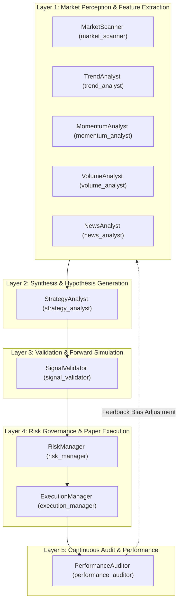

# NEPTUNE Specialist Agent Specification

## Document Information
- **Project**: NEPTUNE — Autonomous Market Intelligence & Paper Trading Platform
- **Document Version**: 1.0.0
- **Status**: Approved / Technical Specification
- **Author**: Neptune Autonomous Agents & Multi-Agent Systems Team
- **Date**: 2026-11-01

---

## 1. Overview & Multi-Agent Architecture

NEPTUNE distributes market perception, hypothesis generation, quantitative validation, risk gatekeeping, and paper execution across **ten specialist agents**.

Each agent is an autonomous, strongly-typed asynchronous software worker implementing the `BaseAgent` contract. Agents have dedicated input and output schemas, isolated execution contexts, bounded execution time budgets, and well-defined error recovery procedures.



---

## 2. Detailed Specifications for All 10 Specialist Agents

---

### Agent 1: MarketScanner (`market_scanner`)

#### 1. Responsibility
Continuously monitors all active cryptocurrency symbols to detect volatility regime shifts, market compression (squeezes), and structural state transitions (trending vs. ranging). Provides global market context to the Central Brain.

#### 2. Input Contract (`MarketScannerInput`)
```python
class MarketScannerInput(BaseModel):
    timestamp: int                       # Epoch milliseconds
    symbols: list[str]                    # e.g., ["BTCUSDT", "ETHUSDT", "SOLUSDT"]
    primary_timeframe: str                # e.g., "15m"
    candle_lookback: int                  # Number of candles evaluated (e.g., 100)
```

#### 3. Output Contract (`MarketScannerOutput`)
```python
class SymbolRegimeState(BaseModel):
    symbol: str
    current_price: float
    regime: str                           # "TRENDING_BULL", "TRENDING_BEAR", "RANGING", "VOLATILE_BREAKOUT"
    atr_14: float                         # Average True Range (14 periods)
    atr_ratio: float                      # Current ATR / 100-period rolling ATR mean
    bollinger_bandwidth: float            # (Upper - Lower) / Middle band
    is_squeeze: bool                      # True if BB is inside Keltner Channel
    adx_14: float                         # Average Directional Index

class MarketScannerOutput(BaseModel):
    timestamp: int
    symbols_evaluated: int
    regimes: dict[str, SymbolRegimeState]
    global_market_state: str              # "NORMAL", "COMPRESSED", "HIGH_VOLATILITY", "EXTREME_TURMOIL"
```

#### 4. Execution Trigger
- **Mode**: Hybrid (Event-driven on new 1m/5m candle close + scheduled heartbeat every 10 seconds).

#### 5. Dependencies
- Reads from: `In-Memory Ring Buffer` / `IMarketDataRepository`.

#### 6. Error Behavior
- If data is missing for a symbol, skips that symbol, marks it as `UNKNOWN_REGIME`, logs a warning, and continues scanning remaining symbols. Never crashes the scanner.

#### 7. Performance Constraints
- Maximum execution latency budget: **$\le 50$ ms** for up to 10 symbols.

---

### Agent 2: TrendAnalyst (`trend_analyst`)

#### 1. Responsibility
Performs multi-timeframe directional bias and trend stability analysis using Exponential Moving Average (EMA) stacks, Directional Movement Index (DMI/ADX), and higher-high/lower-low structural price action.

#### 2. Input Contract (`TrendAnalystInput`)
```python
class TrendAnalystInput(BaseModel):
    timestamp: int
    symbol: str
    timeframes: list[str]                 # e.g., ["5m", "15m", "1h"]
    ema_lengths: list[int] = [20, 50, 100, 200]
```

#### 3. Output Contract (`TrendAnalystOutput`)
```python
class TimeframeTrend(BaseModel):
    timeframe: str
    bias: str                             # "STRONG_BULL", "WEAK_BULL", "NEUTRAL", "WEAK_BEAR", "STRONG_BEAR"
    ema_stack_ordered: bool               # True if 20 > 50 > 100 > 200 (or inverted for bear)
    ema_values: dict[str, float]          # {"ema_20": 65120.5, "ema_50": 64800.0, ...}
    adx_value: float
    adx_slope: float                      # Change over last 3 bars
    distance_from_200_ema_pct: float

class TrendAnalystOutput(BaseModel):
    timestamp: int
    symbol: str
    composite_bias: str                   # "BULLISH", "BEARISH", "NEUTRAL"
    trend_strength_score: float           # 0.0 to 1.0 (confidence)
    timeframe_breakdown: dict[str, TimeframeTrend]
```

#### 4. Execution Trigger
- **Mode**: Event-driven on candle close (`1m`, `5m`, `15m`).

#### 5. Dependencies
- Reads from: `IMarketDataRepository` (historical closed candles).

#### 6. Error Behavior
- Requires at least 200 candles for EMA 200 calculation. If fewer are available, falls back to EMA 20/50 and marks output `confidence_discount = 0.5`.

#### 7. Performance Constraints
- Execution latency budget: **$\le 25$ ms** per symbol.

---

### Agent 3: MomentumAnalyst (`momentum_analyst`)

#### 1. Responsibility
Measures the velocity and acceleration of price moves, detects overbought/oversold extremes, calculates MACD histogram convergence/divergence, and flags regular/hidden RSI divergences.

#### 2. Input Contract (`MomentumAnalystInput`)
```python
class MomentumAnalystInput(BaseModel):
    timestamp: int
    symbol: str
    timeframe: str                        # e.g., "15m"
    rsi_period: int = 14
    macd_fast: int = 12
    macd_slow: int = 26
    macd_signal: int = 9
```

#### 3. Output Contract (`MomentumAnalystOutput`)
```python
class MomentumAnalystOutput(BaseModel):
    timestamp: int
    symbol: str
    timeframe: str
    rsi: float                            # 0.0 to 100.0
    stoch_rsi_k: float                    # 0.0 to 100.0
    stoch_rsi_d: float
    macd_line: float
    macd_signal_line: float
    macd_histogram: float
    macd_histogram_slope: float
    rsi_divergence: str                   # "NONE", "BULLISH_REGULAR", "BEARISH_REGULAR", "BULLISH_HIDDEN", "BEARISH_HIDDEN"
    momentum_score: float                 # Normalized -1.0 (extreme bearish) to +1.0 (extreme bullish)
```

#### 4. Execution Trigger
- **Mode**: Event-driven on candle close (`1m`, `5m`, `15m`).

#### 5. Dependencies
- Reads from: `In-Memory Ring Buffer`.

#### 6. Error Behavior
- NaN or infinite values in divergence calculations trigger graceful fallback to scalar momentum scores and emit an internal warning.

#### 7. Performance Constraints
- Execution latency budget: **$\le 20$ ms**.

---

### Agent 4: VolumeAnalyst (`volume_analyst`)

#### 1. Responsibility
Analyzes volume distribution, Volume-Weighted Average Price (VWAP) benchmarks, volume anomalies ($> 2.5\sigma$ surges), On-Balance-Volume (OBV) trend, and volume-at-price liquidity clusters.

#### 2. Input Contract (`VolumeAnalystInput`)
```python
class VolumeAnalystInput(BaseModel):
    timestamp: int
    symbol: str
    timeframe: str                        # e.g., "15m"
    volume_ma_period: int = 20
    anomaly_std_threshold: float = 2.5
```

#### 3. Output Contract (`VolumeAnalystOutput`)
```python
class VolumeAnalystOutput(BaseModel):
    timestamp: int
    symbol: str
    current_volume: float
    volume_ma: float
    volume_ratio: float                   # current_volume / volume_ma
    is_volume_anomaly: bool               # True if volume > threshold * std
    vwap: float                           # Session VWAP
    distance_from_vwap_pct: float         # (Close - VWAP) / VWAP * 100
    obv: float
    obv_trend: str                        # "ACCUMULATION", "DISTRIBUTION", "FLAT"
    volume_score: float                   # -1.0 (heavy distribution) to +1.0 (heavy accumulation)
```

#### 4. Execution Trigger
- **Mode**: Event-driven on candle close or high-volume intra-candle spike notification.

#### 5. Dependencies
- Reads from: `In-Memory Ring Buffer` (100 recent bars + cumulative ticks for VWAP).

#### 6. Error Behavior
- Zero-volume periods (rare on top crypto pairs) are caught to prevent division-by-zero, setting `volume_ratio = 1.0` and `is_volume_anomaly = False`.

#### 7. Performance Constraints
- Execution latency budget: **$\le 15$ ms**.

---

### Agent 5: NewsAnalyst (`news_analyst`)

#### 1. Responsibility
Provides deterministic macro environment scoring and scheduled event alerts (e.g. CPI prints, FOMC meetings, crypto funding resets) without external non-deterministic LLM calls in v1.

#### 2. Input Contract (`NewsAnalystInput`)
```python
class NewsAnalystInput(BaseModel):
    timestamp: int
    symbols: list[str]
```

#### 3. Output Contract (`NewsAnalystOutput`)
```python
class MacroEventAlert(BaseModel):
    event_name: str
    event_timestamp: int
    time_to_event_minutes: int
    expected_volatility_impact: str       # "LOW", "MEDIUM", "HIGH"

class NewsAnalystOutput(BaseModel):
    timestamp: int
    macro_sentiment_score: float          # -1.0 (bearish) to +1.0 (bullish)
    sentiment_bias: str                   # "BULLISH", "NEUTRAL", "BEARISH"
    high_impact_event_imminent: bool      # True if high-impact event < 30m away
    active_alerts: list[MacroEventAlert]
```

#### 4. Execution Trigger
- **Mode**: Scheduled timer running every 60 seconds or upon external calendar file reload.

#### 5. Dependencies
- Reads from: Local static calendar JSON / deterministic sentiment rule tables.

#### 6. Error Behavior
- If calendar data file cannot be read, defaults to `macro_sentiment_score = 0.0` (neutral) and `high_impact_event_imminent = False`.

#### 7. Performance Constraints
- Execution latency budget: **$\le 5$ ms**.

---

### Agent 6: StrategyAnalyst (`strategy_analyst`)

#### 1. Responsibility
Ingests synthesized market features from Perception Agents and evaluates active quantitative strategy rules. Generates concrete candidate signals with initial stop-loss and take-profit targets.

#### 2. Input Contract (`StrategyAnalystInput`)
```python
class StrategyAnalystInput(BaseModel):
    timestamp: int
    symbol: str
    timeframe: str
    regime_data: SymbolRegimeState
    trend_data: TrendAnalystOutput
    momentum_data: MomentumAnalystOutput
    volume_data: VolumeAnalystOutput
    news_data: NewsAnalystOutput
    active_strategies: list[str]          # e.g., ["trend_follower", "mean_reversion"]
```

#### 3. Output Contract (`StrategyAnalystOutput`)
```python
class RawCandidateSignal(BaseModel):
    signal_id: str                        # Deterministic UUIDv4
    timestamp: int
    strategy_id: str
    symbol: str
    direction: str                        # "LONG" or "SHORT"
    entry_price: float
    suggested_stop_loss: float
    suggested_take_profit: float
    risk_reward_ratio: float
    raw_confidence: float                 # 0.0 to 1.0
    rationale: str

class StrategyAnalystOutput(BaseModel):
    timestamp: int
    symbol: str
    signals_generated: list[RawCandidateSignal]
```

#### 4. Execution Trigger
- **Mode**: Event-driven when all perception agent outputs for a closed candle are bundled by the Central Brain.

#### 5. Dependencies
- Reads from: Outputs of Agents 1–5; loads strategy rules from `app.strategies.registry`.

#### 6. Error Behavior
- If an individual strategy calculation raises an error, that specific strategy is skipped, logged, and other strategies continue evaluation.

#### 7. Performance Constraints
- Execution latency budget: **$\le 35$ ms**.

---

### Agent 7: SignalValidator (`signal_validator`)

#### 1. Responsibility
Cross-validates raw candidate signals against higher-timeframe trends, support/resistance levels, false-breakout filters, and historical signal reliability scores. Eliminates low-probability signals before expensive forward simulations.

#### 2. Input Contract (`SignalValidatorInput`)
```python
class SignalValidatorInput(BaseModel):
    timestamp: int
    candidate_signal: RawCandidateSignal
    higher_timeframe_context: dict[str, Any]
    active_market_regime: str
```

#### 3. Output Contract (`SignalValidatorOutput`)
```python
class SignalValidatorOutput(BaseModel):
    timestamp: int
    signal_id: str
    is_valid: bool
    rejection_reason: str | None          # None if is_valid is True
    confluence_score: float               # 0.0 to 1.0
    rules_passed: list[str]               # e.g., ["HTF_ALIGNMENT", "MIN_RR_RATIO", "VOLUME_CONFIRMED"]
    rules_failed: list[str]
    simulation_recommended: bool          # True if confluence_score >= 0.75
```

#### 4. Execution Trigger
- **Mode**: Event-driven upon emission of a `RawCandidateSignal`.

#### 5. Dependencies
- Reads from: `StrategyAnalyst` signal output and multi-timeframe candles in SQLite / buffer.

#### 6. Error Behavior
- If higher-timeframe data is unavailable, validation fails conservatively (`is_valid = False`, `rejection_reason = "INSUFFICIENT_HTF_DATA"`).

#### 7. Performance Constraints
- Execution latency budget: **$\le 25$ ms**.

---

### Agent 8: RiskManager (`risk_manager`)

#### 1. Responsibility
Acts as the **sole authorization authority** for order placement. Enforces the 5 strict risk invariants (drawdown breaker, daily loss limit, position limits, correlation exposure, and minimum 1.5:1 R:R). Calculates deterministic position sizing based on account equity and stop-loss distance.

#### 2. Input Contract (`RiskManagerInput`)
```python
class RiskManagerInput(BaseModel):
    timestamp: int
    validated_signal: RawCandidateSignal
    confluence_score: float
    simulation_metrics: dict[str, Any]    # Includes stop/target hit probabilities, MAE
    current_equity: float
    open_positions: list[dict[str, Any]]
    realized_daily_pnl: float
    peak_equity: float
```

#### 3. Output Contract (`RiskManagerOutput`)
```python
class RiskManagerOutput(BaseModel):
    timestamp: int
    signal_id: str
    decision: str                         # "APPROVED" or "REJECTED"
    rejection_reasons: list[str]          # Empty if approved
    authorized_size_units: float          # e.g., 0.005 BTC (0.0 if rejected)
    allocated_risk_amount_usdt: float     # Exact dollar amount at risk
    effective_leverage: float             # In v1 strictly <= 1.0
    risk_approval_token: str | None       # Cryptographic UUID token required by ExecutionManager
```

#### 4. Execution Trigger
- **Mode**: Event-driven when Central Brain enters `RISK_REVIEW` state.

#### 5. Dependencies
- Reads from: `SignalValidator`, `Time Machine` simulation metrics, `paper_orders` and `positions` tables.

#### 6. Error Behavior
- Strict fail-closed design: In the event of any calculation exception or missing parameter, the decision is **100% REJECTED**.

#### 7. Performance Constraints
- Execution latency budget: **$\le 10$ ms**.

---

### Agent 9: ExecutionManager (`execution_manager`)

#### 1. Responsibility
Oversees the simulated paper order lifecycle. Rejects unauthorized orders lacking a valid risk token. Simulates realistic order routing latency, liquidity-dependent slippage, and taker fees. Tracks active position PnL and monitors bracket stop-loss/take-profit triggers on every incoming price tick.

#### 2. Input Contract (`ExecutionManagerInput`)
```python
class ExecutionManagerInput(BaseModel):
    timestamp: int
    order_action: str                     # "CREATE_ORDER", "CANCEL_ORDER", "MARKET_CLOSE", "TICK_UPDATE"
    signal: RawCandidateSignal | None = None
    authorized_size: float | None = None
    risk_approval_token: str | None = None
    tick_price: float | None = None
```

#### 3. Output Contract (`ExecutionManagerOutput`)
```python
class PaperOrderState(BaseModel):
    order_id: str
    symbol: str
    status: str                           # "PENDING", "FILLED", "CANCELLED", "REJECTED"
    order_type: str                       # "LIMIT", "MARKET", "STOP_LOSS", "TAKE_PROFIT"
    side: str                             # "BUY", "SELL"
    requested_price: float
    filled_price: float
    filled_size: float
    slippage_usdt: float
    fee_usdt: float
    simulated_latency_ms: float
    fill_timestamp: int

class ExecutionManagerOutput(BaseModel):
    timestamp: int
    action_completed: str
    order: PaperOrderState | None = None
    positions_updated: list[str]          # List of active position IDs
```

#### 4. Execution Trigger
- **Mode**: Dual-trigger:
  - Event-driven upon Brain transition to `PAPER_ORDER_CREATED`.
  - Continuous 1-second price tick loop for bracket order monitoring.

#### 5. Dependencies
- Reads from: `RiskManager` approval token, `In-Memory Ring Buffer` (latest price), and `IOrderRepository`.

#### 6. Error Behavior
- Orders without an authentic risk approval token are immediately rejected with an alert to the security logger.

#### 7. Performance Constraints
- Execution latency budget: **$\le 15$ ms** (excluding the deliberate simulated exchange latency of 50–250ms).

---

### Agent 10: PerformanceAuditor (`performance_auditor`)

#### 1. Responsibility
Monitors platform execution fidelity and strategy health in real time. Analyzes closed trade logs, detects execution slippage anomalies, updates Sharpe/Sortino ratios, monitors maximum drawdown, and emits automated performance audit summaries.

#### 2. Input Contract (`PerformanceAuditorInput`)
```python
class PerformanceAuditorInput(BaseModel):
    timestamp: int
    closed_trade_id: str | None = None    # Set if triggered by a trade exit
    audit_scope: str                      # "TRADE_EXIT", "PERIODIC_SUMMARY"
```

#### 3. Output Contract (`PerformanceAuditorOutput`)
```python
class PerformanceAuditorOutput(BaseModel):
    timestamp: int
    total_trades_analyzed: int
    win_rate: float                       # 0.0 to 1.0
    profit_factor: float
    sharpe_ratio: float
    sortino_ratio: float
    max_drawdown_pct: float
    avg_slippage_bps: float               # Basis points of slippage
    anomalies_detected: list[str]         # e.g., ["SLIPPAGE_EXCEEDED_EXPECTATION"]
    health_status: str                    # "HEALTHY", "WARNING", "CRITICAL_DRIFT"
```

#### 4. Execution Trigger
- **Mode**: Hybrid:
  - Event-driven immediately upon position close.
  - Scheduled every 5 minutes for rolling statistical re-calculation.

#### 5. Dependencies
- Reads from: `closed_trades`, `paper_fills`, and `strategy_metrics` SQLite tables.

#### 6. Error Behavior
- If fewer than 5 trades exist, statistical metrics (Sharpe/Sortino) return `0.0` with `status = "INSUFFICIENT_SAMPLE"`.

#### 7. Performance Constraints
- Execution latency budget: **$\le 50$ ms**.
