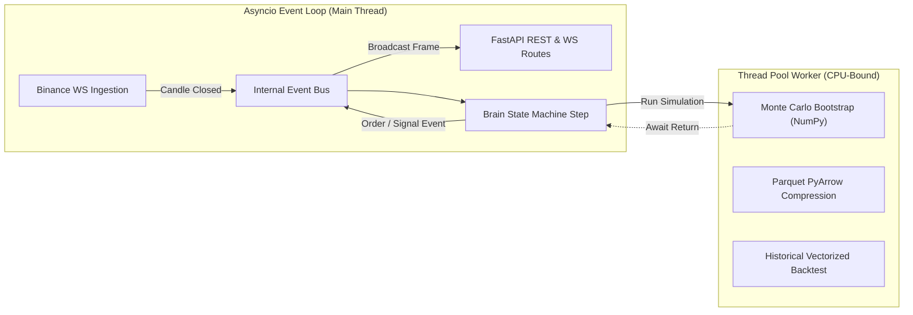

# NEPTUNE Backend Architecture

## Document Information
- **Project**: NEPTUNE — Autonomous Market Intelligence & Paper Trading Platform
- **Document Version**: 1.0.0
- **Status**: Approved / Technical Specification
- **Author**: Neptune Lead Backend Architect
- **Date**: 2026-11-01

---

## 1. Overview & Architectural Goals

The NEPTUNE backend is a high-performance, asynchronous modular application written in Python 3.11+ using the **FastAPI** framework. It serves as the analytical core, multi-agent orchestrator, simulation laboratory, risk gatekeeper, and paper execution engine for the entire platform.

### 1.1 Core Goals
1. **Concurrency Without Race Conditions**: Leverage Python `asyncio` for I/O operations (WebSocket ingestion, client streaming) alongside NumPy/PyArrow in worker thread pools for CPU-bound simulations.
2. **Determinism & Traceability**: Maintain a deterministic decision hierarchy where the Central Brain state machine orchestrates analysis, simulation, risk verification, and paper order creation.
3. **Decoupled Architecture**: Strictly enforce single-responsibility modules with abstract repository interfaces, isolating business rules from storage drivers and external APIs.
4. **Resilient Failure Boundaries**: Contain exceptions within individual agent and service wrappers to prevent cascade failures across the trading engine.

---

## 2. Directory Structure & Module Responsibilities

The backend code is organized under `backend/app/`:

```
backend/
├── app/
│   ├── main.py                    # Application entry point, lifespan, CORS, middleware
│   │
│   ├── api/                       # API and Network Transport Tier
│   │   ├── dependencies.py        # FastAPI dependency injection providers
│   │   ├── routes/                # REST endpoints grouped by domain
│   │   │   ├── health.py          # /api/v1/health
│   │   │   ├── markets.py         # /api/v1/markets, /market/candles, /market/snapshot
│   │   │   ├── agents.py          # /api/v1/agents, /agents/{id}/results
│   │   │   ├── brain.py           # /api/v1/brain/decisions
│   │   │   ├── signals.py         # /api/v1/signals
│   │   │   ├── simulations.py     # /api/v1/simulations
│   │   │   ├── paper.py           # /api/v1/paper/orders, /paper/positions
│   │   │   ├── analytics.py       # /api/v1/analytics/performance
│   │   │   └── system.py          # /api/v1/system/pause, resume, kill-switch
│   │   └── websockets/            # WebSocket connection handlers and broadcast hub
│   │       ├── hub.py             # Central broadcast hub managing active connections
│   │       └── routes.py          # /ws/market, /ws/agents, /ws/brain, /ws/signals, etc.
│   │
│   ├── core/                      # Cross-Cutting Infrastructure & Foundation
│   │   ├── config.py              # Pydantic BaseSettings, environment variables
│   │   ├── logging.py             # Structured JSON logger with contextual trace IDs
│   │   ├── events.py              # In-memory asynchronous EventBus (asyncio.Queue)
│   │   └── security.py            # Localhost binding checks, CORS, origin validation
│   │
│   ├── brain/                     # Autonomous Decision Core & State Machine
│   │   ├── state_machine.py       # 11-State Finite State Machine (FSM)
│   │   ├── orchestrator.py        # Agent execution coordinator & cycle driver
│   │   └── synthesizer.py         # Multi-agent confluence & hypothesis generator
│   │
│   ├── agents/                    # Specialist Agent Swarm
│   │   ├── base.py                # Abstract BaseAgent contract
│   │   ├── registry.py            # Dynamic agent discovery and lifecycle manager
│   │   └── implementations/       # 10 Specialist Agent Implementations
│   │       ├── market_scanner.py
│   │       ├── trend_analyst.py
│   │       ├── momentum_analyst.py
│   │       ├── volume_analyst.py
│   │       ├── news_analyst.py
│   │       ├── strategy_analyst.py
│   │       ├── signal_validator.py
│   │       ├── risk_manager_agent.py
│   │       ├── execution_manager_agent.py
│   │       └── performance_auditor_agent.py
│   │
│   ├── strategies/                # Quantitative Strategy Laboratory
│   │   ├── base.py                # IStrategy abstract interface
│   │   ├── registry.py            # Strategy catalog and parameter manager
│   │   ├── backtester.py          # Vectorized & event-driven backtesting engine
│   │   └── implementations/       # 4 Built-in Strategies
│   │       ├── trend_follower.py
│   │       ├── mean_reversion.py
│   │       ├── breakout.py
│   │       └── dual_momentum.py
│   │
│   ├── simulation/                # Time Machine Forward Simulator
│   │   ├── engine.py              # Multi-path simulation coordinator
│   │   ├── bootstrap.py           # Historical & Block Bootstrap algorithms
│   │   ├── conditioned.py         # Volatility & Regime Conditioned generators
│   │   └── percentiles.py         # Fast vector percentile calculation (p5 to p95)
│   │
│   ├── risk/                      # Capital Preservation & Safety Gatekeeper
│   │   ├── manager.py             # Master RiskManager enforcing 5 invariant checks
│   │   ├── sizing.py              # Volatility & risk-percentage sizing algorithms
│   │   └── circuit_breaker.py     # Drawdown and daily loss kill-switch monitors
│   │
│   ├── execution/                 # Paper Trading Execution Engine
│   │   ├── engine.py              # Simulated matching engine (Limit/Market/Stops)
│   │   ├── fill_simulator.py      # Latency, slippage, and taker fee physics models
│   │   └── position_manager.py    # Active position margin & PnL accounting
│   │
│   ├── analytics/                 # Performance Auditing & Reporting
│   │   ├── auditor.py             # Trade causality and slippage auditor
│   │   └── metrics.py             # Sharpe, Sortino, Calmar, MaxDD, WinRate math
│   │
│   └── data/                      # Persistence & Ingestion Tier
│       ├── buffer.py              # High-speed in-memory candle ring buffer
│       ├── ingest.py              # Binance public WebSocket & REST client
│       ├── sqlite/                # Relational metadata & audit storage
│       │   ├── connection.py      # SQLite WAL connection factory
│       │   ├── migrations.py      # Lightweight SQL script migration runner
│       │   └── repositories/      # Concrete SQLite repositories
│       └── parquet/               # Columnar time-series storage
│           ├── store.py           # PyArrow Parquet writer/reader
│           └── partition.py       # Historical partition resolver
```

---

## 3. Asynchronous Execution Model

The backend leverages a hybrid execution architecture combining Python's cooperative `asyncio` event loop for network/database I/O and a managed `concurrent.futures.ThreadPoolExecutor` for CPU-intensive mathematical tasks.



- **Non-Blocking Ingestion**: Public WebSocket streams push raw messages into an in-memory queue. Processing occurs in asynchronous consumer tasks, ensuring socket buffers never overflow.
- **Offloaded Heavy Math**: Simulations (1000 paths $\times$ 48 candles) execute within NumPy C-extensions inside `asyncio.to_thread()` or `loop.run_in_executor()`, ensuring the main event loop continues dispatching WebSocket ticks with $< 15$ ms latency.

---

## 4. Central Brain Finite State Machine (FSM)

The Central Brain orchestrates all analysis, simulation, risk control, and order handling through a formal 11-state deterministic Finite State Machine.

### 4.1 Complete State Transition Graph

```mermaid
stateDiagram-v2
    [*] --> OBSERVING: System Initialized
    
    OBSERVING --> ANALYZING: Ingest Valid 1m/5m Candle Close
    
    ANALYZING --> OBSERVING: Confluence < Threshold (No Setup)
    ANALYZING --> SIGNAL_DETECTED: Confluence >= Threshold (Setup Formed)
    
    SIGNAL_DETECTED --> VALIDATING: Dispatch Candidate Signal
    
    VALIDATING --> OBSERVING: Validation Failed (Conflicting Rules / Regime Mismatch)
    VALIDATING --> SIMULATING: Validation Passed (Confluence >= 0.75)
    
    SIMULATING --> OBSERVING: Simulation Failed (Tail Risk > Cutoff, Stop Probability > 35%)
    SIMULATING --> RISK_REVIEW: Simulation Passed (Target Prob > 55%, Acceptable MAE)
    
    RISK_REVIEW --> REJECTED: Risk Invariant Violated (Drawdown, Daily Loss, Max Positions)
    RISK_REVIEW --> APPROVED: All 5 Risk Invariants Satisfied
    
    REJECTED --> OBSERVING: Log Risk Violation Event
    
    APPROVED --> PAPER_ORDER_CREATED: Dispatch Order to ExecutionManager
    
    PAPER_ORDER_CREATED --> POSITION_MONITORING: Simulated Fill Confirmed
    PAPER_ORDER_CREATED --> OBSERVING: Fill Expired / Order Cancelled
    
    POSITION_MONITORING --> CLOSED: Stop Loss Hit / Take Profit Hit / Manual Close
    
    CLOSED --> AUDITED: PerformanceAuditor Calculates Trade Metrics & Slippage
    
    AUDITED --> OBSERVING: Position Cycle Complete; Return to Observation
```



### 4.2 State Invariants & Triggers

| State | Purpose & Active Operations | Exit Trigger & Next State |
|---|---|---|
| `OBSERVING` | Listening for market ticks and closed candles; ring buffer ingestion active. | Closed candle received $\rightarrow$ `ANALYZING`. |
| `ANALYZING` | Concurrently executing `MarketScanner`, `TrendAnalyst`, `MomentumAnalyst`, `VolumeAnalyst`, `NewsAnalyst`. | Confluence evaluated: If setup identified $\rightarrow$ `SIGNAL_DETECTED`; else $\rightarrow$ `OBSERVING`. |
| `SIGNAL_DETECTED` | `StrategyAnalyst` evaluates rules and formats raw candidate signal. | Raw signal ready $\rightarrow$ `VALIDATING`. |
| `VALIDATING` | `SignalValidator` tests multi-timeframe confirmation and false-breakout filters. | If validated $\rightarrow$ `SIMULATING`; if rejected $\rightarrow$ `OBSERVING`. |
| `SIMULATING` | `Time Machine` generates 1000 forward bootstrap paths; computes stop/target probabilities. | If metrics pass thresholds $\rightarrow$ `RISK_REVIEW`; else $\rightarrow$ `OBSERVING`. |
| `RISK_REVIEW` | `RiskManager` evaluates 5 risk checks and calculates exact position size. | If approved $\rightarrow$ `APPROVED`; if rule violated $\rightarrow$ `REJECTED`. |
| `APPROVED` | Intermediate state logging risk approval token and sizing. | Immediate transition $\rightarrow$ `PAPER_ORDER_CREATED`. |
| `REJECTED` | Logs specific risk failure reason to `risk_events` table. | Immediate return $\rightarrow$ `OBSERVING`. |
| `PAPER_ORDER_CREATED` | `ExecutionManager` models latency, spread, and slippage to fill paper order. | Fill confirmed $\rightarrow$ `POSITION_MONITORING`. |
| `POSITION_MONITORING` | Real-time position tracking; monitoring bracket orders (SL/TP) on every price tick. | Exit condition met $\rightarrow$ `CLOSED`. |
| `CLOSED` | Closes position, releases margin, records realized PnL in ledger. | Ledger updated $\rightarrow$ `AUDITED`. |
| `AUDITED` | `PerformanceAuditor` assesses execution slippage, updates Sharpe/Sortino and win rate. | Audit logged $\rightarrow$ `OBSERVING`. |

---

## 5. Agent Base Class Contract

Every specialist agent inherits from `BaseAgent`, enforcing strict typing for input and output contracts:

```python
from abc import ABC, abstractmethod
from typing import Generic, TypeVar, Any
from pydantic import BaseModel
from app.core.logging import get_logger

TInput = TypeVar("TInput", bound=BaseModel)
TOutput = TypeVar("TOutput", bound=BaseModel)

class AgentExecutionResult(BaseModel, Generic[TOutput]):
    agent_id: str
    execution_time_ms: float
    success: bool
    data: TOutput | None = None
    error_message: str | None = None

class BaseAgent(ABC, Generic[TInput, TOutput]):
    def __init__(self, agent_id: str, name: str, timeout_seconds: float = 2.0):
        self.agent_id = agent_id
        self.name = name
        self.timeout_seconds = timeout_seconds
        self.logger = get_logger(f"agent.{agent_id}")
        self.consecutive_errors = 0

    @abstractmethod
    async def execute(self, payload: TInput) -> TOutput:
        """Core analytical or execution logic implemented by the specialist agent."""
        pass

    @abstractmethod
    async def on_error(self, error: Exception, context: dict[str, Any]) -> None:
        """Dedicated error containment and logging procedure."""
        pass

    async def safe_execute(self, payload: TInput) -> AgentExecutionResult[TOutput]:
        """Wrapper enforcing timeout, runtime latency profiling, and error boundary."""
        import time
        start_time = time.perf_counter()
        try:
            # Enforce execution timeout
            import asyncio
            result = await asyncio.wait_for(self.execute(payload), timeout=self.timeout_seconds)
            self.consecutive_errors = 0
            elapsed = (time.perf_counter() - start_time) * 1000.0
            return AgentExecutionResult(
                agent_id=self.agent_id,
                execution_time_ms=elapsed,
                success=True,
                data=result
            )
        except Exception as e:
            self.consecutive_errors += 1
            elapsed = (time.perf_counter() - start_time) * 1000.0
            self.logger.error("Agent execution failed", agent=self.agent_id, error=str(e), exc_info=True)
            await self.on_error(e, {"payload": payload.model_dump()})
            return AgentExecutionResult(
                agent_id=self.agent_id,
                execution_time_ms=elapsed,
                success=False,
                error_message=str(e)
            )
```

---

## 6. Strategy Interface Specification

All quantitative trading strategies implement the uniform `IStrategy` protocol:

```python
from abc import ABC, abstractmethod
from typing import List, Optional
from pydantic import BaseModel

class SignalDirection(str):
    LONG = "LONG"
    SHORT = "SHORT"

class StrategyCandidateSignal(BaseModel):
    strategy_id: str
    symbol: str
    timeframe: str
    direction: str
    entry_price: float
    suggested_stop_loss: float
    suggested_take_profit: float
    confidence_score: float
    rationale: str

class IStrategy(ABC):
    strategy_id: str
    name: str
    version: str
    supported_timeframes: list[str]

    @abstractmethod
    def entry_conditions(self, market_data_slice: Any, agent_context: dict[str, Any]) -> Optional[StrategyCandidateSignal]:
        """Evaluates technical criteria and emits a candidate signal if satisfied."""
        pass

    @abstractmethod
    def exit_conditions(self, current_price: float, position_context: dict[str, Any]) -> bool:
        """Determines if active position should be exited before hitting stop/target."""
        pass

    @abstractmethod
    def invalidation_rules(self, current_price: float, candidate_signal: StrategyCandidateSignal) -> bool:
        """Checks if price action invalidates the thesis prior to order entry."""
        pass

    @abstractmethod
    def risk_requirements(self) -> dict[str, Any]:
        """Returns strategy-specific risk parameters (e.g. min R:R ratio, max ATR multiple)."""
        pass
```

---

## 7. Dependency Injection & Service Management

FastAPI routes utilize constructor and dependency injection via `Depends()` to access singleton repositories, buses, and engines:

```python
# Example: api/dependencies.py
from fastapi import Depends
from app.data.sqlite.repositories.order_repo import SQLiteOrderRepository
from app.risk.manager import RiskManager
from app.core.events import EventBus

_event_bus = EventBus()
_order_repo = SQLiteOrderRepository()
_risk_manager = RiskManager(_order_repo)

def get_event_bus() -> EventBus:
    return _event_bus

def get_order_repository() -> SQLiteOrderRepository:
    return _order_repo

def get_risk_manager(repo: SQLiteOrderRepository = Depends(get_order_repository)) -> RiskManager:
    return _risk_manager
```

---

## 8. Configuration Management

Configuration is declared using Pydantic `BaseSettings`, loading from `.env` with strict validation:

```python
from pydantic_settings import BaseSettings
from pydantic import Field

class NeptuneSettings(BaseSettings):
    ENVIRONMENT: str = Field(default="development", description="Runtime environment")
    HOST: str = Field(default="127.0.0.1", description="Backend binding host (strictly local)")
    PORT: int = Field(default=8000, description="Backend HTTP/WS port")
    CORS_ORIGINS: list[str] = Field(default=["http://localhost:3000"], description="Allowed CORS origins")
    
    # Storage Paths
    SQLITE_PATH: str = Field(default="storage/neptune_trading.db", description="Path to SQLite WAL database")
    PARQUET_DIR: str = Field(default="storage/historical", description="Root directory for Parquet storage")
    
    # Risk Limits
    INITIAL_EQUITY_USDT: float = Field(default=1000.0, ge=100.0)
    MAX_CONCURRENT_POSITIONS: int = Field(default=2, ge=1, le=5)
    RISK_PER_TRADE_PCT: float = Field(default=0.005, ge=0.001, le=0.02)
    DAILY_LOSS_LIMIT_PCT: float = Field(default=0.02, ge=0.005, le=0.05)
    MAX_DRAWDOWN_PCT: float = Field(default=0.05, ge=0.02, le=0.10)
    
    # Market Data
    ACTIVE_SYMBOLS: list[str] = Field(default=["BTCUSDT", "ETHUSDT", "SOLUSDT"])
    DEFAULT_TIMEFRAME: str = Field(default="15m")

    class Config:
        env_file = ".env"
        env_file_encoding = "utf-8"
        case_sensitive = True

settings = NeptuneSettings()
```
