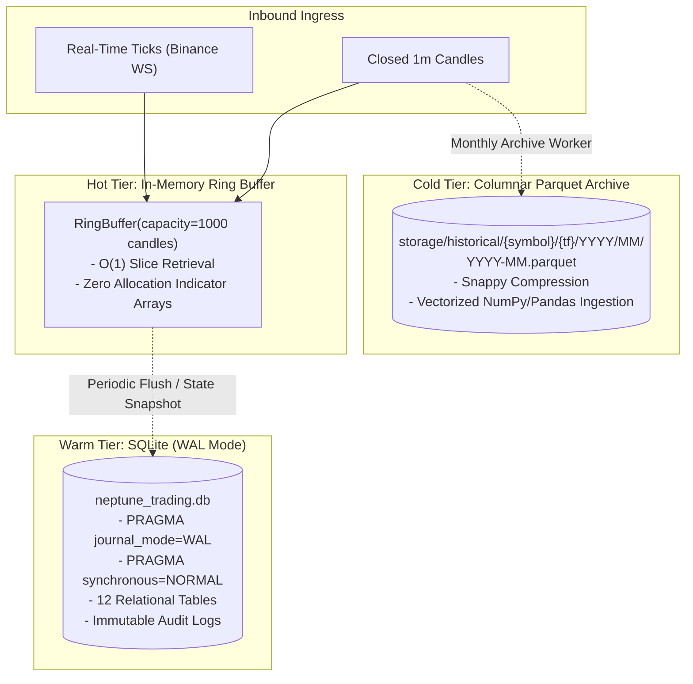

# NEPTUNE Data Architecture & Persistence Specification

## Document Information
- **Project**: NEPTUNE — Autonomous Market Intelligence & Paper Trading Platform
- **Document Version**: 1.0.0
- **Status**: Approved / Technical Specification
- **Author**: Neptune Principal Data Architect
- **Date**: 2026-11-01

---

## 1. Overview & Storage Strategy

NEPTUNE implements a hybrid storage architecture purpose-built for financial quantitative trading:
1. **Relational Metadata & Audit Logs (SQLite 3)**: Optimized for fast ACID transactional updates, append-only audit trails, and complex relational lookups (decisions, orders, positions, events).
2. **Columnar Historical Time-Series (Apache Parquet via PyArrow)**: Optimized for high-throughput, compressed analytical querying of multi-year 1m/5m/15m OHLCV candle datasets.
3. **In-Memory Ring Buffers**: Ultra-low-latency, zero-allocation circular arrays providing $O(1)$ random access to the latest $N$ closed candles for real-time indicator calculations.



---

## 2. SQLite Schema (Complete DDL)

The transactional database resides in `storage/neptune_trading.db`. SQLite is operated with `PRAGMA foreign_keys = ON;`, `PRAGMA journal_mode = WAL;`, and `PRAGMA busy_timeout = 5000;`.

### 2.1 Complete DDL for All 12 Tables

```sql
-- 1. AGENTS: Status, health, and configuration of all specialist agents
CREATE TABLE IF NOT EXISTS agents (
    agent_id TEXT PRIMARY KEY,
    name TEXT NOT NULL,
    version TEXT NOT NULL,
    status TEXT NOT NULL CHECK(status IN ('HEALTHY', 'DEGRADED', 'PAUSED', 'OFFLINE')),
    config_json TEXT NOT NULL DEFAULT '{}',
    total_invocations INTEGER NOT NULL DEFAULT 0,
    total_errors INTEGER NOT NULL DEFAULT 0,
    avg_latency_ms REAL NOT NULL DEFAULT 0.0,
    last_invoked_at INTEGER,
    created_at INTEGER NOT NULL,
    updated_at INTEGER NOT NULL
);

-- 2. BRAIN_DECISIONS: Comprehensive audit log of every Central Brain state transition
CREATE TABLE IF NOT EXISTS brain_decisions (
    decision_id TEXT PRIMARY KEY,
    from_state TEXT NOT NULL,
    to_state TEXT NOT NULL,
    trigger_event TEXT NOT NULL,
    symbol TEXT,
    timeframe TEXT,
    hypothesis_json TEXT,
    agent_votes_json TEXT,
    rationale TEXT NOT NULL,
    decision_metadata_json TEXT,
    created_at INTEGER NOT NULL
);
CREATE INDEX IF NOT EXISTS idx_brain_decisions_created_at ON brain_decisions(created_at);
CREATE INDEX IF NOT EXISTS idx_brain_decisions_to_state ON brain_decisions(to_state);

-- 3. SIGNALS: Raw and validated candidate trading signals
CREATE TABLE IF NOT EXISTS signals (
    signal_id TEXT PRIMARY KEY,
    strategy_id TEXT NOT NULL,
    symbol TEXT NOT NULL,
    timeframe TEXT NOT NULL,
    direction TEXT NOT NULL CHECK(direction IN ('LONG', 'SHORT')),
    entry_price REAL NOT NULL,
    stop_loss REAL NOT NULL,
    take_profit REAL NOT NULL,
    risk_reward_ratio REAL NOT NULL,
    raw_confidence REAL NOT NULL,
    is_validated INTEGER NOT NULL DEFAULT 0,
    validation_score REAL,
    validation_reasons_json TEXT,
    status TEXT NOT NULL CHECK(status IN ('PENDING', 'VALIDATED', 'SIMULATED', 'REJECTED', 'ORDER_CREATED', 'EXPIRED')),
    created_at INTEGER NOT NULL,
    updated_at INTEGER NOT NULL
);
CREATE INDEX IF NOT EXISTS idx_signals_symbol_timeframe ON signals(symbol, timeframe);
CREATE INDEX IF NOT EXISTS idx_signals_created_at ON signals(created_at);

-- 4. SIMULATIONS: Time Machine forward stochastic bootstrap simulation results
CREATE TABLE IF NOT EXISTS simulations (
    simulation_id TEXT PRIMARY KEY,
    signal_id TEXT NOT NULL,
    symbol TEXT NOT NULL,
    timeframe TEXT NOT NULL,
    method TEXT NOT NULL CHECK(method IN ('HISTORICAL_BOOTSTRAP', 'BLOCK_BOOTSTRAP', 'VOLATILITY_CONDITIONED', 'REGIME_CONDITIONED')),
    horizon_candles INTEGER NOT NULL,
    num_paths INTEGER NOT NULL,
    seed INTEGER NOT NULL,
    model_version TEXT NOT NULL,
    entry_price REAL NOT NULL,
    p5 REAL NOT NULL,
    p10 REAL NOT NULL,
    p25 REAL NOT NULL,
    p50 REAL NOT NULL,
    p75 REAL NOT NULL,
    p90 REAL NOT NULL,
    p95 REAL NOT NULL,
    stop_hit_probability REAL NOT NULL,
    target_hit_probability REAL NOT NULL,
    max_adverse_excursion_median REAL NOT NULL,
    assumptions_json TEXT NOT NULL DEFAULT '{}',
    created_at INTEGER NOT NULL,
    FOREIGN KEY(signal_id) REFERENCES signals(signal_id) ON DELETE CASCADE
);
CREATE INDEX IF NOT EXISTS idx_simulations_signal_id ON simulations(signal_id);

-- 5. PAPER_ORDERS: Simulated order lifecycle ledger
CREATE TABLE IF NOT EXISTS paper_orders (
    order_id TEXT PRIMARY KEY,
    signal_id TEXT,
    symbol TEXT NOT NULL,
    order_type TEXT NOT NULL CHECK(order_type IN ('LIMIT', 'MARKET', 'STOP_LOSS', 'TAKE_PROFIT')),
    side TEXT NOT NULL CHECK(side IN ('BUY', 'SELL')),
    requested_price REAL NOT NULL,
    requested_size REAL NOT NULL,
    status TEXT NOT NULL CHECK(status IN ('PENDING', 'PARTIALLY_FILLED', 'FILLED', 'CANCELLED', 'REJECTED', 'EXPIRED')),
    risk_approval_token TEXT NOT NULL,
    created_at INTEGER NOT NULL,
    submitted_at INTEGER,
    filled_at INTEGER,
    cancelled_at INTEGER,
    FOREIGN KEY(signal_id) REFERENCES signals(signal_id)
);
CREATE INDEX IF NOT EXISTS idx_paper_orders_symbol ON paper_orders(symbol);
CREATE INDEX IF NOT EXISTS idx_paper_orders_status ON paper_orders(status);

-- 6. PAPER_FILLS: Granular execution audit records for individual fills
CREATE TABLE IF NOT EXISTS paper_fills (
    fill_id TEXT PRIMARY KEY,
    order_id TEXT NOT NULL,
    symbol TEXT NOT NULL,
    side TEXT NOT NULL CHECK(side IN ('BUY', 'SELL')),
    fill_price REAL NOT NULL,
    fill_size REAL NOT NULL,
    slippage_usdt REAL NOT NULL DEFAULT 0.0,
    fee_usdt REAL NOT NULL DEFAULT 0.0,
    fee_rate REAL NOT NULL DEFAULT 0.0004,
    simulated_latency_ms REAL NOT NULL,
    timestamp INTEGER NOT NULL,
    FOREIGN KEY(order_id) REFERENCES paper_orders(order_id) ON DELETE CASCADE
);
CREATE INDEX IF NOT EXISTS idx_paper_fills_order_id ON paper_fills(order_id);

-- 7. POSITIONS: Active portfolio positions and live margin allocations
CREATE TABLE IF NOT EXISTS positions (
    position_id TEXT PRIMARY KEY,
    symbol TEXT NOT NULL UNIQUE,
    direction TEXT NOT NULL CHECK(direction IN ('LONG', 'SHORT')),
    size REAL NOT NULL,
    entry_price REAL NOT NULL,
    current_price REAL NOT NULL,
    stop_loss REAL NOT NULL,
    take_profit REAL NOT NULL,
    margin_allocated REAL NOT NULL,
    unrealized_pnl REAL NOT NULL DEFAULT 0.0,
    unrealized_pnl_pct REAL NOT NULL DEFAULT 0.0,
    opened_at INTEGER NOT NULL,
    updated_at INTEGER NOT NULL
);

-- 8. CLOSED_TRADES: Historical record of completed trades for performance analytics
CREATE TABLE IF NOT EXISTS closed_trades (
    trade_id TEXT PRIMARY KEY,
    position_id TEXT NOT NULL,
    symbol TEXT NOT NULL,
    direction TEXT NOT NULL CHECK(direction IN ('LONG', 'SHORT')),
    size REAL NOT NULL,
    entry_price REAL NOT NULL,
    exit_price REAL NOT NULL,
    gross_pnl REAL NOT NULL,
    fees_paid REAL NOT NULL,
    net_pnl REAL NOT NULL,
    net_return_pct REAL NOT NULL,
    exit_reason TEXT NOT NULL CHECK(exit_reason IN ('TAKE_PROFIT', 'STOP_LOSS', 'MANUAL_CLOSE', 'CIRCUIT_BREAKER', 'EXPIRED')),
    holding_duration_seconds INTEGER NOT NULL,
    opened_at INTEGER NOT NULL,
    closed_at INTEGER NOT NULL
);
CREATE INDEX IF NOT EXISTS idx_closed_trades_closed_at ON closed_trades(closed_at);
CREATE INDEX IF NOT EXISTS idx_closed_trades_symbol ON closed_trades(symbol);

-- 9. RISK_EVENTS: Audit log of all risk limit checks, breaches, and approvals
CREATE TABLE IF NOT EXISTS risk_events (
    event_id TEXT PRIMARY KEY,
    signal_id TEXT,
    event_type TEXT NOT NULL CHECK(event_type IN ('APPROVAL', 'REJECTION', 'WARNING', 'CIRCUIT_BREAKER_TRIGGERED', 'KILL_SWITCH_ENGAGED')),
    rule_name TEXT NOT NULL,
    metric_value REAL NOT NULL,
    threshold_value REAL NOT NULL,
    details_json TEXT NOT NULL DEFAULT '{}',
    timestamp INTEGER NOT NULL
);
CREATE INDEX IF NOT EXISTS idx_risk_events_timestamp ON risk_events(timestamp);

-- 10. STRATEGY_METRICS: Rolling performance statistics per strategy
CREATE TABLE IF NOT EXISTS strategy_metrics (
    strategy_id TEXT PRIMARY KEY,
    total_trades INTEGER NOT NULL DEFAULT 0,
    winning_trades INTEGER NOT NULL DEFAULT 0,
    losing_trades INTEGER NOT NULL DEFAULT 0,
    win_rate REAL NOT NULL DEFAULT 0.0,
    profit_factor REAL NOT NULL DEFAULT 0.0,
    sharpe_ratio REAL NOT NULL DEFAULT 0.0,
    sortino_ratio REAL NOT NULL DEFAULT 0.0,
    max_drawdown_pct REAL NOT NULL DEFAULT 0.0,
    last_calculated_at INTEGER NOT NULL
);

-- 11. SYSTEM_EVENTS: Infrastructure telemetry, connection state changes, and error logs
CREATE TABLE IF NOT EXISTS system_events (
    event_id TEXT PRIMARY KEY,
    component TEXT NOT NULL,
    severity TEXT NOT NULL CHECK(severity IN ('DEBUG', 'INFO', 'WARNING', 'ERROR', 'CRITICAL')),
    message TEXT NOT NULL,
    stack_trace TEXT,
    metadata_json TEXT DEFAULT '{}',
    timestamp INTEGER NOT NULL
);
CREATE INDEX IF NOT EXISTS idx_system_events_timestamp ON system_events(timestamp);
CREATE INDEX IF NOT EXISTS idx_system_events_severity ON system_events(severity);

-- 12. MARKET_SNAPSHOTS: Periodic persistent snapshots of portfolio equity and market state
CREATE TABLE IF NOT EXISTS market_snapshots (
    snapshot_id TEXT PRIMARY KEY,
    timestamp INTEGER NOT NULL,
    virtual_equity REAL NOT NULL,
    unrealized_pnl REAL NOT NULL,
    realized_pnl_daily REAL NOT NULL,
    drawdown_pct REAL NOT NULL,
    open_positions_count INTEGER NOT NULL,
    active_symbols_json TEXT NOT NULL
);
CREATE INDEX IF NOT EXISTS idx_market_snapshots_timestamp ON market_snapshots(timestamp);
```

---

## 3. Columnar Historical Time-Series (Apache Parquet)

For multi-year historical data ingestion and high-speed backtesting, NEPTUNE uses Apache Parquet rather than bloated SQL databases or flat CSVs.

### 3.1 Directory Layout
```
storage/historical/
└── {symbol}/
    └── {timeframe}/
        └── {YYYY}/
            └── {MM}/
                └── {YYYY}-{MM}.parquet
```

*Example*:
`storage/historical/BTCUSDT/15m/2026/03/2026-03.parquet`

### 3.3 Simulation Trajectory Storage (Daily Partitioned Parquet)

To prevent filesystem fragmentation from thousands of tiny individual simulation files, full 1,000-path trajectory arrays are stored using daily partitions or on explicit user export:

```
storage/simulations/
└── {YYYY}/
    └── {MM}/
        └── simulations_{YYYY}-{MM}-{DD}.parquet
```

Each row in the simulation partition table contains:
- `simulation_id` (string, UUID): Foreign key to SQLite `simulations.simulation_id`.
- `path_index` (int32): 0 to 999.
- `step_index` (int32): 0 to horizon.
- `projected_price` (float64): Simulated price step.
- `projected_time` (string): ISO 8601 UTC timestamp.

Summary statistics (`p5, p10, p25, p50, p75, p90, p95`, barrier hit probabilities, MAE) are always stored directly in SQLite for instant query performance without touching Parquet.

### 3.4 Cache-First Historical Backfill Policy

To prevent IP rate-limiting from public exchange endpoints (Binance HTTP 429/418):
1. `MarketDataService` checks local Parquet archives on startup before issuing network requests.
2. Queries the latest stored candle timestamp for the requested symbol/timeframe.
3. If local data is present, issues a REST request only for the missing range (`latest_timestamp + 1` to `now`).
4. If local data is completely absent, fetches the initial historical backfill limit and persists it to Parquet.

---

## 4. Repository Interfaces Pattern

All data access is mediated through abstract repository interfaces, isolating business rules from storage mechanics.

```python
from abc import ABC, abstractmethod
from typing import List, Optional
from pydantic import BaseModel

class IMarketDataRepository(ABC):
    @abstractmethod
    async def get_recent_candles(self, symbol: str, timeframe: str, limit: int) -> list[dict]:
        """Fetch latest N candles from in-memory ring buffer or SQLite."""
        pass

    @abstractmethod
    async def get_historical_candles(self, symbol: str, timeframe: str, start_time: int, end_time: int) -> list[dict]:
        """Query historical Parquet archive for date ranges."""
        pass

    @abstractmethod
    async def save_candle(self, symbol: str, timeframe: str, candle: dict) -> None:
        """Persist a newly closed candle."""
        pass

class IOrderRepository(ABC):
    @abstractmethod
    async def create_order(self, order: dict) -> str:
        """Create pending paper order in DB."""
        pass

    @abstractmethod
    async def record_fill(self, fill: dict) -> None:
        """Persist order fill and transition order status to FILLED."""
        pass

    @abstractmethod
    async def get_active_orders(self, symbol: Optional[str] = None) -> list[dict]:
        """Fetch pending orders."""
        pass

class IPositionRepository(ABC):
    @abstractmethod
    async def get_open_positions(self) -> list[dict]:
        """Fetch all currently open positions."""
        pass

    @abstractmethod
    async def update_position_mark(self, symbol: str, current_price: float, unrealized_pnl: float) -> None:
        """Update mark price and unrealized PnL."""
        pass

    @abstractmethod
    async def close_position(self, position_id: str, closed_trade_record: dict) -> None:
        """Atomically remove position and insert into closed_trades."""
        pass

class ISignalRepository(ABC):
    @abstractmethod
    async def record_signal(self, signal: dict) -> str:
        """Persist raw candidate signal."""
        pass

    @abstractmethod
    async def update_signal_validation(self, signal_id: str, is_valid: bool, score: float, reasons: list[str]) -> None:
        """Update signal validation status."""
        pass
```

---

## 5. Lightweight Custom SQLite Migration Runner

To avoid Alembic or ORM overhead, NEPTUNE uses a lightweight native migration runner with numbered SQL scripts:

```
storage/migrations/
├── 001_initial_schema.sql
├── 002_add_slippage_columns.sql
└── 003_add_indices.sql
```

### Migration Runner Algorithm
1. Mount SQLite database with WAL mode.
2. Ensure table `schema_migrations (version INTEGER PRIMARY KEY, applied_at INTEGER NOT NULL)` exists.
3. Query `SELECT MAX(version) FROM schema_migrations`.
4. Scan `storage/migrations/*.sql` sorted numerically.
5. Execute unapplied files sequentially inside an atomic transaction:
   ```sql
   BEGIN TRANSACTION;
   -- Execute contents of 00X_migration.sql
   INSERT INTO schema_migrations (version, applied_at) VALUES (X, strftime('%s','now') * 1000);
   COMMIT;
   ```
6. If any statement fails, issue immediate `ROLLBACK;` and halt startup with an actionable error.

---

## 6. Backup, Integrity & In-Memory Ring Buffer

### 6.1 Integrity & Backup Strategy
- **Integrity Check**: On application boot, executes `PRAGMA integrity_check;` and `PRAGMA foreign_key_check;`. If issues are detected, halts boot and raises `StorageIntegrityError`.
- **Online Backup**: Runs every 24 hours using SQLite's native `sqlite3_backup_init()` API to generate hot copies without blocking active readers or writers:
  `storage/backups/neptune_trading_YYYYMMDD_HHMM.db`.

### 6.2 In-Memory Ring Buffer Design
- Implemented as a circular fixed-size array in `app/data/buffer.py` using pre-allocated NumPy arrays.
- **Capacity**: 1,000 candles per tracked `{symbol}:{timeframe}` pair.
- **Performance**:
  - Insert time: $O(1)$ ($\le 2$ $\mu$s).
  - Last $K$ elements slice extraction: $O(1)$ zero-copy array view for vectorized indicator calculation.
