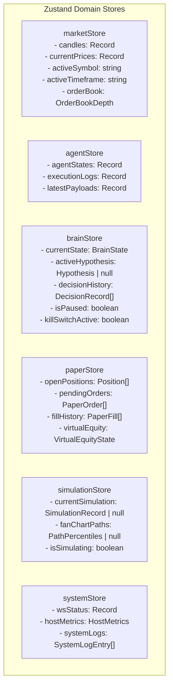
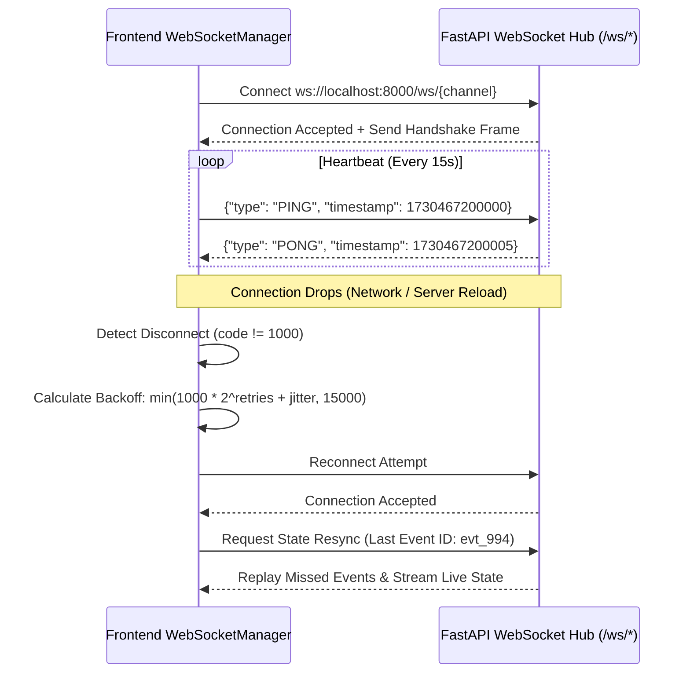

# NEPTUNE Frontend Architecture

## Document Information
- **Project**: NEPTUNE — Autonomous Market Intelligence & Paper Trading Platform
- **Document Version**: 1.0.0
- **Status**: Approved / Technical Specification
- **Author**: Neptune Lead Frontend Architect
- **Date**: 2026-11-01

---

## 1. Overview & Core Principles

The NEPTUNE frontend is designed as a mission-critical, institutional-grade financial workstation. It delivers low-latency data rendering, high visual clarity, deterministic user interactions, and robust state synchronization with the Python FastAPI backend.

### 1.1 Architectural Principles
1. **Zero Fake Activity**: Visual components only animate or re-render when actual state changes occur. No continuous decorative pulsing or simulated telemetry.
2. **Sub-Frame Render Performance**: High-frequency streaming market ticks and candle updates are throttled and batch-rendered using Canvas-based TradingView Lightweight Charts and selective Zustand selectors to preserve a continuous 60fps experience ($< 16.6$ ms frame time).
3. **Strict Type Safety**: Every domain object, API response, and WebSocket frame is validated at runtime using Zod and typed statically with TypeScript.
4. **Ergonomic Financial Palette**: Optimized for extended operations in low-light environments using high-contrast dark navy, charcoal, cyan, emerald, and crimson.

---

## 2. Next.js App Router Directory Structure

The frontend leverages the Next.js 14+ App Router, structuring route layouts, page boundaries, UI components, hooks, stores, and schemas under `frontend/src/`:

```
frontend/
├── src/
│   ├── app/
│   │   ├── layout.tsx                     # Root workstation layout, fonts, providers
│   │   ├── page.tsx                       # Redirects to /command-center
│   │   ├── command-center/
│   │   │   └── page.tsx                   # Section 1: Executive Command Center
│   │   ├── live-markets/
│   │   │   └── page.tsx                   # Section 2: Real-time Multi-Chart & Depth
│   │   ├── agent-center/
│   │   │   └── page.tsx                   # Section 3: 10 Specialist Agents Telemetry
│   │   ├── central-brain/
│   │   │   └── page.tsx                   # Section 4: Brain FSM & Reasoning Inspector
│   │   ├── time-machine/
│   │   │   └── page.tsx                   # Section 5: Monte Carlo Simulation Fan Charts
│   │   ├── strategy-laboratory/
│   │   │   └── page.tsx                   # Section 6: Strategy Builder & Backtest Lab
│   │   ├── paper-trading/
│   │   │   └── page.tsx                   # Section 7: Live Order Lifecycle Console
│   │   ├── portfolio/
│   │   │   └── page.tsx                   # Section 8: Open Positions & Exposure Ledger
│   │   ├── performance/
│   │   │   └── page.tsx                   # Section 9: Auditing, PnL & Sharpe Analytics
│   │   ├── system-monitoring/
│   │   │   └── page.tsx                   # Section 10: WebSocket, DB & Host Telemetry
│   │   └── settings/
│   │       └── page.tsx                   # Section 11: Risk Parameters & Configuration
│   │
│   ├── components/
│   │   ├── common/                        # Atomic UI components
│   │   │   ├── Badge.tsx
│   │   │   ├── Button.tsx
│   │   │   ├── Card.tsx
│   │   │   ├── Modal.tsx
│   │   │   ├── StatWidget.tsx
│   │   │   ├── Tabs.tsx
│   │   │   └── Tooltip.tsx
│   │   ├── layout/                        # Workstation structure
│   │   │   ├── Header.tsx                 # Real-time tickers, Kill Switch, Brain status
│   │   │   ├── Sidebar.tsx                # Nav tabs with live alert badges
│   │   │   └── StatusBar.tsx              # WS ping/pong latency, DB state, UTC clock
│   │   ├── charts/                        # Canvas & chart wrappers
│   │   │   ├── LightweightChart.tsx       # TradingView TradingView wrapper
│   │   │   ├── FanChartCanvas.tsx         # Monte Carlo percentile cone renderer
│   │   │   ├── ProbabilityHistogram.tsx   # PDF / CDF distribution renderer
│   │   │   └── EquityCurveChart.tsx       # Historical portfolio equity & drawdown
│   │   └── modules/                       # Section-specific composite views
│   │       ├── command-center/
│   │       ├── live-markets/
│   │       ├── agent-center/
│   │       ├── central-brain/
│   │       ├── time-machine/
│   │       ├── strategy-laboratory/
│   │       ├── paper-trading/
│   │       ├── portfolio/
│   │       ├── performance/
│   │       ├── system-monitoring/
│   │       └── settings/
│   │
│   ├── hooks/
│   │   ├── useWebSocket.ts                # Base multiplexed WebSocket hook
│   │   ├── useMarketData.ts               # Candle subscription & throttling hook
│   │   ├── useChartResize.ts              # ResizeObserver for responsive charts
│   │   └── useKeyboardShortcuts.ts        # Fast hotkeys for emergency pause & navigation
│   │
│   ├── stores/                            # Zustand isolated domain stores
│   │   ├── marketStore.ts
│   │   ├── agentStore.ts
│   │   ├── brainStore.ts
│   │   ├── paperStore.ts
│   │   ├── simulationStore.ts
│   │   └── systemStore.ts
│   │
│   ├── schemas/                           # Zod runtime validation schemas
│   │   ├── marketSchema.ts
│   │   ├── agentSchema.ts
│   │   ├── brainSchema.ts
│   │   ├── orderSchema.ts
│   │   ├── simulationSchema.ts
│   │   └── systemSchema.ts
│   │
│   ├── types/                             # Inferred TypeScript definitions
│   │   └── index.ts
│   │
│   └── styles/
│       └── globals.css                    # Tailwind directives & CSS variables
```

---

## 3. Page-to-Component Hierarchy (All 11 Sections)

```
RootLayout (Header + Sidebar + WorkstationCanvas + StatusBar)
│
├── 1. Command Center (/command-center)
│   ├── HeaderKPIStrip (Equity, Unrealized PnL, Realized PnL, Margin Free, Exposure)
│   ├── BrainStatusHero (State Pill, Active Signal Target, Confidence Meter)
│   ├── QuickAgentStatusGrid (10 Agent Mini-Tiles: Status, Latency, Bias)
│   ├── ActivePositionsMiniTable (Symbol, Size, PnL, Quick-Close)
│   ├── EmergencyActionPanel (Kill Switch, System Pause, Breakeven All)
│   └── LiveAlertsFeed (Scrollable event log with priority severity flags)
│
├── 2. Live Markets (/live-markets)
│   ├── SymbolSelectorBar (BTC/USDT, ETH/USDT, SOL/USDT + 24h Stats)
│   ├── TimeframeToolbar (1m, 5m, 15m, 1h, 4h, 1D)
│   ├── ChartWorkspace (Main Canvas: LightweightChart + Volume Pane)
│   ├── TechnicalOverlayControls (Toggle EMA Ribbons, VWAP, Bollinger Bands)
│   ├── OrderBookPreview (Top 20 bids/asks depth ladder)
│   └── SignalAnnotationOverlay (Visual arrows for entries, stops, and targets)
│
├── 3. AI Agent Center (/agent-center)
│   ├── AgentSelectorTabs (List of 10 Agents with live health dots)
│   ├── AgentDetailView
│   │   ├── AgentHeader (ID, Status, Version, Average Runtime, Invocation Count)
│   │   ├── MetricBar (Accuracy/Confidence, Error Rate, Last Execution Timestamp)
│   │   ├── IOInspector (Dual-pane JSON viewer: Inbound Contract vs Outbound Result)
│   │   └── AgentLogConsole (Streaming agent debug events with filter)
│   └── AgentBenchmarkComparison (Bar chart of execution latencies across all 10 agents)
│
├── 4. Central Brain (/central-brain)
│   ├── FSMStateVisualizer (Animated SVG/Canvas node diagram of 11 FSM states)
│   ├── ActiveReasoningCard (Current active hypothesis, rationale summary)
│   ├── ConsensusVotingMatrix (Heatmap of 10 agent weights & confidence contributions)
│   ├── DecisionTimeline (Chronological audit history of Brain transitions)
│   └── ManualOverrideControls (State step-through trigger for debugging)
│
├── 5. Time Machine (/time-machine)
│   ├── SignalSelectionDropdown (Select active candidate signal to inspect)
│   ├── SimulationConfigBar (Method: Historical / Block / Vol / Regime; Horizon; Paths)
│   ├── FanChartWorkspace (Interactive percentile cone: p5, p10, p25, p50, p75, p90, p95)
│   ├── PathOutcomeStats (Median MAE, Target Hit Probability, Stop Hit Probability)
│   ├── OutcomeDistributionHistogram (PDF / CDF of terminal returns)
│   └── SeedReproducibilityCard (Display 64-bit seed, Model version, Re-run button)
│
├── 6. Strategy Laboratory (/strategy-laboratory)
│   ├── StrategyDirectory (Built-in: TrendFollower, MeanReversion, Breakout, DualMom)
│   ├── ParameterEditorForm (Input thresholds, ATR multipliers, Stop ratios with Zod validation)
│   ├── HistoricalDatasetPicker (Select symbol, timeframe, date range from local Parquet)
│   ├── BacktestExecutionPanel (Run Backtest button, progress bar, CPU execution time)
│   └── BacktestResultsView (Equity curve, Sharpe, Sortino, Drawdown chart, Trade list)
│
├── 7. Paper Trading Execution Console (/paper-trading)
│   ├── ExecutionSummaryStrip (Pending Orders, Fills Today, Fees Paid, Avg Latency)
│   ├── ManualPaperOrderForm (Symbol, Type, Side, Quantity, Limit Price, Attached SL/TP)
│   ├── ActiveOrdersTable (Order ID, Symbol, Type, Side, Price, Qty, Status, Actions)
│   ├── FillsAuditTable (Fill ID, Order ID, Price, Slippage Incurred, Fee Incurred, Time)
│   └── SlippageDistributionChart (Histogram of expected price vs actual simulated fill)
│
├── 8. Portfolio & Positions (/portfolio)
│   ├── PortfolioHealthCards (Total Equity, Free Margin, Used Margin, Margin Level %)
│   ├── OpenPositionsGrid (Detailed cards per position with dynamic PnL color coding)
│   ├── PositionRiskBreakdown (Exposure by asset, Net Delta, Liquidation buffer)
│   ├── BracketOrderManager (Adjust Stop Loss / Take Profit sliders directly)
│   └── ClosedTradesTimeline (Interactive timeline of recent closed positions)
│
├── 9. Performance Analytics & Auditing (/performance)
│   ├── PerformanceMetricsGrid (Sharpe, Sortino, Calmar, Profit Factor, Win Rate, Expectancy)
│   ├── EquityDrawdownMultiChart (Cumulative returns synced with underwater drawdown %)
│   ├── TradeDistributionCharts (PnL per trade histogram, Holding duration scatter plot)
│   ├── MonthlyReturnsHeatmap (Year x Month return matrix)
│   └── ExecutionAuditReport (Downloadable JSON/CSV audit report with complete causality)
│
├── 10. System Monitoring & Telemetry (/system-monitoring)
│   ├── SystemHealthBanner (Overall status: OPERATIONAL, DEGRADED, CRITICAL)
│   ├── HostResourceMeters (CPU %, Memory MB, SQLite Disk Size, Parquet Store Size)
│   ├── WebSocketConnectionMatrix (Ping/Pong latency, Reconnect count, Dropped frames)
│   ├── EventBusMetrics (Queue depth, Event dispatch rate, Avg processing latency)
│   └── TerminalLogStream (Raw virtualized log stream with regex filter and pause)
│
└── 11. System Settings & Risk Parameters (/settings)
    ├── RiskParametersForm (Initial Capital, Max Positions, Risk %, Daily Loss %, Drawdown %)
    ├── MarketFeedConfig (Active symbols checklist, polling intervals)
    ├── StorageMaintenanceCard (Database size, Vacuum SQLite, Parquet check, Reset Paper State)
    └── AboutAndLicense (Version 1.0.0, Architecture specs, Local endpoints)
```

---

## 4. Zustand Store Design

The state layer is segregated into six domain stores to eliminate cross-domain re-rendering bottlenecks.



### 4.1 Store Contracts & State Interfaces

#### `marketStore`
```typescript
interface MarketState {
  activeSymbol: string;
  activeTimeframe: string;
  tickers: Record<string, { price: number; change24h: number; high24h: number; low24h: number; volume24h: number }>;
  candles: Record<string, Candle[]>; // keyed by `${symbol}:${timeframe}`
  orderBook: { bids: [number, number][]; asks: [number, number][] };
  setActiveSymbol: (symbol: string) => void;
  setActiveTimeframe: (tf: string) => void;
  updateTick: (symbol: string, price: number) => void;
  appendCandle: (symbol: string, timeframe: string, candle: Candle) => void;
  setCandles: (symbol: string, timeframe: string, candles: Candle[]) => void;
}
```

#### `brainStore`
```typescript
export type BrainState =
  | 'OBSERVING'
  | 'ANALYZING'
  | 'SIGNAL_DETECTED'
  | 'VALIDATING'
  | 'SIMULATING'
  | 'RISK_REVIEW'
  | 'APPROVED'
  | 'REJECTED'
  | 'PAPER_ORDER_CREATED'
  | 'POSITION_MONITORING'
  | 'CLOSED'
  | 'AUDITED';

interface BrainStoreState {
  currentState: BrainState;
  stateEnteredAt: number;
  activeHypothesis: Hypothesis | null;
  decisions: BrainDecisionRecord[];
  isSystemPaused: boolean;
  isKillSwitchTriggered: boolean;
  setBrainState: (state: BrainState, hypothesis?: Hypothesis) => void;
  addDecision: (decision: BrainDecisionRecord) => void;
  setPaused: (paused: boolean) => void;
  triggerKillSwitch: () => void;
}
```

#### `paperStore`
```typescript
interface PaperStoreState {
  equity: number;
  balance: number;
  marginUsed: number;
  unrealizedPnL: number;
  realizedPnL: number;
  positions: Position[];
  orders: PaperOrder[];
  fills: PaperFill[];
  updateEquity: (equityState: VirtualEquityState) => void;
  syncPositions: (positions: Position[]) => void;
  syncOrders: (orders: PaperOrder[]) => void;
  addFill: (fill: PaperFill) => void;
}
```

---

## 5. WebSocket Subscription & Connection Model

NEPTUNE utilizes a centralized `WebSocketManager` singleton that provides automatic channel multiplexing, exponential backoff with jitter, and heartbeat keepalive tracking.



### 5.1 Reconnection Policy
- **Initial Delay**: 500 ms
- **Multiplier**: $2.0$ with $\pm 20\%$ randomized jitter
- **Maximum Delay**: 15,000 ms
- **Max Retries**: Infinite (resilient background reconnection with visual banner in UI)
- **On Reconnect**: Queries `/api/v1/market/snapshot` and `/api/v1/paper/positions` to ensure zero desynchronization.

---

## 6. Design System & Ergonomic Standards

### 6.1 Color Palette
The interface enforces strict semantic color tokens across dark backgrounds:

| Token Name | Hex Code | Semantic Role |
|---|---|---|
| `--color-navy-base` | `#0a0e1a` | Workstation root background, canvas depth |
| `--color-navy-surface` | `#111827` | Card backgrounds, panel headers, sidebar |
| `--color-charcoal-border` | `#1a1f2e` | Component borders, grid dividers, table strokes |
| `--color-electric-blue` | `#00b4d8` | Primary interactive accents, active tabs, buttons |
| `--color-cyan-bright` | `#00f5d4` | Secondary highlights, indicators, Brain active state |
| `--color-emerald-profit` | `#10b981` | Long signals, profit PnL, healthy agent status |
| `--color-crimson-loss` | `#ef4444` | Short signals, loss PnL, kill switch, critical alerts |
| `--color-amber-warning` | `#f59e0b` | Degraded status, risk limits approached, paused |
| `--color-text-primary` | `#f9fafb` | Primary data labels, active numbers, headings |
| `--color-text-secondary` | `#9ca3af` | Secondary metrics, muted text, inactive tabs |
| `--color-text-muted` | `#4b5563` | Timestamps, table borders, inactive indicators |

### 6.2 Typography
- **Display & Headings**: `Outfit`, sans-serif (Weights: 600, 700) for section titles and high-level KPI cards.
- **Body & Controls**: `Inter`, sans-serif (Weights: 400, 500, 600) for standard textual content, navigation, and modal dialogues.
- **Numbers, Code & Metrics**: `JetBrains Mono`, monospace (Weights: 400, 500, 700) with `font-variant-numeric: tabular-nums` to guarantee non-jumping columnar alignments during high-speed price changes.

### 6.3 Spacing Scale
Based on an 8-point geometric scale:
- `space-1`: 4px (micro-badges, tight borders)
- `space-2`: 8px (element padding, compact table cells)
- `space-3`: 12px (form input gaps, button padding)
- `space-4`: 16px (card interior padding, standard gutters)
- `space-6`: 24px (section margins, dashboard grid gaps)
- `space-8`: 32px (major layout section separation)

---

## 7. Framer Motion Animation Guidelines

To maintain an authentic institutional feel, NEPTUNE strictly prohibits decorative or continuous animations. Animations must represent genuine state transitions:

1. **State Machine Transitions**: When Central Brain transitions from one state to another (e.g. `ANALYZING` $\rightarrow$ `SIGNAL_DETECTED`), animate the state badge with a single subtle 200ms spring scale ($1.0 \rightarrow 1.05 \rightarrow 1.0$) and color fade.
2. **Order & Fill Additions**: New items entering the pending orders or fills tables use a subtle slide-down fade (`opacity: 0, y: -6` to `opacity: 1, y: 0`) over 150ms with ease-out.
3. **Emergency Kill Switch**: Immediate visual red perimeter boundary transition with zero bouncy delay.
4. **No Simulated Loops**: Pulsing or infinite spin animations are strictly banned except for genuine indeterminate async requests (e.g., initial backtest computation).

---

## 8. TradingView Lightweight Charts Integration Plan

Candlestick and market data visualization is implemented via `@tradingview/lightweight-charts` (v4.1+):

### 8.1 Chart Architecture
- **Component**: `LightweightChart.tsx`
- **Engine**: Native HTML5 Canvas rendering. Avoids standard DOM nodes per candle, enabling 100,000+ points with zero memory leak.
- **Series Configuration**:
  - `CandlestickSeries`: Custom upColor (`#10b981`), downColor (`#ef4444`), borderVisible (`false`), wickUpColor (`#10b981`), wickDownColor (`#ef4444`).
  - `HistogramSeries` (Bottom 20% Pane): Volume bars colored by candle direction with 40% alpha.
  - `LineSeries`: EMA 20 (`#00b4d8`), EMA 50 (`#f59e0b`), EMA 200 (`#8b5cf6`), VWAP (`#00f5d4`).
- **Interactive Markers**:
  - Applied via `series.setMarkers()` to visualize executed buy/sell fills, stop loss levels, and take profit hits directly on the candle canvas.
- **Dynamic Resize**: Synchronized with parent container dimensions using `ResizeObserver` with requestAnimationFrame throttling.

---

## 9. TypeScript Conventions & Zod Schema Validation

### 9.1 Zod Validation Strategy
All untrusted external data (REST responses, WebSocket incoming payloads, user form inputs) must be parsed through Zod schemas before entering Zustand stores.

```typescript
// Example: schemas/marketSchema.ts
import { z } from 'zod';

export const CandleSchema = z.object({
  timestamp: z.number().int().positive(),
  open: z.number().positive(),
  high: z.number().positive(),
  low: z.number().positive(),
  close: z.number().positive(),
  volume: z.number().nonnegative(),
});

export const WsMarketEventSchema = z.object({
  event_id: z.string().uuid(),
  event_type: z.enum(['TICK', 'CANDLE_UPDATE', 'CANDLE_CLOSED']),
  timestamp: z.number().int().positive(),
  version: z.literal('1.0'),
  payload: z.object({
    symbol: z.string(),
    timeframe: z.string().optional(),
    candle: CandleSchema.optional(),
    price: z.number().optional(),
  }),
});

export type Candle = z.infer<typeof CandleSchema>;
export type WsMarketEvent = z.infer<typeof WsMarketEventSchema>;
```

### 9.2 TypeScript Strictness Rules
- `tsconfig.json` specifies `"strict": true`, `"noImplicitAny": true`, `"strictNullChecks": true`.
- Zero `any` policy: Where external dynamic payloads occur, utilize `unknown` and validate via Zod.
- All domain entity IDs are strongly typed using branded strings (e.g., `type OrderId = string & { readonly __brand: unique symbol }`).
