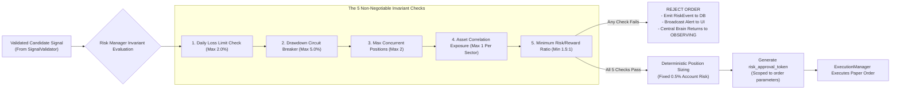

# NEPTUNE Risk Management & Capital Preservation Protocol

## Document Information
- **Project**: NEPTUNE — Autonomous Market Intelligence & Paper Trading Platform
- **Document Version**: 1.0.0
- **Status**: Approved / Institutional Mandate
- **Author**: Neptune Chief Risk Officer & Quantitative Risk Council
- **Date**: 2026-11-01

---

## 1. Governance Principle: The Sole Authorization Authority

In the NEPTUNE platform, **the Risk Manager is the sole and absolute authorization authority for order placement**.

No upstream specialist agent, strategy definition, or Central Brain state transition can issue or execute an order directly. The `ExecutionManager` will strictly reject and log any order submission that does not carry a cryptographically verified `risk_approval_token` issued directly by the `RiskManager`.



---

## 2. Default Paper Trading Parameters (Version 1.0)

NEPTUNE enforces conservative, institutional-style paper trading defaults designed for long-term survival:

| Parameter | Default Value | Hard Boundary Constraint | Description |
|---|---|---|---|
| **Initial Paper Capital** | `1000.00 USDT` | Min: $100$, Max: $100,000$ | Starting virtual account equity in USDT. |
| **Leverage Limit** | `1.0x` (No Leverage) | Strictly $1.0\times$ (Spot Only) | Zero borrowing; position size cannot exceed total equity. |
| **Max Concurrent Positions** | `2` | Max: $3$ | Maximum simultaneous active open positions. |
| **Risk Per Trade ($\text{risk\_pct}$)** | `0.5%` ($0.005$) | Min: $0.1\%$, Max: $1.0\%$ | Max percentage of current equity lost if stop loss is hit. |
| **Daily Loss Limit** | `2.0%` ($0.020$) | Min: $1.0\%$, Max: $3.0\%$ | Cumulative net daily loss threshold triggering trading pause. |
| **Max Drawdown Circuit Breaker** | `5.0%` ($0.050$) | Min: $2.0\%$, Max: $8.0\%$ | Peak-to-trough equity drop triggering global kill switch. |
| **Minimum Risk/Reward Ratio** | `1.5 : 1.0` | Min: $1.5$, Recommended: $2.0+$ | Ratio of potential profit to potential loss. |

---

## 3. Position Sizing Formula & Mathematical Model

Position sizing is mathematically coupled to the distance between the proposed entry price and the stop-loss level, ensuring that any individual stop-out never exceeds the exact risk allocation.

### 3.1 Mathematical Derivation
1. **Account Equity at Risk ($R_{\text{USDT}}$)**:
   $$R_{\text{USDT}} = E_{\text{current}} \cdot \text{risk\_pct}$$
   *Example*: With $E_{\text{current}} = 1000.00$ USDT and $\text{risk\_pct} = 0.005$ ($0.5\%$):
   $$R_{\text{USDT}} = 1000.00 \times 0.005 = 5.00 \text{ USDT}$$

2. **Per-Unit Stop Loss Distance ($\Delta P_{\text{stop}}$)**:
   $$\Delta P_{\text{stop}} = |P_{\text{entry}} - P_{\text{stop}}|$$
   *Example*: Entry $= 65,000.00$ USDT, Stop Loss $= 64,000.00$ USDT:
   $$\Delta P_{\text{stop}} = 65,000.00 - 64,000.00 = 1,000.00 \text{ USDT}$$

3. **Raw Position Size ($S_{\text{raw}}$)**:
   $$S_{\text{raw}} = \frac{R_{\text{USDT}}}{\Delta P_{\text{stop}}}$$
   *Example*:
   $$S_{\text{raw}} = \frac{5.00}{1,000.00} = 0.005 \text{ BTC}$$

4. **Nominal Position Value ($V_{\text{nominal}}$)**:
   $$V_{\text{nominal}} = S_{\text{raw}} \cdot P_{\text{entry}} = 0.005 \times 65,000.00 = 325.00 \text{ USDT}$$

5. **Spot Leverage Constraint (1.0x Cap)**:
   If $V_{\text{nominal}} > E_{\text{available\_margin}}$, size is capped at:
   $$S_{\text{capped}} = \frac{E_{\text{available\_margin}}}{P_{\text{entry}}}$$

6. **Precision & Lot Size Rounding**:
   The final size is truncated to the exchange's minimum lot size and step precision (e.g., 0.0001 BTC).

---

## 4. The 5 Pre-Order Risk Checks

Before any paper order can be authorized, the Risk Manager evaluates five explicit checks. If any check fails, the signal is rejected immediately.

### Check 1: Daily Loss Limit Check
- **Rule**: If realized losses plus unrealized losses incurred since 00:00:00 UTC exceed $2.0\%$ of starting daily equity, reject order.
- **Formula**:
  $$\frac{\text{Daily Realized PnL} + \sum \text{Unrealized PnL}}{E_{\text{day\_start}}} \le -0.020$$
- **Action on Violation**: Freeze all new order submissions until 00:00:00 UTC reset.

### Check 2: Drawdown Circuit Breaker Check
- **Rule**: If current equity has dropped $\ge 5.0\%$ from the all-time high-water mark ($E_{\text{peak}}$), reject order and engage system circuit breaker.
- **Formula**:
  $$\text{Drawdown} = \frac{E_{\text{peak}} - E_{\text{current}}}{E_{\text{peak}}} \ge 0.050$$
- **Action on Violation**: Transition platform into `CIRCUIT_BREAKER_ACTIVE` state. Disallow all new trading. Require explicit user override in Settings.

### Check 3: Max Concurrent Positions Check
- **Rule**: Count of currently open positions must be strictly $< 2$.
- **Action on Violation**: Reject signal with code `MAX_POSITIONS_REACHED`.

### Check 4: Asset Correlation Exposure Check
- **Rule**: Disallow opening two concurrent positions in highly correlated assets (e.g. BTC and ETH simultaneously if 30-day Pearson correlation $> 0.85$).
- **Action on Violation**: Reject secondary correlated signal with code `CORRELATION_EXPOSURE_LIMIT`.

### Check 5: Minimum Risk/Reward Ratio Check
- **Rule**: Potential reward must be at least $1.5\times$ potential risk.
- **Formula**:
  $$\text{R:R Ratio} = \frac{|P_{\text{target}} - P_{\text{entry}}|}{|P_{\text{entry}} - P_{\text{stop}}|} \ge 1.50$$
- **Action on Violation**: Reject signal with code `INSUFFICIENT_RR_RATIO`.

---

## 5. Kill Switch & Emergency Halt Behavior

The **Kill Switch** is NEPTUNE's supreme safety interlock. It can be triggered automatically by circuit breakers or manually by the user via the Command Center header.

### 5.1 Dual-Mode Kill Switch Protocol

The Kill Switch operates in two distinct operational modes:

#### Mode 1: `PAUSE_NEW_ORDERS` (Default Emergency Pause)
1. **Immediate Ingress Gate Locking**: All pending candidate signals and Brain state transitions are aborted.
2. **Cancellation of Pending Orders**: All open `LIMIT` or un-triggered orders are cancelled immediately in the SQLite ledger.
3. **Open Position Preservation Policy**:
   - Active open positions remain open and continue to be monitored by `POSITION_MONITORING` for hard bracket stop-loss and take-profit exits.
   - Prevents unnecessary slippage realization if the issue is purely operational or upstream.
4. **Broadcast Alert**: Dispatches a `CRITICAL` severity event to `/ws/system` notifying the dashboard.

#### Mode 2: `LIQUIDATE_ALL_AND_HALT` (Emergency Liquidation & System Shutdown)
1. **Immediate Ingress Gate Locking**: All pending candidate signals and Brain state transitions are aborted.
2. **Cancellation of Pending Orders**: All open `LIMIT` or un-triggered orders are cancelled immediately.
3. **Simulated Market Liquidation**:
   - Immediately generates market exit orders for every open paper position.
   - **Mandatory Execution Assumptions (Rules S-06, A-10)**: All liquidated fills MUST apply realistic paper execution assumptions:
     - Taker fee ($0.1\%$).
     - Slippage model ($0.05\%$ per side).
     - Actual bid/ask spread at liquidation timestamp.
   - Records full execution assumptions in `paper_orders` and `positions` tables with reason `EMERGENCY_KILL_SWITCH_LIQUIDATION`.
4. **Broadcast Alert**: Dispatches a `CRITICAL` severity event across all WebSocket channels.

---

## 6. Risk Event Logging & Audit Trail

Every evaluation by the Risk Manager is recorded in the append-only `risk_events` table:

```sql
INSERT INTO risk_events (
    event_id,
    signal_id,
    event_type,
    rule_name,
    metric_value,
    threshold_value,
    details_json,
    timestamp
) VALUES (
    'evt_risk_77192',
    'sig_btc_4401',
    'REJECTION',
    'DAILY_LOSS_LIMIT',
    -0.0215,
    -0.0200,
    '{"realized_today": -21.50, "starting_equity": 1000.0, "time_utc": "2026-11-01T14:40:00Z"}',
    1730472000000
);
```

- **Immutability**: Once written, risk event records cannot be updated or deleted by the application layer.
- **Telemetry**: Streamed live to the Command Center alerts feed and the System Monitoring console.
