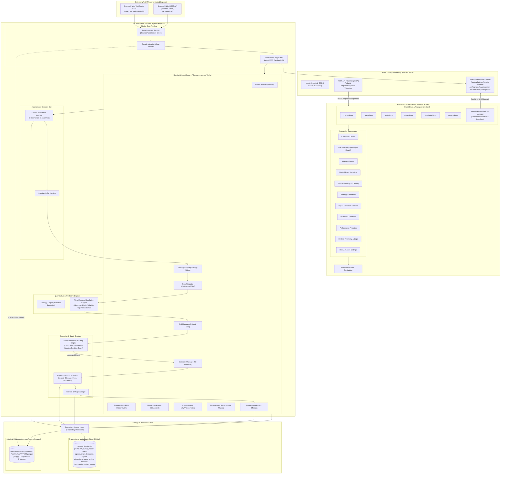
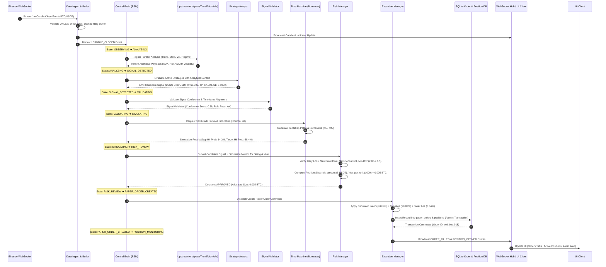
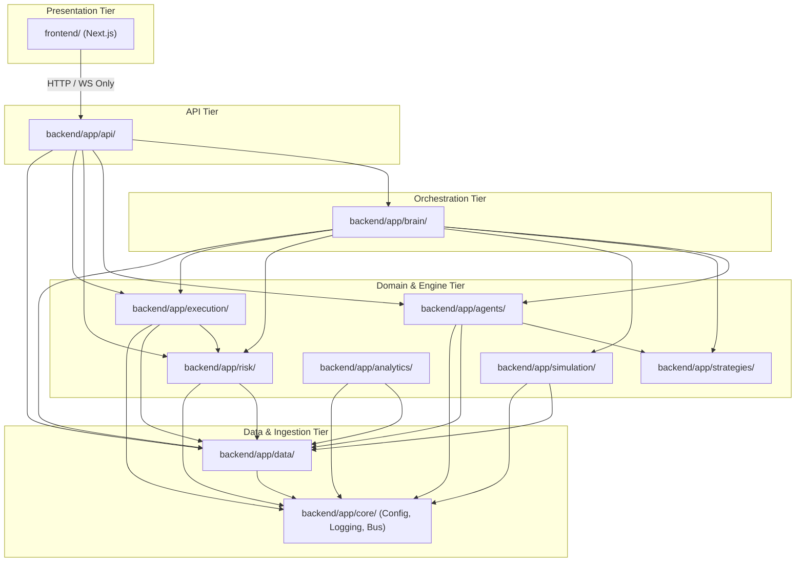
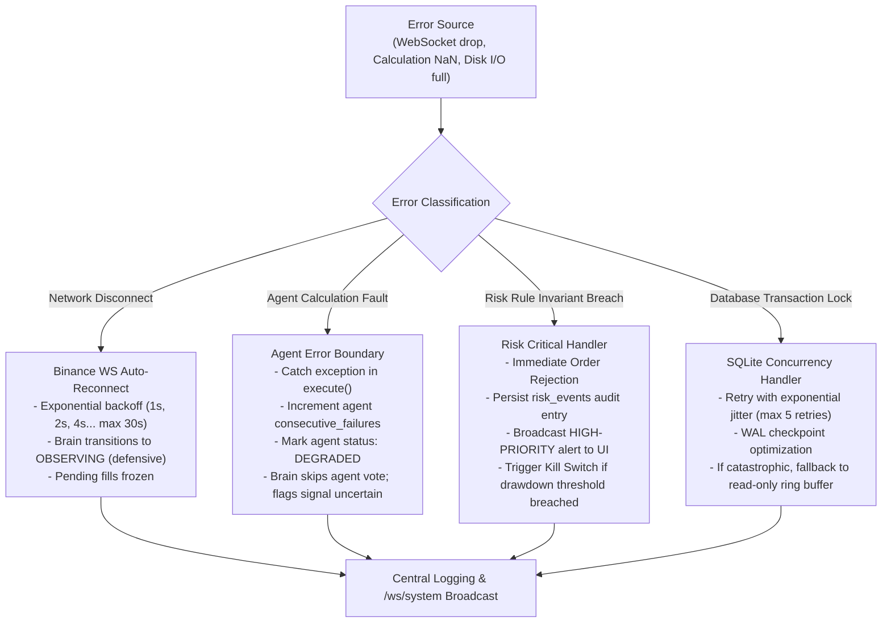

# NEPTUNE System Architecture

## Document Information
- **Project**: NEPTUNE — Autonomous Market Intelligence & Paper Trading Platform
- **Document Version**: 1.0.0
- **Status**: Approved / Architectural Blueprint
- **Author**: Neptune Principal Systems Architect
- **Date**: 2026-11-01

---

## 1. Architectural Overview & System Blueprint

NEPTUNE is engineered as a high-performance **modular monolith** optimized for low-latency market analysis, deterministic quantitative evaluation, and institutional-grade paper trading simulation. The platform decouples computation into clean horizontal layers while strictly enforcing unidirectional dependencies from external interfaces down to core storage models.

### 1.1 Complete Layered System Diagram

The following Mermaid flowchart models the complete end-to-end topology from external data ingress and the Next.js presentation tier down to transactional storage and columnar time-series archives.

---

## 2. Layered Architecture Description

The NEPTUNE architecture is structured into five distinct operational tiers:

### 2.1 Presentation Tier (Frontend Workstation)
- **Framework**: Next.js 14+ with App Router, React Server Components (RSC) for initial page layouts, and Client Components for high-frequency interactive canvases.
- **State Management**: Zustand split into isolated domain stores (`marketStore`, `agentStore`, `brainStore`, `paperStore`, `simulationStore`, `systemStore`).
- **Visualizations**: TradingView Lightweight Charts canvas engine for sub-millisecond price rendering; HTML5 Canvas and SVG for Monte Carlo fan charts and probability density functions.
- **Design Language**: Dark financial workstation palette (Navy `#0a0e1a`, Charcoal `#1a1f2e`, Electric Blue `#00b4d8`, Cyan `#00f5d4`, Emerald `#10b981`, Crimson `#ef4444`).

### 2.2 API & Transport Gateway Tier
- **Engine**: FastAPI running on Python's `uvicorn` ASGI server.
- **REST Endpoints**: Strict OpenAPI 3.1 documentation, asynchronous route handlers, dependency injection for services/repositories, and Pydantic v2 serialization.
- **WebSocket Hub**: Asynchronous pub/sub connection manager supporting dedicated topic channels with automatic connection tracking, ping-pong keepalives, and dropped connection cleanup.

### 2.3 Application & Orchestration Tier
- **Central Brain**: Finite State Machine driving the analytical lifecycle. Coordinates parallel agent dispatch, evaluates confidence confluences, and mediates transitions.
- **Event Bus**: Internal in-memory asynchronous event bus utilizing `asyncio.Queue` primitives to ensure non-blocking message passing between agents and pipelines.

### 2.4 Domain & Analytical Engines Tier
- **Specialist Agent Swarm**: 10 purpose-built agents running isolated execution logic. Each agent operates under typed schemas with strict timeout enforcement.
- **Time Machine (Forward Simulation Engine)**: Monte Carlo / Bootstrap vector simulator utilizing `numpy` for high-speed multi-path trajectory generation without GIL bottlenecks.
- **Risk Gatekeeper**: Pure deterministic verification engine. Enforces capital preservation invariants prior to any trade authorization.
- **Paper Execution Engine**: Market simulator computing fill prices, slippage as a function of liquidity/volatility, simulated exchange network latency, and taker fees.

### 2.5 Persistence & Storage Tier
- **Metadata & State (SQLite)**: Embeds SQLite 3 configured with Write-Ahead Logging (`WAL`), `synchronous = NORMAL`, and foreign key enforcement. Manages relational data, system audit logs, decisions, signals, and order states.
- **Historical Time-Series (Apache Parquet)**: Stores multi-year 1m/5m/15m/1h candle histories partitioned by `{symbol}/{timeframe}/YYYY/MM/`. Compressed with Snappy via `pyarrow`.

---

## 3. End-to-End Data Flow: Market Event to Paper Order

The primary pipeline transitions an inbound WebSocket market tick or closed candle into an executed paper trade through an immutable, auditable state progression.

---

## 4. Module Dependency Map & Architecture Invariants

To avoid circular dependencies, tight coupling, and "spaghetti" code, NEPTUNE enforces strict unidirectional dependency rules:

### 4.1 Architecture Invariants
1. **No Circular Imports**: `core` has zero dependencies on higher layers. `data` depends only on `core`. Domain engines (`simulation`, `risk`, `execution`) depend only on `data` and `core`.
2. **Brain as Master Coordinator**: Individual agents do **not** invoke other agents directly. All multi-agent sequencing is orchestrated through the Central Brain state machine or event subscriptions.
3. **Storage Abstraction**: Domain and application engines never execute raw SQL. All persistence is handled through typed abstract repository interfaces (`IMarketDataRepository`, `IOrderRepository`, `IPositionRepository`, `ISignalRepository`).
4. **Pure Risk Authority**: The `ExecutionManager` cannot execute any paper order without a cryptographically valid, signed approval token or internal authorization object issued exclusively by `RiskManager`.

---

## 5. Technology Stack Decisions & Rationale Summary

| Component | Selected Technology | Alternative Evaluated | Strategic Rationale |
|---|---|---|---|
| **Backend Framework** | **FastAPI (Python 3.11+)** | Django, Flask, Express | Native `asyncio` support for concurrent WebSocket feeds, automatic OpenAPI generation, Pydantic v2 performance, unified Python scientific ecosystem (`numpy`, `pandas`, `pyarrow`). |
| **Frontend Framework** | **Next.js 14+ (App Router)** | Vite + React SPA, Nuxt | Production-grade server component routing, built-in layout management, optimized hydration, native TypeScript support, unified developer tooling. |
| **Client State** | **Zustand** | Redux Toolkit, MobX, Context API | Minimal boilerplate, unopinionated sub-store architecture, exceptional performance under 60fps high-frequency WebSocket updates without unneeded re-renders. |
| **Transactional Storage** | **SQLite (WAL Mode)** | PostgreSQL, MySQL | Zero network latency, single-file embedded distribution, ACID compliant, capable of $> 50,000$ read operations/sec under Write-Ahead Logging with zero maintenance overhead. |
| **Time-Series Storage** | **Apache Parquet (PyArrow)** | InfluxDB, TimescaleDB, CSV | Columnar compression (typically 80-90% reduction vs CSV), blazing fast vectorized querying into Pandas/NumPy arrays, partitioned filesystem hierarchy. |
| **Charting Engine** | **TradingView Lightweight Charts** | Chart.js, D3.js, Highcharts | Canvas-based rendering optimized specifically for financial candlesticks, zero DOM bloat, native support for volume histograms, markers, and multi-pane sync. |
| **Styling & UI Kit** | **Tailwind CSS + Lucide Icons** | Material UI, Ant Design | Utility-first CSS compiling to zero runtime overhead, exact hex-code color consistency, high-density financial terminal ergonomics. |

---

## 6. Error Propagation & System Resilience Model

NEPTUNE implements a multi-tiered error containment model to prevent analytical faults or network anomalies from destabilizing the trading core.

### 6.1 Domain Error Hierarchy
- `NeptuneBaseException`: Base class for all internal errors.
  - `MarketDataError`: Gaps in candle series, stale ticks, malformed exchange JSON.
  - `AgentExecutionError`: Timeout during agent computation, mathematical singularities (division by zero, NaN in indicator).
  - `BrainStateError`: Illegal finite state machine transitions (e.g., attempting to execute an unvalidated signal).
  - `RiskViolationException`: Sizing overflow, drawdown circuit-breaker breach, daily loss cap reached.
  - `PaperExecutionError`: Invalid order parameters, insufficient virtual margin, slippage calculation failure.
  - `StorageError`: SQLite disk lock, Parquet serialization failure, repository integrity violation.

### 6.2 Degraded State Protocols
- When 2 or more specialist agents enter `DEGRADED` status, the Central Brain suspends all transitions to `SIGNAL_DETECTED` and locks the platform in `OBSERVING`.
- If WebSocket market feed latency exceeds 2000ms or drops for $> 3$ consecutive heartbeat intervals, all paper trading order creation is paused automatically until 60 seconds of contiguous, validated data is re-established.
