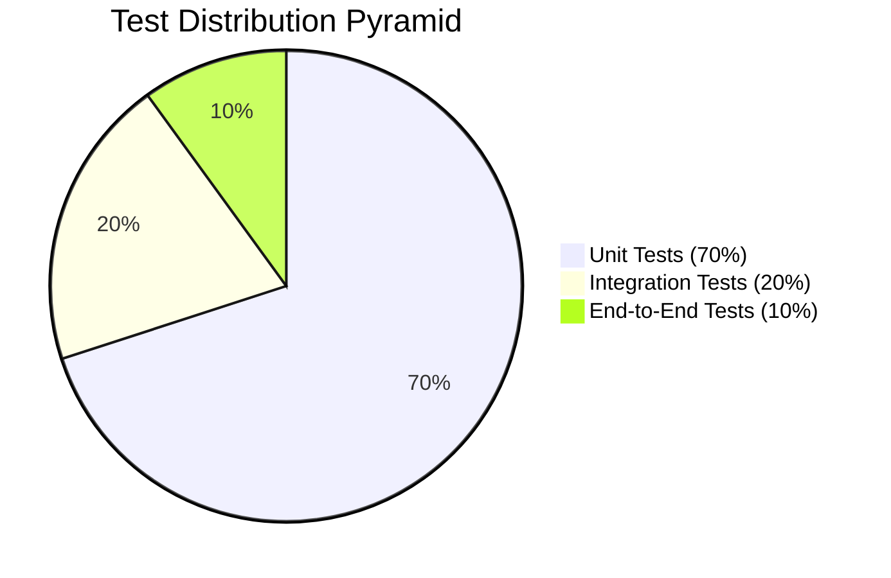
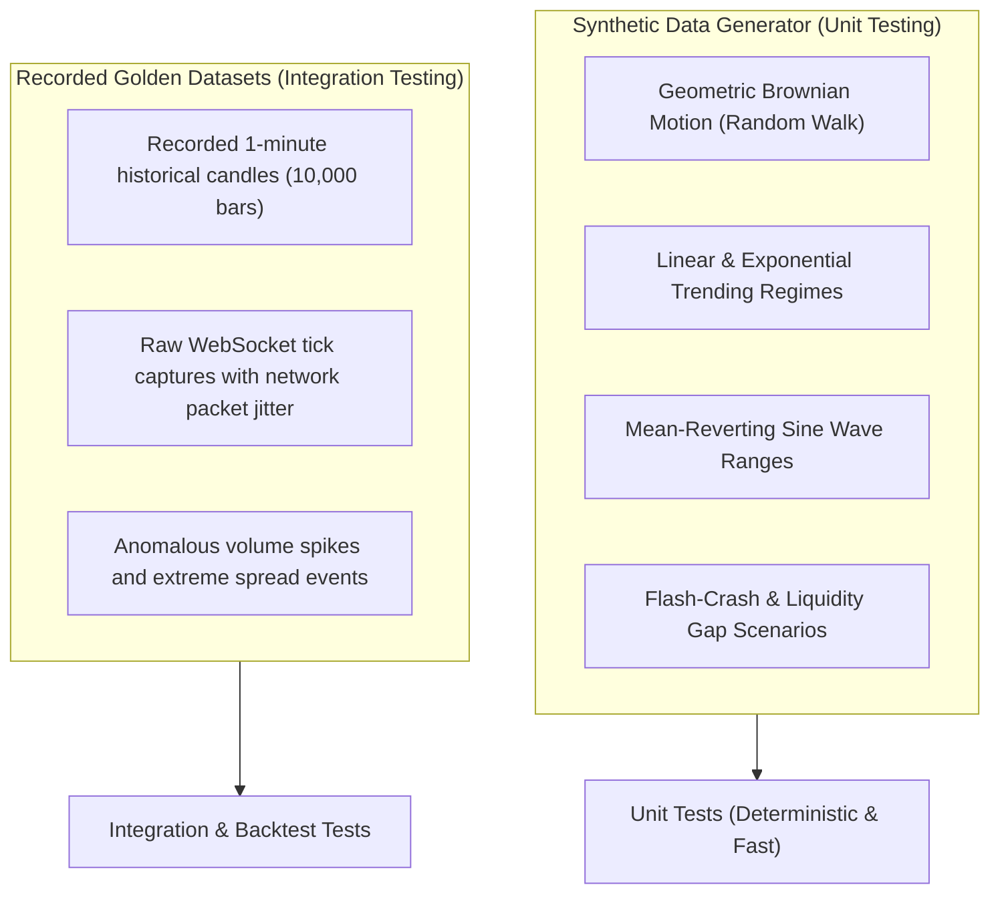

# NEPTUNE Quality Assurance & Testing Strategy

## Document Information
- **Project**: NEPTUNE — Autonomous Market Intelligence & Paper Trading Platform
- **Document Version**: 1.0.0
- **Status**: Approved / Quality Assurance Mandate
- **Author**: Neptune Head of Quality Engineering & Core Developers
- **Date**: 2026-11-01

---

## 1. Quality Philosophy & The Test Pyramid

In algorithmic and autonomous trading systems, software defects translate directly into simulated capital destruction or erroneous executions. NEPTUNE treats test-driven engineering not as an afterthought, but as a hard prerequisite for every module.

The system adheres strictly to the **70 / 20 / 10 Test Pyramid**:



1. **Unit Tests (70%)**: Pure mathematical routines, indicator logic, agent input/output schema validation, position sizing equations, risk rules, and state machine transitions in isolation.
2. **Integration Tests (20%)**: Multi-agent coordination, SQLite repository queries, Parquet file partitioning, REST endpoint request/response flows, and WebSocket broadcasting.
3. **End-to-End (E2E) Tests (10%)**: Full pipeline scenarios: Ingesting a synthetic tick sequence $\rightarrow$ Central Brain state progression $\rightarrow$ Time Machine simulation $\rightarrow$ Risk approval $\rightarrow$ Paper order execution $\rightarrow$ Position closure $\rightarrow$ Audit verification.

---

## 2. Test Frameworks & Tooling

### 2.1 Backend Testing Tooling (Python 3.11+)
- **Test Runner**: `pytest`
- **Async Test Support**: `pytest-asyncio` (strict mode with auto-event-loop scoping)
- **Coverage Profiler**: `pytest-cov`
- **Benchmarking**: `pytest-benchmark` (for latency budget verification)
- **Mocking**: `unittest.mock` for external network isolation

### 2.2 Frontend Testing Tooling (Next.js 14+)
- **Test Runner**: `vitest` (fast, native ESM support)
- **Component Testing**: `@testing-library/react` and `@testing-library/jest-dom`
- **Hook Testing**: `@testing-library/react-hooks`
- **Schema Validation**: Unit tests on Zod schemas against edge-case JSON payloads

---

## 3. Non-Negotiable Test Mandates

The following criteria are enforced as hard blocking conditions:

### 3.1 Monetary & PnL Accounting Test-First Rule
- **Mandate**: **All monetary calculations must have unit tests written and verified before the business logic is merged.**
- **Scope**:
  - Virtual balance increments/decrements.
  - Unrealized and realized PnL calculations for both Long and Short positions.
  - Taker fee ($0.04\%$) and maker fee ($0.02\%$) deductions.
  - Slippage modeling as a function of size and volatility.
  - Available margin, used margin, and leverage ratios.

### 3.2 100% Risk Check Coverage
- Every one of the 5 Risk Invariant Checks must be tested with exhaustive boundary conditions:
  - Exact boundary, boundary $- 1\epsilon$, boundary $+ 1\epsilon$.
  - Negative and zero capital inputs.
  - Sudden volatility spikes triggering circuit breakers.
  - Kill Switch engagement verifying immediate order rejection.

### 3.3 Agent Contract Enforcement
- Every specialist agent must have automated tests validating that:
  - It rejects invalid input payloads with strict validation errors.
  - Output conforms precisely to its declared Pydantic schema.
  - Timeout boundaries ($\le \text{budget}$) are enforced under load.
  - When an internal exception is raised, `on_error()` is invoked without bubbling uncaught exceptions to the Brain.

### 3.4 API Integration Coverage
- Every REST endpoint under `/api/v1/*` must have automated integration tests verifying both happy-path responses and malformed request error handling.
- Every WebSocket channel under `/ws/*` must have tests confirming envelope schema compliance and client connection cleanup.

---

## 4. Test Data Strategy

Testing cannot rely on unstable live exchange connections. NEPTUNE utilizes a two-tier test data infrastructure:



### 4.1 Synthetic Candle Generator Example
```python
import numpy as np
import pandas as pd

def generate_synthetic_candles(
    n_candles: int = 500,
    start_price: float = 65000.0,
    regime: str = "TRENDING_BULL",
    seed: int = 42
) -> pd.DataFrame:
    """Generates synthetic OHLCV candles with realistic wick and volume dynamics."""
    rng = np.random.default_rng(seed)
    
    if regime == "TRENDING_BULL":
        mu, sigma = 0.0005, 0.002
    elif regime == "CRASH":
        mu, sigma = -0.0020, 0.008
    else: # RANGING
        mu, sigma = 0.0000, 0.0015
        
    returns = rng.normal(mu, sigma, n_candles)
    prices = start_price * np.cumprod(1 + returns)
    
    # Construct realistic OHLCV
    highs = prices * (1 + rng.uniform(0.0005, 0.002, n_candles))
    lows = prices * (1 - rng.uniform(0.0005, 0.002, n_candles))
    opens = np.roll(prices, 1)
    opens[0] = start_price
    closes = prices
    volumes = rng.uniform(10.0, 150.0, n_candles)
    
    return pd.DataFrame({
        "open": opens, "high": highs, "low": lows, "close": closes, "volume": volumes
    })
```

---

## 5. Coverage Targets & CI Quality Gate

### 5.1 Minimum Coverage Requirements
- **Overall Codebase**: $\ge 80\%$ line and branch coverage.
- **`app/risk/` (Risk Module)**: **Strictly 100% line and branch coverage**.
- **`app/execution/` (Paper Execution & Accounting)**: **Strictly 100% line and branch coverage**.
- **`app/data/sqlite/` (Persistence Repositories)**: $\ge 90\%$ coverage.

### 5.2 Continuous Integration (CI) Quality Gates
All automated test workflows execute on pull request creation and prior to code merging:

1. **Gate 1: Static Analysis & Linting**:
   - `ruff check .` (Python)
   - `mypy --strict .` (Python type verification)
   - `npm run lint` & `npm run type-check` (TypeScript)
2. **Gate 2: Unit Test Suite**:
   - `pytest tests/unit --cov=app --cov-report=term-missing`
   - Must achieve required coverage with zero test failures.
3. **Gate 3: Integration Test Suite**:
   - `pytest tests/integration`
   - Verifies database migrations and repository contracts.
4. **Gate 4: Frontend Component Tests**:
   - `npm run test:unit` (Vitest)
   - Verifies UI rendering and Zustand store actions.
