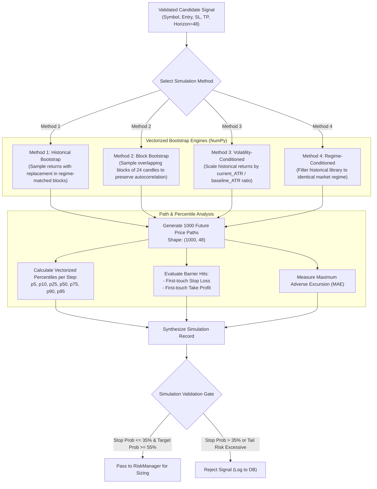

# NEPTUNE Time Machine — Forward Simulation Engine

## Document Information
- **Project**: NEPTUNE — Autonomous Market Intelligence & Paper Trading Platform
- **Document Version**: 1.0.0
- **Status**: Approved / Technical Specification
- **Author**: Neptune Lead Quantitative Research Engineer
- **Date**: 2026-11-01

---

## 1. Executive Summary & Philosophy

The **Time Machine** is NEPTUNE's forward stochastic simulation engine. Before any candidate signal can be submitted to the Risk Manager for order allocation, it must pass through rigorous multi-path forward trajectory modeling.

Rather than relying on naive geometric Brownian motion (which incorrectly assumes normal distributions, constant variance, and zero autocorrelation), the Time Machine uses empirical bootstrap methods calibrated directly on cryptocurrency market data.

The engine projects **1,000 synthetic future price paths** over a configurable forward horizon (typically 12 to 96 candles, default 48). It evaluates the path-dependent likelihood of reaching the proposed take-profit target before triggering the stop-loss level, measures tail risk, and calculates the median Maximum Adverse Excursion (MAE).

---

## 2. Simulation Engine Architecture & Flow



---

## 3. Four Core Simulation Methods

### 3.1 Method 1: Historical Bootstrap
- **Mechanism**: Draws empirical 15-minute log returns from the historical Parquet pool with replacement.
- **Formulation**:
  $$R_t = \ln\left(\frac{P_t}{P_{t-1}}\right)$$
  For each synthetic path $i \in [1, 1000]$ and step $k \in [1, H]$:
  $$P_{i, k} = P_{\text{entry}} \cdot \exp\left(\sum_{j=1}^k R^*_{i, j}\right)$$
  where $R^*_{i, j} \sim \text{Uniform}(\{R_{\text{historical}}\})$.
- **Best Used For**: Broad baseline distributions when regime stability is moderate.

### 3.2 Method 2: Block Bootstrap (Circular Block Bootstrap)
- **Mechanism**: Preserves short-term autocorrelation, volatility clustering, and momentum memory by sampling contiguous blocks of historical candles (block length $L = 24$ candles, representing 6 hours on 15m).
- **Formulation**:
  Samples starting index $s \sim \text{Uniform}(1, N - L + 1)$ and copies the unbroken return sequence $[R_s, R_{s+1}, \dots, R_{s+L-1}]$.
- **Best Used For**: Trending or persistent momentum setups where candle returns exhibit non-zero serial autocorrelation.

### 3.3 Method 3: Volatility-Conditioned Bootstrap
- **Mechanism**: Dynamically scales historical return distributions by the ratio of current instantaneous volatility to historical baseline volatility:
  $$\sigma_{\text{ratio}} = \frac{\text{ATR}_{14}(t)}{\text{ATR}_{\text{baseline}}}$$
  $$R^*_{\text{conditioned}} = R^*_{\text{historical}} \cdot \sigma_{\text{ratio}}$$
- **Best Used For**: Volatility breakouts or periods immediately following major market compression (e.g., Bollinger Band squeezes).

### 3.4 Method 4: Regime-Conditioned Bootstrap
- **Mechanism**: Restricts the historical return sampling pool strictly to historical periods where the market exhibited the same regime classification (e.g., only pulling from past `TRENDING_BULL` or `HIGH_VOLATILITY` periods as identified by `MarketScanner`).
- **Best Used For**: Highly specific regime-driven strategies (e.g., mean-reversion in sideways ranging markets).

---

## 4. Simulation Record Schema

Every completed simulation is assigned an immutable record stored in SQLite:

```python
class TimeMachineSimulationRecord(BaseModel):
    simulation_id: str                   # UUIDv4 (e.g., "sim_8f1e2c90...")
    signal_id: str                       # References candidate signal
    symbol: str                          # e.g., "BTCUSDT"
    timeframe: str                       # e.g., "15m"
    created_at: int                      # Unix epoch milliseconds (UTC)
    seed: int                            # 64-bit integer seed for 100% reproducibility
    model_version: str                   # e.g., "v1.0.4-bootstrap"
    method: str                          # "HISTORICAL_BOOTSTRAP", "BLOCK_BOOTSTRAP", etc.
    horizon_candles: int                 # e.g., 48 (12 hours on 15m)
    num_paths: int                       # Strictly 1000
    entry_price: float                   # e.g., 65000.0
    
    # Vectorized Percentiles across paths at horizon terminal step
    p5: float
    p10: float
    p25: float
    p50: float                           # Median projected terminal price
    p75: float
    p90: float
    p95: float
    
    # Path-Dependent Barrier Metrics
    stop_hit_probability: float          # Fraction of paths touching Stop Loss before Target
    target_hit_probability: float        # Fraction of paths touching Take Profit before Stop
    max_adverse_excursion_median: float  # Median maximum adverse price deviation
    assumptions_json: str                # Serialized JSON of ATR ratio, block size, etc.
```

---

## 5. Seed-Based Reproducibility Guarantee

A central architectural mandate of NEPTUNE is **absolute audit reproducibility**. Any historical simulation must be regenerable with zero floating-point drift.

```python
import numpy as np

def run_simulation(seed: int, returns_pool: np.ndarray, horizon: int = 48, num_paths: int = 1000) -> np.ndarray:
    """
    Guaranteed deterministic simulation using NumPy's Generator.
    Given the identical seed and returns_pool, output is bit-for-bit identical.
    """
    rng = np.random.default_rng(seed)
    # Randomly draw return indices with replacement
    sampled_indices = rng.integers(0, len(returns_pool), size=(num_paths, horizon))
    sampled_returns = returns_pool[sampled_indices]
    
    # Cumulative return paths
    cumulative_paths = np.cumprod(1.0 + sampled_returns, axis=1)
    return cumulative_paths
```

- **Seed Generation**: Deterministically derived from `hash(signal_id + str(candle_timestamp)) % (2**63 - 1)`.
- **Auditing**: Re-running the simulation endpoint with the recorded seed reproduces the exact fan chart and percentile numbers.

---

## 6. Time Machine UI Visual Specifications

The Time Machine frontend section (`/time-machine`) provides an interactive quantitative visualization suite:

1. **The "Cone of Uncertainty" Fan Chart**:
   - Renders 1,000 paths as aggregated shaded confidence bands:
     - Outer band ($p5 - p95$): Translucent electric blue ($10\%$ opacity)
     - Interquartile band ($p25 - p75$): Moderately dense electric blue ($25\%$ opacity)
     - Center line ($p50$): Crisp cyan dashed line (`#00f5d4`)
   - Static horizontal reference lines:
     - Entry price: Solid white line (`#ffffff`)
     - Take Profit: Solid emerald green line (`#10b981`)
     - Stop Loss: Solid crimson red line (`#ef4444`)
2. **Terminal Return Probability Density Function (PDF)**:
   - Kernel density estimation or 30-bin histogram displaying the terminal distribution at step $H$.
3. **Barrier Outcome Gauges**:
   - Circular progress ring showing `Target Hit Probability` vs. `Stop Hit Probability`.
4. **Interactive Path Scrubber**:
   - Allows scrubbing horizontally along the horizon to inspect percentiles at candle step $k \in [1, 48]$.
