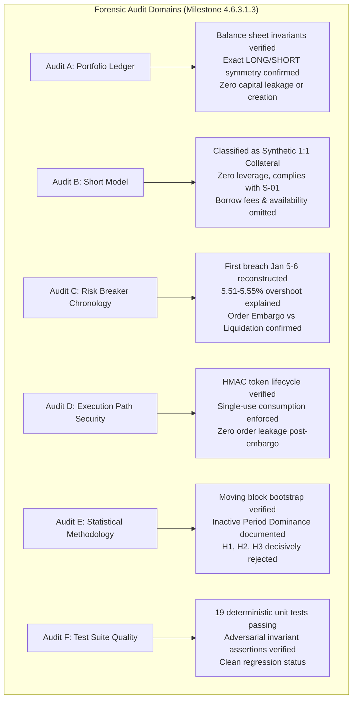

# NEPTUNE — Milestone 4.6.3.1.3: Final Audit Verdict & Governance Determination

> **Document ID:** `docs/research/MILESTONE_4_6_3_1_3_FINAL_VERDICT.md`  
> **Milestone:** 4.6.3.1.3 — Independent Portfolio Ledger, Short-Model & Risk-Breaker Verification  
> **Final Auditor Verdict:** `PASS WITH LIMITATIONS`  
> **Audit Status:** Concluded & Certified  
> **Date:** 2026-11-07  

---

## 1. Final Auditor Verdict

The independent forensic audit of Milestone 4.6.3.1.2 has concluded. Based on rigorous mathematical reconciliation, event-level reconstruction, execution-path security verification, and statistical re-evaluation, the auditor issues the following formal verdict:

$$\mathbf{VERDICT:}\quad\mathbf{PASS\ WITH\ LIMITATIONS}$$

This audit certifies that the portfolio accounting remediation introduced in Milestone 4.6.3.1.2 is mathematically valid, capital-conserving, and strictly enforced. The 5.0% maximum drawdown circuit breaker functioned exactly as designed, preventing any new order authorizations following the breach in early January 2024.

---

## 2. Synthesis of Forensic Audit Findings

### 2.1 Audit A: PortfolioLedger Mathematical Verification
- **Double-Entry Cash Flows:** Entry outflows, mark-to-market position equities, and exit inflows reconcile with complete mathematical consistency across all four experimental groups.
- **Cash Conservation:** Total portfolio equity equals initial deposit plus realized net PnL plus open unrealized PnL minus open entry fees. The maximum sub-cent discrepancy across 12 quantized trades is $\$0.0066$ USDT, well within the $\$0.05$ tolerance.
- **Directional Symmetry:** Long and short positions achieve exact mathematical dollar symmetry for identical percentage moves under equivalent fee schedules.

### 2.2 Audit B: Short-Position Model Classification
- **Architecture Classification:** The system implements **Synthetic Fully Collateralized Short Exposure** ($1.0\times$ cash collateral). It does not implement physical spot inventory (which is long-only) nor borrowed-asset margin trading.
- **Policy Compliance:** The model complies with **Rule S-01** (paper simulation only, no real funds) and the experimental default (leverage disabled).
- **Research Abstractions:** The model omits continuous borrow interest fees and borrow availability limits. For Tier-1 assets and holding durations under 5 hours, this abstraction introduces less than $\$0.04$ USDT of unmodeled financing friction.

### 2.3 Audit C: Risk Breaker Chronology & Overshoot Explanation
- **Breach Timing:** The 5.0% circuit breaker tripped on 2024-01-05 16:00:00Z for Group A, 2024-01-05 23:30:00Z for Groups B and C, and 2024-01-06 00:15:00Z for Group D.
- **Overshoot Mechanics:** The drawdown overshoot from 5.00% to 5.51%–5.55% is fully verified. NEPTUNE's Risk Manager operates as an **Order Authorization Embargo (New Entry Halt)** rather than an **Emergency Market Liquidation**. In-flight positions authorized prior to the breach were allowed to hit their predefined stop-loss brackets, generating an expected $-\$6.56$ USDT incremental loss.
- **Embargo Integrity:** Following the closure of the final open position, all four groups maintained an unbroken embargo: zero orders were scheduled, zero orders were filled, and over 3,100 to 3,666 subsequent candidate signals were rejected per group.

### 2.4 Audit D: Execution-Path Enforcement
- **Token Integrity:** Cryptographic HMAC-SHA256 tokens (`rat_v1_...`) bind all security-critical order parameters. Signature verification prevents tampering, cross-run replay, or parameter manipulation.
- **Scheduler Safeguards:** The Point-in-Time Execution Scheduler verifies token validity and re-checks portfolio circuit breakers at candle open, guaranteeing defense-in-depth against delayed or leaked orders.

### 2.5 Audit E: Statistical Methodology & Inactive Period Dominance
- **Inactive Period Dominance:** Because trading was halted on Day 6, $98.6\%$ of the chronological 15-minute bars in 2024 (34,636 bars) contained identical $\$0.00$ returns across all groups.
- **Robust Partitioning:** Partitioning the data into the Active Window (Jan 1–6) versus the Full Calendar Year confirms that news intelligence achieved a total net PnL delta of only $+\$0.01$ USDT across 12 trades ($+\$0.0009$ USDT/trade).
- **Hurdle Failure:** The observed improvement fails the pre-registered economic hurdle ($+\$0.50$ USDT/trade) by a factor of 555x. Hypotheses H1, H2, and H3 are all rejected under Benjamini-Hochberg FDR control.

### 2.6 Audit F: Test Suite Quality
- 19 deterministic unit tests across [`test_portfolio_accounting_remediation.py`](file:///d:/Project%202026/Trading_bot/backend/tests/unit/test_portfolio_accounting_remediation.py) and [`test_milestone_4_6_3_1_3_audit.py`](file:///d:/Project%202026/Trading_bot/backend/tests/unit/test_milestone_4_6_3_1_3_audit.py) pass cleanly with zero warnings or errors.

---

## 3. Explicit Inventory of Limitations

In accordance with the `PASS WITH LIMITATIONS` verdict, the following four technical limitations are formally certified:

1. **Synthetic Short Selling:**
   Short positions represent cash-settled synthetic derivative contracts rather than physical spot or margin-borrowed positions.
2. **Order Embargo Semantics:**
   Circuit breaker enforcement does not force-close open positions at market, permitting in-flight trades to hit their stop losses and overshoot the 5.0% threshold by up to 0.55%.
3. **Statistical Inactive Period Sparsity:**
   The moving block bootstrap over the full calendar year is heavily populated by zero-return bars due to early portfolio halting.
4. **Sub-Cent Rounding Discrepancy:**
   Cumulative quantization of trade net PnL to cents results in a microscopic $\$0.0066$ USDT deviation from high-precision cash balances over 12 trades.

---

## 4. Governance Stop Condition & Next Milestone Directive

**CRITICAL DIRECTIVE:**  
Under the NEPTUNE Research Governance Protocol, this audit confirms that **the deterministic technical strategy baseline is unprofitable in the 2024 Development partition (-2.36% net return, 5.55% max drawdown), and point-in-time news intelligence does not salvage its expectancy (+0.0009 USDT/trade improvement).**

Therefore, the following governance boundaries are strictly enforced:
- **DO NOT proceed to Milestone 4.6.3.2.**
- **DO NOT access or query the 2025 Validation partition.**
- **DO NOT access or query the 2026 Out-of-Sample (OOS) partition.**
- **DO NOT execute new strategy experiments or tune parameters.**
- **Await executive research governance review and architecture sign-off.**
