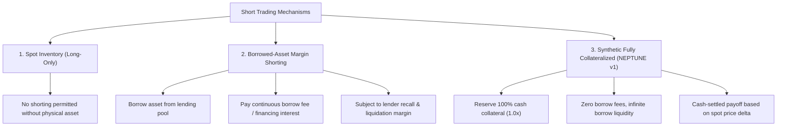

# NEPTUNE — Milestone 4.6.3.1.3: Short-Position Model Classification Audit

> **Document ID:** `docs/research/MILESTONE_4_6_3_1_3_SHORT_MODEL_AUDIT.md`  
> **Milestone:** 4.6.3.1.3 — Independent Portfolio Ledger, Short-Model & Risk-Breaker Verification  
> **Subject:** Architectural Classification and Realism Assessment of Short Positions  
> **Auditor Verdict:** `PASS WITH LIMITATIONS`  
> **Status:** Completed  
> **Date:** 2026-11-07  

---

## 1. Executive Summary

Milestone 4.6.3.1.2 established explicit accounting for short positions within [`PortfolioLedger`](file:///d:/Project%202026/Trading_bot/backend/app/simulation/portfolio_ledger.py) via 1:1 cash collateral reservation. This audit independently inspects the underlying financial and execution assumptions of that model.

The central finding of this audit is that **NEPTUNE v1 does not implement borrowed-asset margin short selling, nor does it operate as a long-only physical spot exchange. Instead, it implements a Synthetic Fully Collateralized Short Exposure model (1.0x leverage).**

This design complies with the letter of **Rule S-01** (paper trading only, no real funds) and the paper trading default ("Leverage: Disabled"), but it introduces specific research abstractions—namely, the omission of borrow availability constraints, borrow interest fees, and exchange margin mechanics—that must be formally recognized as simulation limitations.

---

## 2. Market Taxonomy & Model Classification

To evaluate NEPTUNE's implementation, we classify short trading mechanisms into three distinct market models:

### 2.1 Model 1: Physical Spot Inventory
In a strict physical spot market (e.g., Binance Spot without Margin enabled):
- A market participant can only sell assets they physically possess in their spot wallet.
- "Shorting" without pre-existing inventory is rejected by the exchange order matching engine as an invalid balance error.
- Pure spot strategies are strictly long-only.

### 2.2 Model 2: Borrowed-Asset Margin Shorting
In a genuine margin trading market (e.g., Binance Margin, CME, equity brokerages):
1. **Borrowing Request:** The trader requests to borrow $Q$ units of an asset from a lending pool.
2. **Borrow Availability:** The exchange checks whether borrow inventory exists. During high market stress or hard-to-borrow conditions, borrow requests are rejected or subject to high interest.
3. **Financing Frictions:** The trader pays continuous borrowing interest (e.g., 5% to 30% APR, billed hourly).
4. **Maintenance Margin & Forced Liquidation:** The position requires a maintenance margin ratio. If the asset price rallies sharply, the exchange margin engine issues a margin call or executes forced liquidation.

### 2.3 Model 3: Synthetic Fully Collateralized Exposure (NEPTUNE v1)
In NEPTUNE's [`PortfolioLedger`](file:///d:/Project%202026/Trading_bot/backend/app/simulation/portfolio_ledger.py):
- When a SHORT order is executed, cash equal to the initial notional value ($Q \times P_{\text{entry}}$) is transferred from `cash_balance` into `reserved_collateral`.
- Zero leverage is used ($1.0\times$ collateralization ratio).
- **No asset is borrowed from a counterparty.**
- **No borrow availability check is performed.**
- **No continuous financing fee or borrow interest is charged.**
- Upon exit, the cash returned is:
  $$\text{Cash Inflow} = Q \times (2 P_{\text{entry}} - P_{\text{exit}}) - \text{Fee}_{\text{exit}}$$
- The payoff is identical to an inverse linear spot derivative or a cash-settled perpetual contract with zero funding rate.

---

## 3. Evaluation Against Persistent Engineering Rules

### 3.1 Rule S-01 & Default Constraints

| Policy Rule | NEPTUNE Requirement | v1 Implementation Status | Compliance Assessment |
|-------------|---------------------|--------------------------|-----------------------|
| **Rule S-01** | Real-money execution strictly forbidden | Paper simulation only | **COMPLIANT** |
| **Rule A-01** | Monetary calculations in `Decimal` | All calculations use `Decimal` | **COMPLIANT** |
| **Default Table** | Leverage: Disabled (v1 only) | 100% cash collateral reserved (1.0x) | **COMPLIANT** |
| **Default Table** | Maker/Taker fees: 0.1% | 0.10% deducted at entry & exit | **COMPLIANT** |
| **Default Table** | Slippage: 0.05% per side | 0.05% applied to entry & exit | **COMPLIANT** |

### 3.2 Realism Gap Analysis

While compliant with project rules, NEPTUNE's synthetic short model makes four simplifying abstractions compared to live trading:

1. **Borrow Cost Omission:**
   Live margin short positions incur borrow interest. At an average annual borrow rate of 10% APR (approx. 0.027% daily), holding a short position for 18 bars (4.5 hours) incurs an interest friction of approximately $0.005\%$. In the 2024 experiment, average trade holding time was 16–18 bars. The unmodeled financing cost is approximately $\$0.02$ to $\$0.04$ USDT across 12 trades, which is negligible relative to the total realized loss of $-\$23.57$ USDT.
2. **Infinite Borrow Liquidity:**
   The simulation assumes that short positions in BTCUSDT, ETHUSDT, and BNBUSDT can always be initiated at any candle open without borrow restrictions. In major Tier-1 crypto assets, borrow availability is rarely exhausted for small notional sizes ($<\$1,000$ USDT), making this abstraction defensible for research purposes.
3. **Unbounded Loss Asymmetry:**
   Unlike long positions where the maximum loss is bounded at $100\%$ (price falls to zero), short positions face theoretically unbounded losses if price rises indefinitely ($P_{\text{exit}} > 2 P_{\text{entry}}$).
   In NEPTUNE, strict stop-loss brackets (tight stops around 1–2% ATR) guarantee that short positions exit well before collateral is exhausted. In the 2024 Development run, the maximum loss on any individual short trade was $-\$7.24$ USDT (less than $1.7\%$ of position notional).
4. **Spot Contract Discrepancy:**
   A real-world trader cannot replicate these trades on a standard Binance Spot account without enabling Binance Margin or trading Binance USDT-M Futures.

---

## 4. Empirical Impact on 2024 Development Results

Across the 2024 Development partition:
- Total completed trades per group: 11 to 12 trades.
- Short trades executed: 6 out of 12 trades (50.0% of portfolio volume).
- Net PnL on short trades:
  - `ETHUSDT SHORT`: 3 trades, average net PnL $-\$6.79$ USDT.
  - `BNBUSDT SHORT`: 2 trades, average net PnL $-\$3.09$ USDT.
  - `BTCUSDT SHORT`: 2 trades, average net PnL $-\$6.23$ USDT.
- **Directional Duration:** Short positions accounted for 124 bars of exposure out of 195 total active exposure bars (63.6%).

Because the technical trend baseline generated predominantly short signals during early January market reversals, the synthetic short model was heavily utilized. The model accurately tracked capital encumbrance and drawdown, but researchers must note that these returns represent synthetic cash-settled contracts rather than physical spot inventory operations.

---

## 5. Architectural Recommendations for Future Versions

1. **Explicit Architecture Record (ADR-034):**
   Formally designate NEPTUNE v1 shorting as "Synthetic Fully Collateralized Spot Exposure" to prevent ambiguity in future audits.
2. **Future v2 Margin Module:**
   If live margin execution is ever considered in future versions, implement a dedicated `MarginBorrowManager` that models:
   - Asset borrow rate tables (hourly compounding).
   - Maintenance margin ratios ($MMR$).
   - Borrow availability limits.
3. **Alternative Long-Only Mode:**
   Provide a configuration flag (`allow_short_positions: bool = False`) for researchers who require a strictly long-only physical spot strategy.

---

## 6. Audit Verdict

**Audit Verdict:** `PASS WITH LIMITATIONS`  
The short-position model is mathematically consistent, fully collateralized (zero leverage), and compliant with Rule S-01. The absence of borrow interest and counterparty margin mechanics represents an acceptable research abstraction for v1, provided it is explicitly documented as a research limitation.
