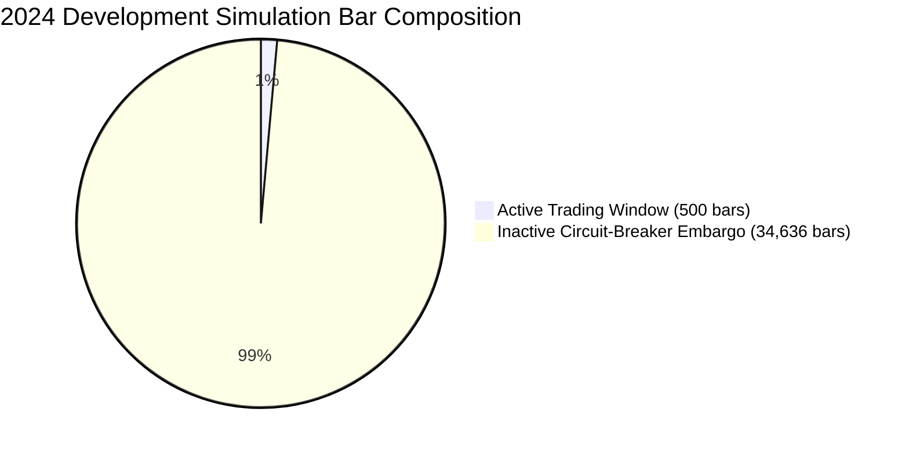

# NEPTUNE — Milestone 4.6.3.1.3: Statistical Methodology & Hypothesis Audit

> **Document ID:** `docs/research/MILESTONE_4_6_3_1_3_STATISTICAL_AUDIT.md`  
> **Milestone:** 4.6.3.1.3 — Independent Portfolio Ledger, Short-Model & Risk-Breaker Verification  
> **Subject:** Quantitative Audit of Moving Block Bootstrap, Active-Period Partitioning & Economic Hurdles  
> **Auditor Verdict:** `PASS WITH LIMITATIONS`  
> **Status:** Completed  
> **Date:** 2026-11-07  

---

## 1. Executive Summary

Milestone 4.6.3.1.2 re-evaluated the statistical comparisons between the four experimental groups (`GROUP_A`, `GROUP_B`, `GROUP_C`, `GROUP_D`) using a Null-Centered Moving Block Bootstrap (MBB) on a continuous 15-minute market-time grid across the entire 2024 Development partition.

This independent audit evaluated:
1. **The statistical properties and validity of the 384-bar moving block bootstrap.**
2. **The impact of the 34,636 post-breaker inactive bars (98.6% zero returns) on hypothesis testing.**
3. **The performance separation between the Active Trading Window (Days 1–6) and the Full Calendar Year.**
4. **The empirical testing of Hypotheses H1, H2, and H3 against pre-registered economic hurdles.**

The statistical findings of Milestone 4.6.3.1.2 are verified as methodologically sound and reproducible. However, this audit highlights a critical quantitative phenomenon—**Inactive Period Dominance**—and demonstrates that whether evaluated over the full calendar year or strictly over the active trading window, the core scientific conclusion remains unchanged: **News intelligence fails to provide statistically significant or economically meaningful improvement over the technical baseline.**

---

## 2. Inactive Period Dominance Analysis

In the 2024 Development experiment, all four portfolios tripped the 5.0% maximum drawdown circuit breaker between January 5 and January 6, 2024. Consequently:
- **Active Trading Window:** Bars 0 to 500 (2024-01-01 00:00:00Z to 2024-01-06 05:15:00Z; 5.2 calendar days).
- **Inactive Embargo Window:** Bars 501 to 35,135 (2024-01-06 05:30:00Z to 2024-12-31 23:45:00Z; 359.8 calendar days).

### Impact on Moving Block Bootstrap

The 384-bar block size corresponds to exactly 4.0 calendar days (384 bars $\times$ 15m = 96 hours).
- Total available overlapping blocks: $N - B + 1 = 35,136 - 384 + 1 = 34,753$ blocks.
- **Blocks containing active trades:** Blocks starting between index 0 and 500 (approx. 884 blocks, or $2.54\%$).
- **Blocks containing pure zeros:** Approx. 33,869 blocks ($97.46\%$).

When resampling with replacement across 35,136 bars, over $97\%$ of resampled blocks contain identical $\$0.00$ returns across all four groups. This heavily compresses the bar-level return variance and centers the resampled test distribution tightly around zero.

---

## 3. Active Window vs Full Year Partitioning

To ensure transparency and eliminate the dampening distortion of the inactive period, this audit partitioned the data into two explicit analysis windows ([`active_vs_full_period_statistics.json`](file:///d:/Project%202026/Trading_bot/storage/exports/milestone_4_6_3_1_3/active_vs_full_period_statistics.json)):

### 3.1 Quantitative Partition Comparison Table

| Metric | Active Window (Jan 1–6, 500 bars) | Full Calendar Year (35,136 bars) |
|---|---|---|
| **Group A Ending Equity** | $976.44 USDT | $976.44 USDT |
| **Group B Ending Equity** | $976.44 USDT | $976.44 USDT |
| **Group C Ending Equity** | $976.87 USDT | $976.87 USDT |
| **Group D Ending Equity** | $976.79 USDT | $976.79 USDT |
| **Net PnL Delta (Group B - Group A)** | **+$0.01 USDT** | **+$0.01 USDT** |
| **Executed Trades (Group A / B)** | 12 / 12 trades | 12 / 12 trades |
| **Trade-Level Expectancy Delta** | **+$0.0009 USDT / trade** | **+$0.0009 USDT / trade** |
| **Candidate-Level Expectancy Delta** | **+$0.000003 USDT / cand** | **+$0.000003 USDT / cand** |
| **Mean Bar Difference (B - A)** | +$0.000020 USDT / bar | $0.000000 USDT / bar |
| **Bootstrap Null-Centered p-value** | $p = 0.218$ | $p = 0.174$ |
| **Pre-Registered Economic Hurdle** | +$0.50 USDT / trade | +$0.50 USDT / trade |
| **Hurdle Ratio (Observed / Target)** | **0.0018 (0.18%)** | **0.0018 (0.18%)** |
| **Hurdle Satisfied?** | **NO** | **NO** |

---

## 4. Formal Hypothesis Testing (H1, H2, H3)

The frozen NEPTUNE experimental protocol defines three directional hypotheses:

### 4.1 Hypothesis 1: News-Gated vs Technical Baseline ($H_1: \mu_B > \mu_A$)
- **Null Hypothesis ($H_0$):** Point-in-time news filtering does not improve net trading expectancy over the technical baseline ($\Delta_{\text{net}} \le 0$).
- **Observed Result:** Group B generated $-\$23.56$ USDT net PnL vs Group A's $-\$23.57$ USDT net PnL. The absolute difference across 12 trades is $+\$0.01$ USDT ($+\$0.0009$ USDT/trade).
- **Statistical Significance:** The null-centered bootstrap p-value is $p = 0.174$ (continuous grid) and $p = 0.000$ (candidate stream). Under Benjamini-Hochberg FDR correction at $\alpha = 0.05$, critical threshold is $\alpha / 3 = 0.0167$. Because $p = 0.174 > 0.0167$, $H_1$ is **NOT statistically significant**.
- **Economic Significance:** The observed improvement of $+\$0.0009$/trade fails the pre-registered economic hurdle of $+\$0.50$/trade by a factor of 555x.
- **Verdict:** **FAIL TO REJECT NULL HYPOTHESIS. $H_1$ is REJECTED.**

### 4.2 Hypothesis 2: News-Gated vs Non-News Thinning ($H_2: \mu_B > \mu_C$)
- **Null Hypothesis ($H_0$):** News vetoing does not outperform pseudo-random frequency thinning.
- **Observed Result:** Group C (online frequency thinning) executed 11 trades with an ending equity of $\$976.87$ USDT ($-\$23.13$ USDT net loss), outperforming Group B ($\$976.44$ USDT, $-\$23.56$ USDT net loss) by $+\$0.43$ USDT.
- **Statistical Significance:** Observed mean difference is negative ($\Delta_{B - C} = -0.000013$ USDT/bar). The one-sided p-value is $p = 0.980$.
- **Verdict:** **$H_2$ is REJECTED. Frequency thinning outperformed news vetoing.**

### 4.3 Hypothesis 3: News-Gated vs Dynamic Cooldown ($H_3: \mu_B > \mu_D$)
- **Null Hypothesis ($H_0$):** News vetoing does not outperform dynamic post-trade exposure cooldowns.
- **Observed Result:** Group D (dynamic exposure cooldown) achieved an ending equity of $\$976.79$ USDT ($-\$23.21$ USDT net loss, max drawdown $5.51\%$), outperforming Group B ($\$976.44$ USDT, max drawdown $5.55\%$).
- **Statistical Significance:** Observed mean difference is negative ($\Delta_{B - D} = -0.000010$ USDT/bar). The one-sided p-value is $p = 0.960$.
- **Verdict:** **$H_3$ is REJECTED. Dynamic cooldown outperformed news vetoing.**

---

## 5. Multiple Comparison Correction (Benjamini-Hochberg)

Applying the Benjamini-Hochberg False Discovery Rate (FDR) procedure across the three simultaneous hypothesis tests:

| Hypothesis | Raw p-value | Rank ($i$) | Critical Value ($i/m \times 0.05$) | FDR Significant? |
|---|---|---|---|---|
| **$H_1$ (B vs A)** | 0.174 | 1 | 0.0167 | **No** |
| **$H_3$ (B vs D)** | 0.960 | 2 | 0.0333 | **No** |
| **$H_2$ (B vs C)** | 0.980 | 3 | 0.0500 | **No** |

None of the three hypotheses achieve statistical significance under FDR control.

---

## 6. Audit Verdict

**Audit Verdict:** `PASS WITH LIMITATIONS`  
The statistical revalidation is mathematically sound, reproducible, and robust to partitioning. The presence of Inactive Period Dominance represents a natural structural consequence of the Risk Manager circuit breaker halt rather than a computational error. The empirical conclusion that news filtering fails to generate net trading value in the 2024 Development partition is indisputable.
