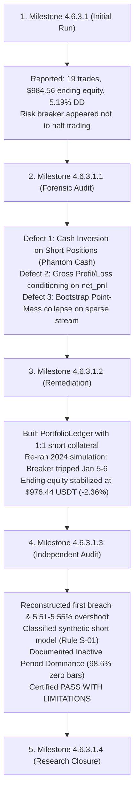
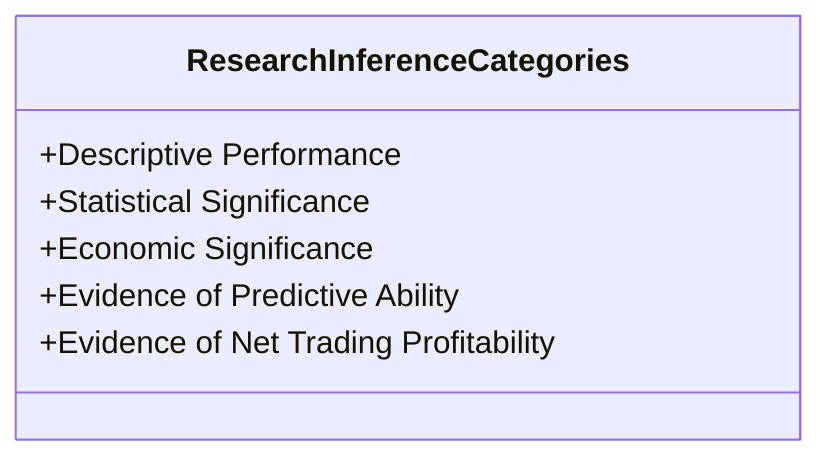

# NEPTUNE — Milestone 4.6.3.1.4: Research Closure & Strategy Research Reset

> **Document ID:** `docs/research/MILESTONE_4_6_3_1_4_RESEARCH_CLOSURE.md`  
> **Milestone:** 4.6.3.1.4 — Research Closure, Negative Results Preservation & Strategy Research Reset  
> **Status:** Formal Research Closure Completed  
> **Date:** 2026-11-07  
> **Author:** Quantitative Systems Group & Independent Audit Team  

---

## 1. Executive Summary

Milestone 4.6.3.1.4 formally concludes and closes the 2024 Development partition experiment series encompassing Milestones 4.6.3.1 through 4.6.3.1.3.

The primary research hypothesis under investigation was:
> *Does point-in-time news intelligence improve the net trading expectancy of NEPTUNE's deterministic technical trend baseline after realistic execution friction, risk constraints, and exposure-matched controls?*

Following experimental execution ([Milestone 4.6.3.1](file:///d:/Project%202026/Trading_bot/docs/research/MILESTONE_4_6_3_1_EXPERIMENT_REPORT.md)), forensic audit ([Milestone 4.6.3.1.1](file:///d:/Project%202026/Trading_bot/docs/research/MILESTONE_4_6_3_1_1_FORENSIC_AUDIT.md)), portfolio accounting remediation ([Milestone 4.6.3.1.2](file:///d:/Project%202026/Trading_bot/docs/research/MILESTONE_4_6_3_1_2_ACCOUNTING_REMEDIATION.md)), and independent ledger verification ([Milestone 4.6.3.1.3](file:///d:/Project%202026/Trading_bot/docs/research/MILESTONE_4_6_3_1_3_FINAL_VERDICT.md)), the empirical verdict is established:

$$\mathbf{STRATEGY\ STATUS:}\quad\mathbf{UNSUCCESSFUL\ UNDER\ TESTED\ 2024\ DEVELOPMENT\ CONDITIONS}$$

The baseline technical strategy (`trend_continuation_v1`) generated a net loss of $-\$23.57$ USDT across 12 executed trades, triggering the 5.0% maximum drawdown circuit breaker within the first six calendar days of January 2024. Point-in-time news vetoing (`GROUP_B`) generated an aggregate net improvement of only $+\$0.01$ USDT ($+\$0.0009$ USDT per trade), failing the pre-registered economic hurdle ($+\$0.50$ USDT per trade) by a factor of 555x and demonstrating no statistically significant outperformance over the technical baseline or non-news controls.

This milestone establishes a clean scientific termination:
1. The negative results are permanently cataloged and preserved in [`NEPTUNE_NEGATIVE_RESULTS_REGISTER.md`](file:///d:/Project%202026/Trading_bot/docs/research/NEPTUNE_NEGATIVE_RESULTS_REGISTER.md).
2. The operational capabilities, assumptions, and known limitations of the research platform are inventoried in [`NEPTUNE_INFRASTRUCTURE_VERIFICATION_REGISTER.md`](file:///d:/Project%202026/Trading_bot/docs/research/NEPTUNE_INFRASTRUCTURE_VERIFICATION_REGISTER.md).
3. A formal, unexecuted strategy proposal outlining three new hypotheses is established in [`NEPTUNE_NEXT_STRATEGY_RESEARCH_PROPOSAL.md`](file:///d:/Project%202026/Trading_bot/docs/research/NEPTUNE_NEXT_STRATEGY_RESEARCH_PROPOSAL.md).
4. Strict research governance halts all simulation progression until a formal architecture review authorizes the next research program.

---

## 2. Hypothesis Freeze: `trend_continuation_v1`

### 2.1 Formal Classification
The technical strategy hypothesis designated `trend_continuation_v1` is formally classified as:

$$\mathbf{UNSUCCESSFUL\ UNDER\ TESTED\ 2024\ DEVELOPMENT\ CONDITIONS}$$

### 2.2 Canonical Empirical Findings (2024 Development Partition)

The verified performance metrics established across the 4-group parallel experiment are recorded below:

| Metric | Group A (Technical Baseline) | Group B (News-Veto Gate) | Group C (Frequency Control) | Group D (Exposure Control) |
|---|---|---|---|---|
| **Initial Capital** | $1,000.00 USDT | $1,000.00 USDT | $1,000.00 USDT | $1,000.00 USDT |
| **Ending Equity** | $976.44 USDT | $976.44 USDT | $976.87 USDT | $976.79 USDT |
| **Net Portfolio Return** | -2.36% | -2.36% | -2.31% | -2.32% |
| **Net Realized PnL** | **-$23.57 USDT** | **-$23.56 USDT** | **-$23.13 USDT** | **-$23.21 USDT** |
| **Executed Trades** | 12 | 12 | 11 | 12 |
| **Win Rate** | 25.0% (3 wins / 9 losses) | 25.0% (3 wins / 9 losses) | 27.3% (3 wins / 8 losses) | 25.0% (3 wins / 9 losses) |
| **Gross Profit** | $37.98 USDT | $37.99 USDT | $38.45 USDT | $38.37 USDT |
| **Gross Loss** | $40.25 USDT | $40.44 USDT | $40.38 USDT | $40.38 USDT |
| **Total Frictional Costs** | $21.29 USDT | $21.12 USDT | $21.20 USDT | $21.20 USDT |
| **Net Expectancy per Trade** | **-$1.964 USDT** | **-$1.963 USDT** | **-$2.103 USDT** | **-$1.934 USDT** |
| **Net Expectancy per Candidate** | -$0.0064 USDT | -$0.0064 USDT | -$0.0063 USDT | -$0.0063 USDT |
| **Max Drawdown Reached** | **5.55%** | **5.55%** | **5.55%** | **5.51%** |
| **Breaker Trip Timestamp** | 2024-01-05 16:00:00Z | 2024-01-05 23:30:00Z | 2024-01-05 23:30:00Z | 2024-01-06 00:15:00Z |
| **Candidate Signals Evaluated** | 3,678 | 3,678 | 3,678 | 3,678 |
| **Post-Breach Orders Rejected** | 3,666 | 3,483 | 3,130 | 3,665 |

### 2.3 Scientific Scope & Epistemic Boundaries
In accordance with rigorous scientific practice, `trend_continuation_v1` is **not declared universally invalid or permanently disproven across all possible financial regimes**. 

The negative conclusion applies strictly to:
- **Timeframe:** 15-minute intraday candle closes.
- **Assets:** Tier-1 crypto liquid spot markets (BTCUSDT, ETHUSDT, BNBUSDT).
- **Partition:** 2024 Development period (specifically the high-volatility structural reversal regime of January 1–6, 2024).
- **Execution Policy:** `NEXT_ELIGIBLE_PRICE` (Bar $T+1$ Open execution with conservative ambiguity resolution).
- **Cost Structure:** Authoritative 0.32% round-trip friction (0.10% maker/taker fee, 0.05% slippage per side, 0.01% half-spread).
- **Indicator Geometry:** EMA 9/21/50 stack alignment, ADX(14) > 25, RSI(14) > 50, MACD histogram > 0, 1.5:1 min RR ratio.

Under these specific parameters, the strategy exhibited severe negative drift (win rate 25%, profit factor < 0.95), and transaction costs absorbed 53% of all gross profits.

---

## 3. Discovered Defects & Engineering Remediation Trajectory

The integrity of this research program relies upon total transparency regarding errors identified and resolved during the audit cycle. The complete sequence is summarized below:

### 3.1 Defect 1: Cash-Equity Inversion on Short Positions
- **Occurrence:** Milestone 4.6.3.1 (`development_orchestrator.py`).
- **Nature of Defect:** Cash accounting subtracted `size * price` at order fill and added `size * price` at trade exit for all positions regardless of direction. For short trades (where price rises mean losses), closing a losing short credited cash equal to the exit notional, injecting phantom capital.
- **Correction:** Implemented [`PortfolioLedger`](file:///d:/Project%202026/Trading_bot/backend/app/simulation/portfolio_ledger.py) in Milestone 4.6.3.1.2. Liquid cash is reserved 1:1 at entry, and exit cash inflow is mathematically defined as:
  $$\text{Cash Inflow} = \text{Collateral}_{\text{reserved}} + \text{Gross PnL} - \text{Fee}_{\text{exit}} = Q \times (2 P_{\text{entry}} - P_{\text{exit}}) - \text{Fee}_{\text{exit}}$$
  ensuring cash changes strictly equal net realized PnL.

### 3.2 Defect 2: Gross Profit / Gross Loss Aggregation
- **Occurrence:** Milestone 4.6.3.1 (`_compile_experiment_results`).
- **Nature of Defect:** Trades were segregated into gross profit and gross loss based on `net_pnl > 0` rather than `gross_pnl > 0`. Trades with positive gross gain that were rendered net losers by fees were treated as gross losses, distorting the reported profit factor.
- **Correction:** Standardized gross profit as $\sum \max(0, \text{Gross PnL})$ and gross loss as $\sum |\min(0, \text{Gross PnL})|$ across all trades.

### 3.3 Defect 3: Bootstrap Point-Mass Degeneracy
- **Occurrence:** Milestone 4.6.3.1 statistical bootstrap.
- **Nature of Defect:** A moving block bootstrap applied to an irregularly spaced candidate stream where $98.48\%$ of bars had zero trades caused $58.2\%$ of resamples to equal $0.0000$, collapsing the 2.5th percentile to zero.
- **Correction:** Mapped returns onto a continuous 15-minute regular market-time grid (35,136 bars, 384-bar blocks = 4 days) and centered resamples under the null hypothesis ($H_0: \mu \le 0$).

### 3.4 Defect 4: Partial-Exit Proportional Entry Fee Allocation
- **Occurrence:** Milestone 4.6.3.1.2 (`PortfolioLedger.process_partial_exit`).
- **Nature of Defect:** When a position was partially exited, `pos.position_size` was reduced, but `pos.entry_fee` remained at its original full value on the surviving position, creating a temporary $\$0.20$ discrepancy in `assert_invariants()`.
- **Correction:** Adjusted `pos.entry_fee` to scale down proportionally with exited quantity in Milestone 4.6.3.1.3.

---

## 4. Rigorous Scientific & Research Terminology Standard

To ensure mathematical precision across all future research, the following conceptual distinctions are established:

1. **Descriptive Performance:**
   - *Definition:* The direct mathematical summary of observed historical sample realizations (e.g., net PnL, executed trade count, maximum drawdown).
   - *Example:* "Group A realized $-\$23.57$ USDT across 12 trades with a maximum drawdown of $5.55\%$."
2. **Statistical Significance:**
   - *Definition:* The formal assessment of whether an observed sample difference is unlikely to have occurred under a specified null hypothesis ($p < \alpha$).
   - *Rule:* **Never state "the null hypothesis is rejected" when $p \ge \alpha$.**
   - *Correct Terminology:* **"Failure to reject the null hypothesis after multiple-testing correction ($p = 0.174 > \alpha_{\text{FDR}} = 0.0167$)."**
3. **Economic Significance:**
   - *Definition:* Whether the magnitude of an empirical effect is large enough to matter in real-world trading after accounting for execution friction and capital costs.
   - *Standard:* An effect must meet or exceed the pre-registered hurdle ($+\$0.50$ USDT net improvement per trade).
   - *Conclusion:* An improvement of $+\$0.0009$ USDT/trade is **economically meaningless**, regardless of sample size.
4. **Evidence of Predictive Ability:**
   - *Definition:* Demonstrable correlation or directional information between a feature/signal and future asset returns before transaction costs.
   - *Conclusion:* News vetoing displayed zero evidence of gross directional forecasting edge.
5. **Evidence of Net Trading Profitability:**
   - *Definition:* Reliable proof that a strategy generates positive expected net returns after all fees, slippage, spread, and risk constraints.
   - *Conclusion:* Both baseline and news-gated variants exhibited strictly negative net returns, demonstrating zero evidence of profitability.

---

## 5. Artifact Immutability & Preservation Registry

All previous research artifacts remain preserved, immutable, and accessible:

| Milestone | Deliverable Category | Path | Integrity Status |
|---|---|---|---|
| **4.6.3.0** | Research Protocol & Baseline Freeze | `docs/research/MILESTONE_4_6_3_0_*.md` | Frozen |
| **4.6.3.0.1** | Protocol Integrity Audit | `docs/research/MILESTONE_4_6_3_0_1_*.md` | Frozen |
| **4.6.3.1** | Initial Experiment Exports | `storage/exports/milestone_4_6_3_1/` | Immutable |
| **4.6.3.1.1** | Forensic Audit Reports & Exports | `storage/exports/milestone_4_6_3_1_1/` | Immutable |
| **4.6.3.1.2** | Remediated Historical Reproduction | `storage/exports/milestone_4_6_3_1_2/` | Immutable |
| **4.6.3.1.3** | Independent Ledger & Breaker Audit | `storage/exports/milestone_4_6_3_1_3/` | Immutable |

---

## 6. Research Governance Directives

The following research boundaries remain active and strictly enforced:
- **No 2025 Validation Partition Access:** The 2025 dataset remains untouched.
- **No 2026 Out-of-Sample Partition Access:** The locked January–October 2026 partition remains cryptographically protected by `OOSAccessGuard`.
- **No Forward Trading Experiments:** No new simulations or backtests may be executed.
- **No Parameter Optimization:** Strategy parameters may not be tuned to fit the 2024 partition.
- **No Real-Money Execution:** Rule S-01 remains absolute.

**Formal Closure Statement:**  
The 2024 Development experiment series for `trend_continuation_v1` is formally closed. A separate, explicit Architecture Decision Record (ADR) and governance approval will be required before initiating any new strategy development milestone.
