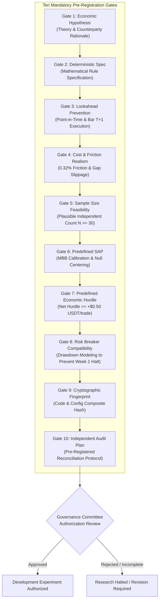

# NEPTUNE — Experiment Selection Gates & Pre-Registration Protocol

> **Document ID:** `docs/research/NEPTUNE_EXPERIMENT_SELECTION_GATES.md`  
> **Repository:** Project NEPTUNE Research Governance  
> **Classification:** Research Protocol Standard  
> **Status:** Active & Mandatory  
> **Last Updated:** 2026-11-07  
> **Governance Authority:** Rule S-04, Rule S-05, Rule S-06, Rule S-07  

---

## 1. Purpose & Guiding Principles

The premature execution of historical backtests without formal research design leads to data snooping, post-hoc parameter adjustments, and false discoveries. 

In Milestone 4.6.3.1.2 and 4.6.3.1.3, NEPTUNE established that the baseline technical strategy tripped its 5.0% maximum drawdown circuit breaker within the first six calendar days of the 2024 Development partition. **A new strategy hypothesis must demonstrate structural and risk-breaker compatibility before consuming full-partition computational and research resources.**

This document codifies the **Ten Non-Negotiable Experiment Selection Gates**. Every candidate strategy family must satisfy all ten gates prior to being granted authorization for a Development-partition experiment.

---

## 2. Detailed Gate Specifications & Acceptance Criteria

### Gate 1: Falsifiable Economic Hypothesis & Counterparty Grounding
- **Requirement:** The strategy proposal must state a clear, falsifiable economic hypothesis explaining why the anomaly exists, which market participants are on the losing side of the trade, and why it is not arbitrated away.
- **Acceptance Standard:** Pure technical pattern descriptions (e.g., "RSI crossing 30 makes money") are rejected. The proposal must provide structural grounding (e.g., liquidity sweeps, volatility clustering, macro flow momentum).
- **Governance Choice & Trade-Off:** Rejects data-mined empirical anomalies at the expense of potentially dismissing unexplainable statistical regularities.

### Gate 2: Complete Deterministic Strategy Specification
- **Requirement:** Full mathematical specification of all indicator lookbacks, regime thresholds, entry signal generation rules, stop-loss calculations, position-sizing equations, and exit management logic.
- **Acceptance Standard:** Zero discretionary rules. Zero ambiguous parameters. All logic must be expressible as pure, deterministic Python code.
- **Governance Choice & Trade-Off:** Guarantees 100% reproducibility but prevents intuitive or dynamic discretionary interventions.

### Gate 3: Look-Ahead & Ambiguity Prevention
- **Requirement:** Compliance with **Rule A-09** and **Rule S-05**. Signals must consume strictly confirmed closed candles. Order execution must use the `NEXT_ELIGIBLE_PRICE` policy (Bar $T+1$ Open).
- **Acceptance Standard:** Intra-bar bracket ambiguity must be resolved conservatively (stop loss prioritized over take profit if both price levels are touched within the same candle). Lookahead assertion checks must be active in code.

### Gate 4: Realistic Execution & Frictional Cost Modeling
- **Requirement:** Full integration with NEPTUNE's authoritative transaction cost model:
  $$\text{Friction}_{\text{round-trip}} = 2 \times f_{\text{taker}} + 2 \times \text{Slippage} + 2 \times \text{Spread}_{\text{half}} = 0.20\% + 0.10\% + 0.02\% = 0.32\%$$
- **Acceptance Standard:** Must include opening gap slippage penalties (gaps beyond stop loss fill at actual candle open). Zero-fee or low-fee assumptions are strictly prohibited.
- **Breakout Stress Test:** Breakout strategies (Candidate B) must additionally pass a stress test with doubled entry slippage ($0.10\%$ per side).

### Gate 5: Statistical Sample Adequacy & Feasibility
- **Requirement:** The proposed strategy architecture and timeframe must support a plausible independent trade count of $N \ge 30$ trades across the target evaluation partition.
- **Acceptance Standard:** If estimated annual trade count is $< 25$, the proposal must explicitly explain how statistical power collapse will be managed, or why confidence interval expansion is acceptable.
- **Governance Choice & Trade-Off:** We establish $N = 30$ as a governance threshold based on standard central limit theorem and bootstrap sample stability considerations. It represents a deliberate trade-off between statistical testability and higher-timeframe selectivity.

### Gate 6: Predefined Statistical Analysis Plan (SAP)
- **Requirement:** Pre-registration of the exact inferential statistical methods to be applied to the output data prior to running the experiment:
  - Moving Block Bootstrap (MBB) with block size calibrated to ~4 calendar days on the target timeframe (e.g., 96 bars for 1h, 24 bars for 4h).
  - Null-centered resampling under $H_0: \mu \le 0$.
  - Continuous regular market-time grid mapping to eliminate point-mass collapse.
  - Benjamini-Hochberg False Discovery Rate (FDR) control at $\alpha = 0.05$.
- **Acceptance Standard:** Metrics cannot be altered, added, or discarded post-experiment.

### Gate 7: Predefined Economic Hurdle
- **Requirement:** A clear distinction between statistical significance and economic significance. The strategy must establish a minimum net economic hurdle:
  $$E_{\text{trade}} \ge +\$0.50\text{ USDT net profit per trade after all costs}$$
- **Acceptance Standard:** An observed positive return that fails this hurdle (e.g., $+\$0.0009$/trade) is pre-registered as a failure.
- **Governance Choice & Trade-Off:** The $\$0.50$ hurdle on a $\$1,000$ virtual portfolio (0.05% of capital, or ~10% of typical risk per trade) is a conservative governance choice ensuring the edge survives unmodeled exchange latency and API connection costs.

### Gate 8: Risk Breaker Compatibility & Drawdown Modeling
- **Requirement:** The strategy design must specifically demonstrate why it will not breach the 5.0% maximum drawdown circuit breaker during adverse market regimes.
- **Acceptance Standard:** The proposal must calculate:
  - Theoretical maximum consecutive losses ($MCL$) before tripping breaker:
    $$\text{Breaker Headroom} = \frac{5.0\%}{\text{Risk per Trade } (0.5\%)} = 10\text{ consecutive losses}$$
  - In-flight position resolution buffer: Accounting for the Order Embargo policy where open positions resolve at their stop loss, the strategy's planned risk per trade must leave at least a $1.0\%$ buffer below the 5.0% breaker ($MDD_{\text{target}} \le 4.0\%$).
- **Weekly Regime Invalidation:** The proposal must detail how the strategy behaves during sharp market reversals (e.g., the January 1–6, 2024 BTC ETF rally).

### Gate 9: Cryptographic Fingerprint & Version Freezing
- **Requirement:** Generation of a composite SHA-256 fingerprint binding the strategy configuration, indicator parameters, software commit hash, and historical dataset manifests.
- **Acceptance Standard:** Any post-experiment change to code or configuration invalidates the run and requires full re-authorization.

### Gate 10: Independent Forensic Audit Plan
- **Requirement:** A pre-registered audit protocol requiring:
  - Balance sheet invariant verification in `PortfolioLedger` ($\text{tolerance} \le \$0.05$ USDT).
  - Verification of zero look-ahead bias and timestamp monotonicity.
  - Verification of cryptographic HMAC risk authorization token lifecycle.
  - Generation of machine-readable ledger and statistical JSON exports in `storage/exports/`.

---

## 3. Candidate Strategy Family Gate Readiness Audit

An independent quantitative audit of the three candidate families against the Ten Selection Gates reveals the following readiness matrix:

| Selection Gate | Candidate A (HTF Trend) | Candidate B (Vol Breakout) | Candidate C (Mean Reversion) |
|---|---|---|---|
| **GATE-01: Economic Hypothesis** | **PASS** (Macro capital flows) | **PASS** (Volatility clustering) | **MARGINAL** (Liquidity bounds) |
| **GATE-02: Deterministic Spec** | **PENDING** (Conceptual stage) | **PENDING** (Conceptual stage) | **PENDING** (Conceptual stage) |
| **GATE-03: Lookahead Prevention** | **PASS** (Closed candle logic) | **PASS** (Closed candle logic) | **PASS** (Closed candle logic) |
| **GATE-04: Cost Realism** | **PASS** (Wide target brackets) | **MARGINAL** (Breakout slippage) | **FAIL** (Fee drag on small target) |
| **GATE-05: Sample Adequacy** | **FAIL** (Risk of $N < 25$ on 4h) | **PASS** (Estimated $N \approx 50-80$) | **PASS** (Estimated $N \approx 100+$) |
| **GATE-06: Predefined SAP** | **PASS** (MBB 96-bar calibrated) | **PASS** (MBB 96-bar calibrated) | **PASS** (MBB 384-bar calibrated) |
| **GATE-07: Economic Hurdle** | **PASS** (Target $+\$0.50$ feasible) | **PASS** (Target $+\$0.50$ feasible) | **FAIL** (High friction drag) |
| **GATE-08: Risk Breaker** | **PASS** (Wider stops, small size) | **MARGINAL** (Fakeout strings) | **FAIL** (Trend breakout tail risk) |
| **GATE-09: Crypto Fingerprint** | **PENDING** (Pre-experiment step) | **PENDING** (Pre-experiment step) | **PENDING** (Pre-experiment step) |
| **GATE-10: Audit Plan** | **PASS** (PortfolioLedger ready) | **PASS** (PortfolioLedger ready) | **PASS** (PortfolioLedger ready) |
| **Overall Gate Readiness** | **BLOCKED ON GATE 5 & 2** | **BLOCKED ON GATE 4 & 2** | **DECISIVELY BLOCKED** |

---

## 4. Formal Selection Decision & Governance Directive

### Summary of Blockers
1. **Candidate C (Mean Reversion) Fails Gates 4, 7, and 8:** Small targets mean that 0.32% friction consumes the edge, and runaway trend transitions present severe risk-breaker breach hazards. It is **REJECTED / SHELVED**.
2. **Candidate B (Volatility Breakout) Fails Gate 4:** Fixed 0.05% slippage is inadequate for high-volatility breakouts; requires explicit breakout slippage modeling before passing Gate 4.
3. **Candidate A (HTF Trend Following) Fails Gate 5:** Moving to 4h creates severe risk of sample size collapse ($N < 25$ trades in a single year), threatening the statistical validity of the entire experiment.

### Governance Determination
$$\mathbf{GOVERNANCE\ STATUS:}\quad\mathbf{ZERO\ CANDIDATES\ AUTHORIZED\ FOR\ EXPERIMENTATION}$$

- **No Development-partition experiment is authorized at this time.**
- Prior to authorizing any implementation milestone:
  - Candidate A must solve Gate 5 by formulating a dual-timeframe specification (1h execution conditioned on 4h trend) that guarantees $N \ge 30$ independent opportunities.
  - Candidate B must solve Gate 4 by integrating dynamic breakout slippage stress-testing.
- **All simulation execution, parameter tuning, and partition progression remain strictly prohibited.**

