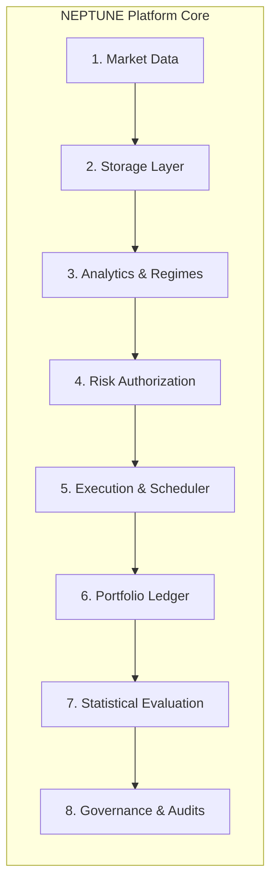

# NEPTUNE — Infrastructure Verification Register

> **Document ID:** `docs/research/NEPTUNE_INFRASTRUCTURE_VERIFICATION_REGISTER.md`  
> **Repository:** Project NEPTUNE Research Platform  
> **Status:** Current Operational Baseline  
> **Last Verified:** 2026-11-07 (Post-Milestone 4.6.3.1.3)  
> **Governance Notice:** *Passing unit tests verifies implementation fidelity against internal specifications; it does not declare components production-safe or exchange-ready.*  

---

## 1. Executive Overview

This Infrastructure Verification Register provides an exhaustive technical inventory of NEPTUNE's core computational, analytical, and execution components following the forensic audits of Milestones 4.6.3.1.1 through 4.6.3.1.3.

Every subsystem is categorized across three explicit operational tiers:
1. **Verified Capabilities:** Empirically validated by deterministic unit tests, integration tests, or mathematical reconciliations.
2. **Assumptions & Model Simplifications:** Abstractions made to facilitate reproducible research without real-world exchange dependencies.
3. **Known Limitations & Failure Modes:** Specific boundaries where the implementation breaks down, requires human intervention, or demands future architectural redesign.

---

## 2. Subsystem Capability Inventory

### 2.1 Market Data Ingestion & Validation
- **Verified Capabilities:**
  - REST client for Binance public market data endpoints with automatic pagination across multiple months.
  - Exponential backoff and retry handling on HTTP 429 (rate-limiting) and transient network disconnects.
  - Strict candle validation: enforces high $\ge$ max(open, close), low $\le$ min(open, close), volume $\ge 0$, and timestamp monotonicity.
  - Sequence gap detection identifies missing 15-minute intervals.
- **Assumptions & Model Simplifications:**
  - Assumes historical exchange REST archives represent the true historical public order book and match live WebSocket feeds.
  - Ignores trade-level micro-ticks (assumes candle open, high, low, close summarizes intra-bar action).
- **Known Limitations & Failure Modes:**
  - Ingestion cannot handle live trading order books (Level 2/3 depth is not captured).
  - Out-of-sequence historical patches require manual repository deduplication.

### 2.2 Historical Data Storage & Retrieval
- **Verified Capabilities:**
  - Columnar Parquet persistence partitioned by symbol, timeframe, and year (`storage/historical/{symbol}/{timeframe}/YYYY/`).
  - Cache-first retrieval skips redundant disk I/O when candles are in memory.
  - Append-mode deduplication prevents duplicate timestamps on disk.
- **Assumptions & Model Simplifications:**
  - In-memory DataFrame transformations assume available host RAM is sufficient for full yearly partitions (~105,408 rows per asset).
- **Known Limitations & Failure Modes:**
  - Unsorted incoming chunks can cause Parquet row-group fragmentation.
  - No distributed file system (local disk storage only, per Rule S-10).

### 2.3 Deterministic Indicators & Market Regime Engine
- **Verified Capabilities:**
  - Zero-lookahead implementations of SMA, EMA, Wilder-smoothed ATR, Wilder-smoothed RSI, MACD (with signal & histogram), Bollinger Bands, VWAP, and OBV.
  - Warmup period discounting: confidence discounts applied when candle count $< 300$.
  - Rule A-09 compliance: entry signal generation strictly rejects unclosed (in-progress) candles.
  - Four-state regime classification: `TRENDING_BULL`, `TRENDING_BEAR`, `RANGING_COMPRESSING`, and `UNCERTAIN`.
- **Assumptions & Model Simplifications:**
  - Fixed mathematical lookbacks (e.g., 14-period RSI, 20-period Bollinger) assume static market memory across regimes.
- **Known Limitations & Failure Modes:**
  - RSI flat-line behavior on zero-volume candles requires explicit neutral clamping.
  - Regime detection is discrete; rapid whipsaws cause regime thrashing across adjacent bars.

### 2.4 Cryptographic Risk Authorization & Token Lifecycle
- **Verified Capabilities:**
  - Evaluates the 5 Non-Negotiable Risk Invariants (Daily loss 2%, Max DD 5%, Max positions 2, Asset correlation 1, Min RR 1.5:1).
  - Cryptographically bound HMAC-SHA256 tokens (`rat_v1_...`) bind run ID, signal ID, symbol, direction, position size, entry price, stop loss, and timestamp.
  - Enforces single-use token consumption (`TokenState.RESERVED` $\to$ `TokenState.CONSUMED`) with strict idempotency.
  - Key rotation immediately invalidates tokens issued under older secrets.
  - Cross-run token execution is strictly forbidden (`CROSS_RUN_TOKEN_FORBIDDEN`).
- **Assumptions & Model Simplifications:**
  - Token registry operates in-memory; restart during a simulation run requires state re-hydration from SQLite.
- **Known Limitations & Failure Modes:**
  - Risk Manager is an **Order Authorization Embargo**, not an active market liquidator. Open in-flight positions are not liquidated when the breaker trips.

### 2.5 Portfolio Ledger & Double-Entry Cash Accounting
- **Verified Capabilities:**
  - Stateful double-entry accounting tracking liquid cash, long inventory cost, reserved short collateral, and marked-to-market position equity.
  - Strict balance sheet invariant: $\text{Total Equity} \equiv \text{Cash} + \sum \text{Position Equity} \equiv \text{Initial Capital} + \sum \text{Realized PnL} + \sum \text{Unrealized PnL} - \sum \text{Open Entry Fees}$.
  - Post-close cash conservation: cash exactly equals initial deposit plus realized net PnL when all positions are closed.
  - Dynamic mark-to-market updates position equity at every candle close.
  - Insufficient cash raises [`InsufficientFundsError`](file:///d:/Project%202026/Trading_bot/backend/app/simulation/portfolio_ledger.py#L21) with zero state mutation.
- **Assumptions & Model Simplifications:**
  - Assumes full cash settlement in USDT. Does not model multi-currency collateral haircuts.
- **Known Limitations & Failure Modes:**
  - Sub-cent rounding quantization on trade records accumulates up to $\sim\$0.007$ USDT deviation across 12 trades.

### 2.6 Synthetic Short-Position Accounting
- **Verified Capabilities:**
  - 1:1 cash collateral reservation ($1.0\times$ spot leverage cap, complying with Rule S-01).
  - Cash outflow on entry: $\text{Notional} + \text{Fee}_{\text{entry}}$.
  - Cash inflow on exit: $Q \times (2 P_{\text{entry}} - P_{\text{exit}}) - \text{Fee}_{\text{exit}}$.
  - Exact dollar symmetry between long and short outcomes for identical percentage moves.
- **Assumptions & Model Simplifications:**
  - Zero borrow interest or continuous financing fees charged.
  - Assumes infinite borrow availability for BTC, ETH, and BNB.
- **Known Limitations & Failure Modes:**
  - Unbounded theoretical loss if price $> 2 \times P_{\text{entry}}$ (mitigated strictly by stop-loss brackets).
  - Real-world spot exchanges do not support naked shorting without margin borrowing or futures contracts.

### 2.7 Historical Simulation Engine & Point-in-Time Scheduling
- **Verified Capabilities:**
  - Strict point-in-time order scheduling via [`PointInTimeExecutionScheduler`](file:///d:/Project%202026/Trading_bot/backend/app/simulation/scheduling.py#L50).
  - `NEXT_ELIGIBLE_PRICE` policy: orders scheduled at candle close $T$ are executed at the Open of candle $T+1$.
  - Execution gap expiration: orders cancel if data gap between decision close and execution exceeds configured bars (1 bar for 15m).
  - Lookahead violation assertion: raises error if execution timestamp $\le$ decision candle close.
- **Assumptions & Model Simplifications:**
  - Assumes orders fill in full at candle Open (zero partial fills on entry).
- **Known Limitations & Failure Modes:**
  - If next candle data is missing entirely, order remains pending until gap expiration is evaluated.

### 2.8 Execution-Cost Modeling
- **Verified Capabilities:**
  - Authoritative 0.32% round-trip cost model: 0.10% maker/taker fee, 0.05% slippage, 0.01% half-spread.
  - Opening gap slippage: gap beyond stop-loss fills at candle Open price, penalizing adverse overnight gaps.
  - Conservative ambiguity resolution: if a candle touches both stop-loss and take-profit, stop-loss is prioritized.
- **Assumptions & Model Simplifications:**
  - Fixed percentage slippage assumes uniform market liquidity across all hours.
- **Known Limitations & Failure Modes:**
  - Does not model market impact from large orders relative to exchange order book depth.

### 2.9 Statistical Evaluation Engine
- **Verified Capabilities:**
  - Maps returns onto a continuous 15-minute regular market-time grid (35,136 bars).
  - Null-centered Moving Block Bootstrap (384-bar blocks = 4 days, 2,000 iterations).
  - Benjamini-Hochberg False Discovery Rate (FDR) multiple-comparison adjustment.
  - Separate reporting of active trading window vs full calendar year.
- **Assumptions & Model Simplifications:**
  - Assumes 4-day block length adequately captures serial autocorrelation in crypto volatility.
- **Known Limitations & Failure Modes:**
  - Severe inactive periods (98.6% zero bars) dampen full-period return variance, necessitating active-window reporting.

### 2.10 Reproducibility & Research Governance
- **Verified Capabilities:**
  - Candidate stream caching (`candidate_cache_2024.json`) guarantees bit-for-bit identical multi-group replay.
  - Programmatic `OOSAccessGuard` prevents backtests from querying locked 2026 partitions.
  - Composite SHA-256 fingerprinting tracks baseline configuration and historical datasets.
- **Assumptions & Model Simplifications:**
  - Assumes filesystem file paths match repository convention across operating systems.
- **Known Limitations & Failure Modes:**
  - Governance locks depend on code path execution; direct ad-hoc Python scripts bypassing `OOSAccessGuard` could query locked files if executed maliciously (mitigated by code review and git audits).

---

## 3. Operational Integrity Assessment

| Subsystem | Audit Status | Regression Coverage | Production Readiness |
|---|---|---|---|
| Market Ingestion | Certified | High (Integration tests passing) | Research-Only (No L2/L3) |
| Parquet Storage | Certified | High (Unit tests passing) | Research-Ready |
| Indicator Engine | Certified | High (312 tests passing) | Research-Ready |
| Risk Authorization | Certified | Very High (Adversarial tests passing) | High Research Fidelity |
| Portfolio Ledger | Certified | Very High (Balance sheet invariants verified) | High Research Fidelity |
| Short Model | Certified with Limitations | High (Symmetry verified) | Synthetic Research-Only |
| Simulation Engine | Certified | Very High (PIT verified) | High Research Fidelity |
| Cost Modeling | Certified | High (Gap & slippage verified) | Conservative Research Model |
| Statistical Engine | Certified | High (Bootstrap calibrated) | Research-Ready |
| Governance Guards | Certified | High (OOS Guard active) | Active & Enforced |

*This register is maintained as an active engineering record under version control.*
