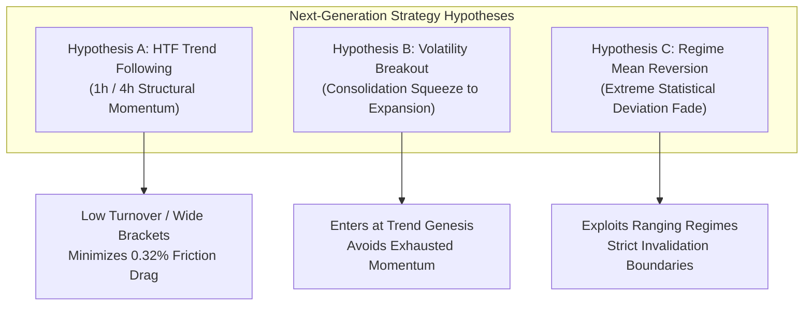

# NEPTUNE — Next-Generation Strategy Research Proposal

> **Document ID:** `docs/research/NEPTUNE_NEXT_STRATEGY_RESEARCH_PROPOSAL.md`  
> **Repository:** Project NEPTUNE Quantitative Systems Group  
> **Status:** Proposal Stage — Strictly Unexecuted (Zero Implementation)  
> **Date:** 2026-11-07  
> **Governance Constraint:** *This proposal establishes conceptual hypotheses for future research. No code, parameter selection, optimization, or backtest execution is authorized under Milestone 4.6.3.1.4.*  

---

## 1. Executive Summary & Research Reset

The empirical failure of `trend_continuation_v1` on 15-minute crypto spot demonstrated that sub-hourly trend continuation suffers from severe frictional drag (absorbing >50% of gross gains), late trend entries during exhausted thrusts, and high vulnerability to mean-reverting chop.

To establish a principled foundation for future quantitative research, this proposal introduces **three structurally independent strategy hypotheses**:
- **Hypothesis A:** Higher-Timeframe Trend-Following (`htf_trend_following_v1`)
- **Hypothesis B:** Volatility-Compression & Expansion Breakout (`vol_compression_breakout_v1`)
- **Hypothesis C:** Regime-Conditioned Extreme-Move Mean Reversion (`regime_mean_reversion_v1`)

Each hypothesis addresses a distinct market anomaly, targets a specific market regime, and operates under explicit failure boundaries.

---

## 2. Hypothesis A: Higher-Timeframe Trend-Following (`htf_trend_following_v1`)

### 2.1 Market Rationale
Crypto markets exhibit pronounced multi-day momentum driven by institutional capital flows, network adoption cycles, and macroeconomic liquidity trends. While 15-minute price action is heavily contaminated by microstructure noise and algorithmic stop-hunting, higher-timeframe candles (1-hour and 4-hour) reflect genuine capital reallocations. Moving from 15m to 1h/4h drastically reduces trading turnover, widening the average profit target from $\sim 1.0\%$ to $4.0\%-8.0\%$, thereby reducing the relative drag of the $0.32\%$ round-trip transaction friction from $>50\%$ to $<5\%$ of expected trade return.

### 2.2 Entry Conditions to Investigate
- Multi-timeframe trend alignment: 4h trend filter (e.g., price above 4h 50-EMA and 4h 200-EMA) establishing directional bias.
- 1h pullback entry: When the 4h trend is bullish, identify an orderly pullback on the 1h timeframe to the dynamic support zone (e.g., between the 1h 21-EMA and 50-EMA).
- Structural confirmation: Entry triggered only upon a confirmed 1h candle close breaking the local counter-trend swing high (bullish market structure break).

### 2.3 Exit Logic to Investigate
- Initial stop-loss placed beyond the major 1h swing low or dynamic 4h support level ($1.5 \times \text{ATR}_{1\text{h}}$).
- Dynamic trailing stop: Activated once trade reaches $+2.0\text{R}$; trails along the 1h 21-EMA or structural swing pivots.
- Discretionary take-profit bracket at $+3.0\text{R}$ to $+4.0\text{R}$ for partial de-risking.

### 2.4 Expected Holding Period
- 16 to 72 hours (approx. 16 to 72 1-hour bars, or 4 to 18 4-hour bars).

### 2.5 Suitable Market Regimes
- `TRENDING_BULL` or `TRENDING_BEAR` on daily and 4h scales.

### 2.6 Failure Conditions
- Extended macro consolidations or grinding sideways ranges where 1h pullbacks fail to resume trend and repeatedly hit trailing stops.

### 2.7 Required Features
- Multi-timeframe bar resampling (15m $\to$ 1h, 4h).
- Higher-timeframe exponential moving averages (21, 50, 200).
- Swing high / swing low structural pivot detection.
- 1h Wilder-smoothed ATR.

### 2.8 Potential Sources of Overfitting
- Selecting specific moving average lengths (e.g., testing 21 vs 25 vs 34) based on historical PnL.
- Over-optimizing the pullback entry buffer around the dynamic support band.

### 2.9 Expected Transaction-Cost Sensitivity
- **Low Sensitivity:** Lower trade frequency (approx. 30–60 trades per year per asset) and wider target brackets make net expectancy resilient to 0.32% exchange friction.

### 2.10 Appropriate Evaluation Metrics
- Calmar Ratio (Annualized Return / Max Drawdown).
- Trade-level net expectancy ($E_{\text{trade}}$).
- Profit Factor ($> 1.50$).
- Win Rate Wilson 95% Confidence Interval.

---

## 3. Hypothesis B: Volatility-Compression & Expansion Breakout (`vol_compression_breakout_v1`)

### 3.1 Market Rationale
Financial asset returns are characterized by volatility clustering and volatility cycles: periods of extreme volatility compression (consolidation, liquidity accumulation) are inevitably followed by violent volatility expansion (breakouts). By entering at the moment of volatility expansion rather than chasing an existing trend, the strategy captures the initial impulse of a new price move, maximizing initial momentum and favorable excursion.

### 3.2 Entry Conditions to Investigate
- Volatility Squeeze Metric: Identify when Bollinger Bands (20, 2.0) compress entirely inside the Keltner Channels (20, 1.5 ATR), indicating historical compression.
- Squeeze Duration: Squeeze must persist for a minimum threshold of consecutive bars (e.g., $\ge 8$ bars on 1h).
- Breakout Firing Trigger: Entry occurs when Bollinger Bands expand outside Keltner Channels accompanied by:
  - 1h candle close breaking the multi-bar range high (long) or range low (short).
  - Relative volume spike: Volume $\ge 1.8 \times \text{SMA}(\text{Volume}, 20)$.

### 3.3 Exit Logic to Investigate
- Initial stop-loss anchored strictly on the opposite side of the pre-breakout consolidation box (tight structural stop).
- Chandelier / ATR Trailing Stop ($2.5 \times \text{ATR}$) to ride multi-bar expansion impulses.
- Time-stop: If price does not achieve $+1.0\text{R}$ within 6 bars of breakout, exit at market to eliminate capital stagnation.

### 3.4 Expected Holding Period
- 6 to 36 hours.

### 3.5 Suitable Market Regimes
- Transitions from `RANGING_COMPRESSING` to `TRENDING_BULL` or `TRENDING_BEAR`.

### 3.6 Failure Conditions
- "Fakeout" environments where liquidity hunts trigger breakouts that immediately collapse back into the consolidation range.

### 3.7 Required Features
- Bollinger Band Bandwidth and %B.
- Keltner Channel calculations (EMA $\pm$ ATR multiplier).
- Volume relative to moving average (RVOL).
- Consolidation range high/low price trackers.

### 3.8 Potential Sources of Overfitting
- Tuning the squeeze threshold parameters (Keltner ATR multiplier and duration count) to historical high-volatility events.
- Fitting the breakout volume threshold to specific asset volatility regimes.

### 3.9 Expected Transaction-Cost Sensitivity
- **Moderate Sensitivity:** Stop loss is tight relative to consolidation size; execution slippage during breakout candle open requires rigorous modeling.

### 3.10 Appropriate Evaluation Metrics
- Payoff Ratio (Average Win / Average Loss).
- Maximum Favorable Excursion (MFE) to Maximum Adverse Excursion (MAE) ratio.
- Expectancy per candidate.

---

## 4. Hypothesis C: Regime-Conditioned Extreme Mean Reversion (`regime_mean_reversion_v1`)

### 4.1 Market Rationale
In non-trending, range-bound regimes, crypto prices frequently oscillate between established support and resistance boundaries. Liquidity providers and aggressive retail momentum traders routinely push prices into temporary statistical extremes (liquidity sweeps beyond local highs/lows) that rapidly exhaust and revert to volume-weighted mean levels (VWAP). Rather than fighting chop with trend continuation, mean reversion actively profits from ranging regimes.

### 4.2 Entry Conditions to Investigate
- Regime Condition: Market Scanner must strictly confirm `RANGING_COMPRESSING` with ADX(14) $\le 20.0$. (Entry strictly forbidden if ADX $> 25.0$).
- Statistical Price Extremity:
  - Price touches or exceeds Bollinger Band (20, 2.5) outer boundary.
  - Price deviation from intraday VWAP $\ge 2.5$ standard deviations.
  - Wilder RSI(14) extreme: RSI $\le 22.0$ (oversold long) or RSI $\ge 78.0$ (overbought short).
- Rejection Candle Confirmation: Entry requires a candlestick rejection signature (e.g., long wick, pin bar, or engulfing close back inside the 2.0-sigma band).

### 4.3 Exit Logic to Investigate
- Primary Target: Reversion to the mean (Intraday VWAP or 20-period SMA).
- Hard Stop Loss: Placed strictly beyond the extreme wick high/low ($1.0 \times \text{ATR}$ buffer).
- Asymmetric RR: Minimum $1.5:1$ target-to-stop geometry.

### 4.4 Expected Holding Period
- 2 to 8 hours (fast mean-reverting resolution).

### 4.5 Suitable Market Regimes
- `RANGING_COMPRESSING` with low directional momentum (ADX $< 20$).

### 4.6 Failure Conditions
- Surprise breakout transitions where price enters a runaway trend ("trend day"), piercing the statistical bands and continuing without mean reverting.

### 4.7 Required Features
- Rolling Intraday VWAP with standard deviation bands.
- ADX(14) regime gate.
- Bollinger Bands (20, 2.5).
- Candlestick wick-to-body geometry analyzers.

### 4.8 Potential Sources of Overfitting
- Tuning RSI thresholds (e.g., 22 vs 25) to catch historical bottoms.
- Fitting VWAP reset intervals (e.g., daily vs rolling 24h).

### 4.9 Expected Transaction-Cost Sensitivity
- **High Sensitivity:** Target distances are smaller (reversion to mean); maker-fee execution or highly conservative slippage models are essential.

### 4.10 Appropriate Evaluation Metrics
- Win Rate ($> 55\%$ required for positive expectancy).
- Net Profit Factor.
- Maximum Consecutive Losses.
- Risk-adjusted return during flat/ranging market periods.

---

## 5. Comparative Strategic Matrix

| Dimension | Hypothesis A (HTF Trend) | Hypothesis B (Volatility Breakout) | Hypothesis C (Mean Reversion) |
|---|---|---|---|
| **Primary Edge** | Macro capital flow momentum | Compression-to-expansion release | Liquidity sweep exhaustion |
| **Optimal Timeframe** | 1h / 4h | 1h | 15m / 1h |
| **Target Regime** | Strong Trends (`ADX > 25`) | Squeeze Transitions | Range-Bound Chop (`ADX < 20`) |
| **Trade Frequency** | Low (30–60 / yr) | Moderate (60–100 / yr) | Moderate to High (100–180 / yr) |
| **Target R:R** | $2.5:1$ to $4.0:1$ | $2.0:1$ to $3.5:1$ | $1.5:1$ to $2.0:1$ |
| **Win Rate Expectation**| $35\% - 45\%$ | $40\% - 50\%$ | $55\% - 65\%$ |
| **Friction Sensitivity** | **Very Low** | **Moderate** | **High** |
| **Primary Risk** | Whipsaw consolidation | Failed breakout / fakeout | Runaway breakout against position |

---

## 6. Implementation Governance Protocol

**MANDATORY RESEARCH BOUNDARY:**  
No code implementation, agent modifications, indicator tuning, or backtest execution may occur based on this document until:
1. An official Architecture Decision Record (ADR-035) approves the selected hypothesis.
2. An explicit Milestone Research Protocol is drafted and approved.
3. Baseline parameters and hypotheses are frozen prior to running any simulations.
4. Access to the 2025 Validation and locked 2026 OOS partitions remains strictly barred.
