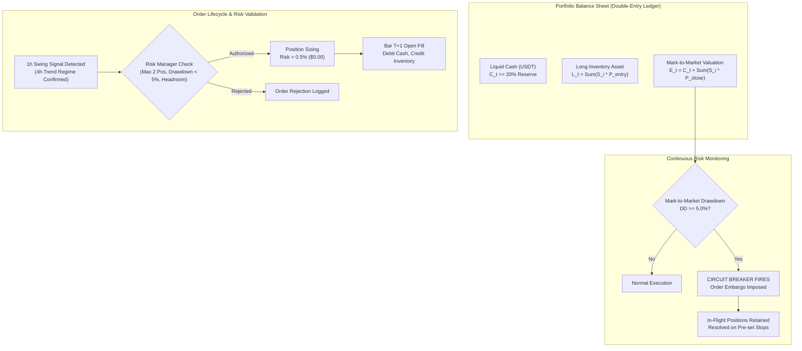

# NEPTUNE — Candidate A: Execution, Cost & Risk Architecture Requirements
## Higher-Timeframe Trend Following (`SHR-001` / Dual-Timeframe 4h/1h)

> **Document ID:** `docs/research/NEPTUNE_SHR001_EXECUTION_AND_RISK_REQUIREMENTS.md`  
> **Repository:** Project NEPTUNE Research Governance  
> **Classification:** Risk Engineering & Execution Specification  
> **Status:** Active Standard Specification  
> **Date:** 2026-11-07  
> **Governing Rules:** Rule S-01, Rule S-04, Rule A-01, Rule A-02, Rule A-09, Rule A-10, ADR-001, ADR-028, ADR-031, ADR-033  
> **Related Documents:**  
> - [`docs/research/NEPTUNE_SHR001_DUAL_TIMEFRAME_FEASIBILITY.md`](file:///d:/Project%202026/Trading_bot/docs/research/NEPTUNE_SHR001_DUAL_TIMEFRAME_FEASIBILITY.md)  
> - [`docs/research/NEPTUNE_SHR001_STATISTICAL_POWER_PLAN.md`](file:///d:/Project%202026/Trading_bot/docs/research/NEPTUNE_SHR001_STATISTICAL_POWER_PLAN.md)  
> - [`docs/research/MILESTONE_4_6_3_1_2_ACCOUNTING_REMEDIATION.md`](file:///d:/Project%202026/Trading_bot/docs/research/MILESTONE_4_6_3_1_2_ACCOUNTING_REMEDIATION.md)  

---

## 1. Executive Summary & Purpose

In Milestone 4.6.3.1.2 and 4.6.3.1.3, NEPTUNE demonstrated that a trading strategy cannot be evaluated in isolation from the execution ledger and portfolio risk manager. The baseline strategy failed not because of technical indicator signals alone, but because high turnover in a low-headroom environment rapidly accumulated transaction costs and breached the 5.0% maximum drawdown circuit breaker within 6 days.

This document codifies the **Execution, Transaction Cost, and Portfolio Risk Architecture Requirements** for Candidate A2 (Dual-Timeframe 4h/1h Trend Following). It establishes strict mathematical formulas for cash reservation, position sizing, execution gap penalties, order embargo handling, and long-only spot portfolio risk aggregation.

---

## 2. Frozen Transaction Cost Model & Sensitivity Bounds

NEPTUNE strictly preserves the **frozen 0.32% round-trip exchange friction** model. Lowering fees or slippage to artificially manufacture positive returns is strictly forbidden (Rule S-06).

### 2.1 Authorized Cost Components
For any executed order of notional value $N = S \cdot P$:
1. **Taker Exchange Fee ($f_{\text{taker}}$):** $0.100\%$ ($0.00100$) per side.
2. **Standard Market Slippage ($s_{\text{std}}$):** $0.050\%$ ($0.00050$) per side.
3. **Half-Spread Liquidity Cost ($s_{\text{half}}$):** $0.010\%$ ($0.00010$) per side.

$$\text{Friction}_{\text{side}} = f_{\text{taker}} + s_{\text{std}} + s_{\text{half}} = 0.160\%$$
$$\text{Friction}_{\text{round-trip}} = 2 \times \text{Friction}_{\text{side}} = 0.320\%$$

### 2.2 Execution Gap & Liquidity Shock Penalties
In 1h candle execution, sudden macroeconomic news, weekend liquidity thinness, or volatility spikes can cause opening price gaps:
- **Normal Execution:** If Bar $T$ triggers an entry or stop exit, execution occurs strictly at Bar $T+1$ Open:
  $$P_{\text{fill}} = P_{\text{open}, T+1} \times (1 \pm \text{Slippage})$$
- **Adverse Stop-Loss Gap Rule:** If Bar $T+1$ opens *below* the pre-set stop loss price $P_{\text{stop}}$ for a long position, the execution manager **must not** fill at $P_{\text{stop}}$. It must fill at the worse price:
  $$P_{\text{fill, exit}} = \min(P_{\text{stop}}, P_{\text{open}, T+1}) \times (1 - \text{Slippage})$$
  This captures real-world gap slippage risk during market cascades.

### 2.3 Theoretical Target vs. Realized Return Geometry
A dangerous error in backtest design is assuming that a theoretical $+3.5\text{R}$ target produces $+3.5\text{R}$ in cash when won. 

In actual multi-day trend execution:
- **Theoretical Bracket:** Target $= P_{\text{entry}} + 3.5 \times (P_{\text{entry}} - P_{\text{stop}})$.
- **Trailing Stop Realization:** Multi-day trends rarely terminate with a clean touch of a distant limit order; they terminate in exhaustion wicks or structural consolidations that trigger dynamic trailing stops.
- **Empirical Expectation:** Realized average winning trade return is substantially lower:
  $$\bar{R}_{\text{realized, win}} \approx 2.0\text{R} \text{ to } 2.4\text{R} \quad (4.0\% - 5.5\% \text{ price gain})$$
- **Frictional Impact on Realized Return:**
  On a realized $4.5\%$ gain, the $0.32\%$ round-trip friction consumes:
  $$\frac{0.32\%}{4.50\%} \approx 7.11\% \text{ of the gross gain}$$
  This is structurally viable, unlike the 15m baseline where friction consumed $>35\%$ of gross return.

---

## 3. Long-Only Spot Portfolio Architecture

### 3.1 Long-Only Spot Operation (Rule S-01)
1. **Zero Borrowing & Zero Derivatives:** NEPTUNE v1 operates strictly within available liquid USDT balance.
2. **Zero Short Selling:** Short positions are entirely disabled. When the 4h trend is BEARISH or sideways, the strategy holds **100% USDT cash**.
3. **No Phantom Capital:** No trade can be entered unless liquid cash $C_t$ fully covers the notional value plus entry fee.

### 3.2 Double-Entry Ledger Equations
Implemented strictly via [`PortfolioLedger`](file:///d:/Project%202026/Trading_bot/backend/app/simulation/portfolio_ledger.py):

1. **At Entry Fill (Bar $T+1$ Open):**
   - Notional Cost: $N = S \cdot P_{\text{entry}}$
   - Entry Fee: $F_{\text{entry}} = N \cdot f_{\text{taker}}$
   - Cash Outflow: $\Delta C_{\text{out}} = N + F_{\text{entry}}$
   - Balance Invariant:
     $$C_{t^+} = C_{t^-} - (N + F_{\text{entry}})$$
     $$L_{t^+} = L_{t^-} + N$$
   - Solvency Pre-condition: $C_{t^-} \ge \Delta C_{\text{out}}$.

2. **Mark-to-Market Valuation (At every 1h bar close):**
   $$E_t = C_t + \sum_{i \in \text{active}} S_i \cdot P_{\text{close}, t}$$

3. **At Exit Fill (Bar $T_{\text{exit}}$):**
   - Exit Notional: $N_{\text{exit}} = S \cdot P_{\text{exit}}$
   - Exit Fee: $F_{\text{exit}} = N_{\text{exit}} \cdot f_{\text{taker}}$
   - Cash Inflow: $\Delta C_{\text{in}} = N_{\text{exit}} - F_{\text{exit}}$
   - Balance Invariant:
     $$C_{t^+} = C_{t^-} + (N_{\text{exit}} - F_{\text{exit}})$$
     $$L_{t^+} = L_{t^-} - N$$
   - Net Realized P&L:
     $$\Delta \text{Equity} = S \cdot (P_{\text{exit}} - P_{\text{entry}}) - F_{\text{entry}} - F_{\text{exit}} \equiv \text{Net P&L}$$

---

## 4. Position Sizing & Portfolio Risk Aggregation

### 4.1 Fixed Fractional Risk-Per-Trade Equation
Every order authorized by the Risk Manager must size its volume $S$ strictly to risk $0.50\%$ of current portfolio equity $E_t$:

$$S = \min\left( \frac{E_t \times 0.0050}{P_{\text{entry}} - P_{\text{stop}}}, \frac{C_t \times 0.40}{P_{\text{entry}} \times (1 + f_{\text{taker}})} \right)$$

Where:
- $E_t \times 0.0050$ is the dollar risk budget (\$5.00 on a \$1,000 equity base).
- $P_{\text{entry}} - P_{\text{stop}}$ is the structural stop-loss distance in USDT.
- $C_t \times 0.40$ is the maximum single-position cash cap (preventing any single position from consuming more than $40\%$ of available cash).

### 4.2 Portfolio Exposure Limits & Capital Lockup
| Constraint Parameter | Standard Limit | Rationale |
|---|:---:|---|
| **Max Concurrent Positions ($N_{\max}$)** | **2** | Limits simultaneous exposure to crypto-wide market beta. |
| **Max Capital Committed** | **80%** | Guarantees at least 20% liquid cash buffer for operational safety. |
| **Max Portfolio Risk per Wave** | **1.00%** | $2 \text{ positions} \times 0.50\% \text{ risk} = 1.00\%$ total portfolio capital at risk. |
| **Max Holding Period** | **168 Hours (7 Days)**| Invalidation time-stop: prevents capital lockup in stagnant consolidations. |

### 4.3 Correlated Asset Shock Analysis
Because BTC, ETH, and BNB have high correlation ($\rho \approx 0.80$), holding 2 concurrent positions (e.g., BTC and ETH) creates **joint tail risk**:
- If a sudden macro liquidation event occurs (e.g., unexpected interest rate hike or regulatory enforcement), both positions will hit their stop losses in the same candle.
- The realized portfolio loss will be:
  $$\text{Loss}_{\text{joint}} = 2 \times 0.50\% + \text{Gap Slippage} \approx 1.10\% - 1.25\%$$
- Because the maximum drawdown breaker threshold is $5.0\%$, the portfolio can absorb **at most 3 consecutive double-stopout events** before tripping the circuit breaker!

---

## 5. Drawdown Circuit Breaker & In-Flight Position Management

### 5.1 The 5.0% Drawdown Circuit Breaker Specification
The Risk Manager tracks cumulative portfolio drawdown from the all-time high-water mark ($HWM$):

$$DD_t = \frac{HWM_t - E_t}{HWM_t}$$

$$\text{If } DD_t \ge 0.0500 \implies \mathbf{CIRCUIT\ BREAKER\ TRIPPED}$$

### 5.2 Order Embargo Protocol
Once the circuit breaker trips:
1. **New Order Freeze:** The Risk Manager unconditionally rejects $100\%$ of candidate entry signals (`ORDER_EMBARGO_ACTIVE`).
2. **No Discretionary Override:** The halt is deterministic and persists across the remainder of the partition.
3. **Audit Event Logged:** A cryptographic risk alert is emitted to the audit ledger.

### 5.3 Treatment of In-Flight Positions
In previous naive implementations, researchers questioned whether open positions should be immediately market-dumped upon breaker trip. 

NEPTUNE strictly enforces the **Order Embargo Resolution Policy**:
1. **No Market Dump:** Open positions are **not** liquidated via market orders upon breaker trip. A market dump would incur immediate taker fees, maximum spread crossing, and adverse slippage during an already stressed market condition.
2. **Bracket Preservation:** In-flight positions remain active and are managed strictly by their pre-registered structural stop-loss and trailing-stop brackets.
3. **Headroom Buffer Requirement:**
   Because an open position could still lose up to its stop distance ($0.50\%$), the strategy must maintain a **1.00% Risk Headroom Buffer**:
   $$\text{Operational Drawdown Target } MDD_{\text{target}} \le 4.00\%$$
   If strategy drawdown reaches $4.00\%$, new position entry should be self-throttled to preserve the $5.00\%$ absolute breaker.
