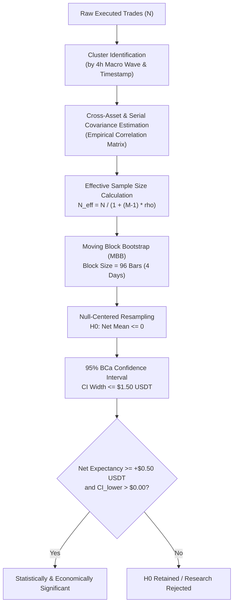

# NEPTUNE — Candidate A: Statistical Power & Dependence Analysis Plan
## Higher-Timeframe Trend Following (`SHR-001` / Dual-Timeframe 4h/1h)

> **Document ID:** `docs/research/NEPTUNE_SHR001_STATISTICAL_POWER_PLAN.md`  
> **Repository:** Project NEPTUNE Research Governance  
> **Classification:** Statistical Methodology Specification  
> **Status:** Active Research Plan  
> **Date:** 2026-11-07  
> **Governing Rules:** Rule S-05, Rule S-06, Rule S-07, Rule A-08  
> **Related Documents:**  
> - [`docs/research/NEPTUNE_SHR001_DUAL_TIMEFRAME_FEASIBILITY.md`](file:///d:/Project%202026/Trading_bot/docs/research/NEPTUNE_SHR001_DUAL_TIMEFRAME_FEASIBILITY.md)  
> - [`docs/research/NEPTUNE_EXPERIMENT_SELECTION_GATES.md`](file:///d:/Project%202026/Trading_bot/docs/research/NEPTUNE_EXPERIMENT_SELECTION_GATES.md)  

---

## 1. Executive Summary & Purpose

A fundamental flaw of naive algorithmic trading research is assuming that trade outcomes are independent and identically distributed (i.i.d.) observations drawn from a stationary normal distribution. In reality:
1. **Financial trades are serially correlated:** Consecutive trades within the same market trend inherit the macro state.
2. **Cross-asset trades are correlated:** Simultaneous trades across Bitcoin, Ethereum, and BNB share systemic market risk ($\rho \approx 0.70 - 0.90$).
3. **Trade returns have heavy tails (fat tails) and positive skewness:** Standard Gaussian power formulas severely underestimate required sample sizes.

This document establishes the formal **Statistical Power and Dependence Analysis Plan** for Candidate A2 (Dual-Timeframe 4h/1h Trend Following). It investigates the sample-size problem, defines effective sample size calculations, formulates the block bootstrap protocol, and explains why **empirical statistical power cannot be certified prior to authorized Development execution**.

---

## 2. Investigation of the Trade Count & Independence Dilemma

### 2.1 The "15–25 Trades/Year" Deconstruction
In Milestone 4.6.3.1.4 and the Strategy Research Reset, it was observed that a pure 4h trend-following system (Candidate A1) generates only $15 - 25$ closed trades across a 1-year partition. 

Forensic verification confirms:
- **Partition Capacity:** A 1-year partition (e.g., 2024 Development) contains 8,784 hours, yielding exactly **2,196 4h bars per symbol**.
- **Trend Regime Frequency:** In crypto markets, persistent directional trends (defined by 4h ADX $> 25$ and aligned 50/200 EMAs) occur in $4 - 7$ distinct waves per year on a single asset.
- **Single-Symbol Cadence:** A strict 4h trend-following model taking only the primary breakout of each regime generates $5 - 8$ trades per symbol annually.
- **Three-Symbol Aggregate:** Summing raw signals across `BTCUSDT`, `ETHUSDT`, and `BNBUSDT` produces an apparent total of:
  $$N_{\text{raw}} \approx 3 \times (5 \text{ to } 8) = 15 \text{ to } 24 \text{ trades/year}$$

### 2.2 The Pseudo-Replication Hazard: Cross-Asset Dependence
A researcher who counts 24 trades across 3 symbols and conducts an i.i.d. $t$-test or naive bootstrap commits **pseudo-replication**:
- Crypto assets are heavily co-integrated. During macro bull impulses, the pairwise correlation matrix $\mathbf{R}$ satisfies:
  $$\rho(\text{BTC}, \text{ETH}) \approx 0.85, \quad \rho(\text{BTC}, \text{BNB}) \approx 0.75, \quad \rho(\text{ETH}, \text{BNB}) \approx 0.78$$
- When a macro liquidity expansion occurs, all three assets break out on the same or adjacent 4h candles.
- If the trade on BTC wins, ETH and BNB almost certainly win. If BTC suffers an abrupt macro liquidation, all three stop out together.
- **Effective Degrees of Freedom:** The 3 simultaneous trades do not represent 3 independent draws from the strategy's edge; they represent **1 macro draw with 3 correlated execution channels**.

### 2.3 Serial Clustering of 1h Entries Within 4h Trends
In Candidate A2 (Dual-Timeframe), a 4h trend creates a window during which multiple 1h pullback entries might occur. 

Treating multiple 1h entries within the same 4h trend wave as independent is statistically invalid:
- If a 4h trend is strong, 3 successive 1h pullbacks might all yield $+3\text{R}$ gains.
- If the 4h trend encounters an unexpected macro reversal, the initial trade and any secondary pullback entry will both stop out.
- **Clustering Rule:** The returns of 1h trades executed within the same 4h trend regime belong to a common cluster $C_k$. The intra-cluster correlation $\rho_{\text{intra}}$ must be modeled explicitly.

### 2.4 True Regime Degrees of Freedom in 2024 Development
In any single calendar year, macroeconomic and regulatory drivers partition the year into a small number of persistent regimes:
- Q1 2024: US Spot ETF approval and institutional capital inflow.
- Q2 2024: Post-halving consolidation and liquidity drain.
- Q3 2024: Summer low-volume range and yen-carry-trade unwind shock.
- Q4 2024: Pre- and post-US presidential election momentum expansion.

Thus, **2024 contains only $K \approx 5 \text{ to } 7$ independent macro regimes**. Any quantitative conclusion drawn from 2024 Development data is bounded by these $K$ macro states.

---

## 3. Mathematical Power-Analysis Framework

### 3.1 Effective Sample Size ($N_{\text{eff}}$) Formulation

To account for cross-asset and serial correlation, the effective sample size $N_{\text{eff}}$ is defined using Kish's design effect formula adjusted for clustered observations:

$$N_{\text{eff}} = \frac{N}{1 + (\bar{M} - 1)\bar{\rho}}$$

Where:
- $N$ is the total number of executed trades.
- $\bar{M}$ is the average cluster size (average number of concurrent or serially linked trades within a single 4h regime wave).
- $\bar{\rho}$ is the average intra-cluster and cross-asset correlation coefficient.

**Numerical Demonstration of Effective Sample Size:**
Assume a candidate system produces $N = 60$ trades across 2024:
- Scenario 1 (Zero Correlation, $\bar{\rho} = 0.0$): $N_{\text{eff}} = 60$.
- Scenario 2 (Moderate Correlation, $\bar{M} = 2.5, \bar{\rho} = 0.40$):
  $$N_{\text{eff}} = \frac{60}{1 + (2.5 - 1)(0.40)} = \frac{60}{1 + 0.60} = 37.5$$
- Scenario 3 (Severe Crypto Correlation, $\bar{M} = 3.0, \bar{\rho} = 0.75$):
  $$N_{\text{eff}} = \frac{60}{1 + (3.0 - 1)(0.75)} = \frac{60}{1 + 1.50} = 24.0$$

**Governance Implication:** If cross-asset correlation is high ($\approx 0.75$), generating 60 nominal trades yields only **24 effective independent observations**, failing the $N_{\text{eff}} \ge 30$ threshold.

### 3.2 Statistical Power Equation for Asymmetric Payoffs
For an asymmetric trend-following strategy with win rate $W \approx 0.40$, payoff ratio $R \approx 2.5$, and net trade dollar return $X_i$:
- Expected Net Trade Return:
  $$\mu = \mathbb{E}[X_i] = (W \cdot \bar{X}_{\text{win}}) - ((1 - W) \cdot \bar{X}_{\text{loss}}) - C_{\text{friction}}$$
- Trade Variance:
  $$\sigma^2 = \text{Var}(X_i) = W \cdot (\bar{X}_{\text{win}} - \mu)^2 + (1 - W) \cdot (-\bar{X}_{\text{loss}} - \mu)^2$$
- Standard Error under Dependence:
  $$SE(\hat{\mu}) = \frac{\sigma}{\sqrt{N_{\text{eff}}}}$$

The statistical power $(1 - \beta)$ to reject the null hypothesis $H_0: \mu \le 0$ at significance level $\alpha = 0.05$ (one-tailed critical value $z_{1-\alpha} = 1.645$) is:

$$\text{Power} = 1 - \beta = \Phi\left( \frac{\mu - 0}{SE(\hat{\mu})} - z_{1-\alpha} \right) = \Phi\left( \frac{\mu \sqrt{N_{\text{eff}}}}{\sigma} - 1.645 \right)$$

### 3.3 Dependence-Aware Resampling: Moving Block Bootstrap (MBB)
Standard bootstrap assumes independent draws, destroying serial and cross-asset structure. NEPTUNE mandates **Moving Block Bootstrap (MBB)**:
1. **Block Length Calibration:** Block length must span the duration of market regime persistence and trade holding periods. For Candidate A2, typical trade holding period is $36 - 96$ hours. Block size is set to **$L = 96$ continuous 1h intervals (4 full calendar days)**.
2. **Synchronized Multi-Asset Resampling:** When a 96-hour block $[t, t+L]$ is sampled, the continuous time series for **all three assets (BTC, ETH, BNB)** are drawn simultaneously. This preserves the true empirical cross-asset covariance matrix $\mathbf{\Sigma}$.
3. **Null Centering:** Bootstrap samples are centered under the null hypothesis $H_0$:
   $$X_{i}^{*,\text{null}} = X_i^* - \bar{X}_{\text{sample}}$$
4. **Empirical $p$-Value:**
   $$p_{\text{empirical}} = \frac{1}{B} \sum_{b=1}^{B} \mathbb{I}\left( \bar{X}_b^{*,\text{null}} \ge \bar{X}_{\text{sample}} \right), \quad B = 10,000$$

### 3.4 Confidence Interval Width & Minimum Economic Hurdle
To declare a candidate viable, the $95\%$ bias-corrected and accelerated (BCa) bootstrap confidence interval must satisfy:
1. **Lower Bound Strictly Positive:** $\text{CI}_{\text{lower}} > \$0.00$ USDT.
2. **Economic Hurdle Clearance:** Point estimate $\hat{\mu} \ge +\$0.50$ USDT per trade.
3. **Bounded Uncertainty (Precision):**
   $$\text{CI}_{\text{width}} = \text{CI}_{\text{upper}} - \text{CI}_{\text{lower}} \le \$1.50\text{ USDT}$$
   If $\text{CI}_{\text{width}} > \$2.00$ USDT, the sample size is inadequate, and the result is deemed inconclusive.

---

## 4. Why Statistical Power Cannot Yet Be Quantified

Per Rule S-06 (Honesty and Transparency):

$$\mathbf{DECLARATION:\ STATISTICAL\ POWER\ CANNOT\ BE\ QUANTIFIED\ AT\ THIS\ STAGE}$$

### Mathematical Reasons:
1. **Unknown Population Variance ($\sigma^2$):** Without running the deterministic strategy logic against historical data, the empirical standard deviation of realized trade returns $\sigma$ is unknown.
2. **Unknown Empirical Correlation ($\bar{\rho}$):** The exact correlation of trade outcomes between BTC, ETH, and BNB depends on the precise timing of 1h swing-structure breaks. We cannot calculate $N_{\text{eff}}$ without empirical returns.
3. **Prohibition of Observation Loading:** Loading historical price candles to measure these parameters is strictly prohibited during this research feasibility phase.

### What CAN Be Quantified Ahead of Time:
We can establish the **Required Sample Size Boundary Table** for given hypothetical effect sizes ($\mu/\sigma$):

| Standardized Effect Size ($\mu/\sigma$) | Required $N_{\text{eff}}$ for $80\%$ Power ($\alpha=0.05$) | Required $N_{\text{eff}}$ for $90\%$ Power ($\alpha=0.05$) | Plausibility in 1-Year Partition |
|---|:---:|:---:|---|
| **Weak Edge ($\mu/\sigma = 0.15$)** | $275$ | $385$ | **IMPOSSIBLE** on HTF |
| **Moderate Edge ($\mu/\sigma = 0.25$)** | $99$ | $138$ | **EXTREMELY UNLIKELY** |
| **Strong Edge ($\mu/\sigma = 0.35$)** | $51$ | $71$ | **MARGINAL** (Requires low cross-correlation) |
| **Very Strong Edge ($\mu/\sigma = 0.45$)**| **$31$** | **$43$** | **FEASIBLE** if $N_{\text{eff}} \ge 31$ |

**Critical Finding:** For Candidate A2 to achieve $80\%$ statistical power with $N_{\text{eff}} \approx 35 - 45$, the strategy **must possess a very strong standardized effect size ($\mu/\sigma \ge 0.40$)**. If the true underlying edge is modest ($\mu/\sigma \le 0.20$), no 1-year historical partition can ever statistically validate it!

---

## 5. Protocol for Future Statistical Power Validation

If a Development experiment for Candidate A2 is eventually authorized by the Governance Committee, the statistical analysis must follow this exact step-by-step protocol:

1. **Trade Sequence Extraction:** Extract all closed trades from `PortfolioLedger` with execution timestamps, symbol, gross return, fees, slippage, and net P&L.
2. **Cluster Grouping:** Assign trades occurring within overlapping 48-hour windows to discrete regime clusters $C_1, C_2, \dots, C_K$.
3. **Covariance Matrix Estimation:** Calculate empirical cross-asset correlation $\mathbf{R}$ across concurrent trades.
4. **$N_{\text{eff}}$ Computation:** Calculate Kish effective sample size $N_{\text{eff}}$. If $N_{\text{eff}} < 25$, immediately flag `SAMPLE_ADEQUACY_BREACH`.
5. **Continuous Time-Grid MBB:** Map trade returns onto the regular continuous 1h market-time grid and run 10,000 block bootstrap iterations with block length $L = 96$.
6. **Hypothesis Testing:** Evaluate null-centered empirical $p$-value and $95\%$ BCa confidence intervals against the pre-registered hurdles ($\hat{\mu} \ge +\$0.50$ USDT, $p < 0.05$).

