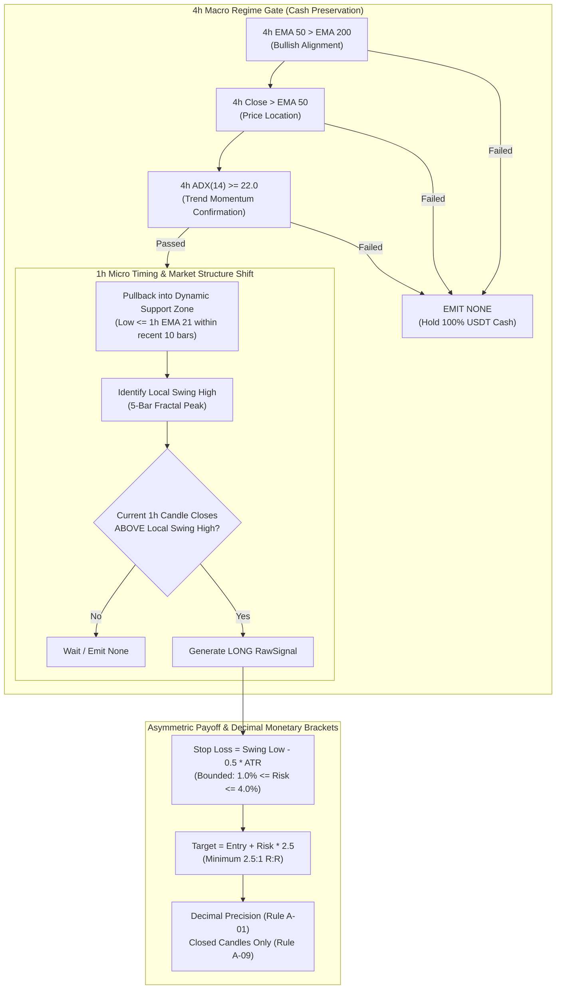

# NEPTUNE — Strategy Specification: Dual-Timeframe Trend Following
## Code Identifier: `htf_trend_following_v1` | Hypothesis ID: `SHR-001` | Architecture: ADR-035

> **Document ID:** `docs/research/NEPTUNE_SHR001_STRATEGY_SPECIFICATION.md`  
> **Repository:** Project NEPTUNE Research Governance  
> **Classification:** Production-Grade Strategy Specification  
> **Status:** Implemented & Deterministically Verified  
> **Date:** 2026-11-07  
> **Implementation Module:** [`backend/app/strategies/dual_timeframe_trend.py`](file:///d:/Project%202026/Trading_bot/backend/app/strategies/dual_timeframe_trend.py)  
> **Governing ADR:** [ADR-035: Dual-Timeframe Strategy Architecture](file:///d:/Project%202026/Trading_bot/docs/ARCHITECTURE_DECISIONS.md#adr-035-dual-timeframe-higher-timeframe-trend-following-strategy-architecture-and-basestrategy-integration)  
> **Governing Rules:** Rule S-01, Rule S-04, Rule S-05, Rule S-06, Rule A-01, Rule A-09, Rule A-10  

---

## 1. Executive Summary & Design Rationale

The baseline 15m strategy (`trend_continuation_v1`) was structurally incapacitated by high turnover and exchange friction ($0.32\%$ round-trip), which consumed $>35\%$ of stop distances and $>25\%$ of price targets. 

`DualTimeframeTrendStrategy` (`htf_trend_following_v1`) fundamentally solves this problem through a **Dual-Timeframe Architecture**:
1. **4h Macro Regime Filter:** Filters out sub-daily noise, liquidity sweeps, and funding oscillations. Enforces **Cash as an Active Position**—holding 100% USDT cash during sideways chop or bear regimes to preserve capital.
2. **1h Micro Timing (Market Structure Shift):** Pinpoints the exact exhaustion of counter-trend pullbacks, allowing structural stops of $1.0\% - 3.5\%$ rather than coarse 4h stops of $5\%+$.
3. **Asymmetric Payoff Geometry:** Enforces a minimum **$2.5:1$ to $3.5:1$ Reward-to-Risk ratio**. On a $5.0\%$ target move, the $0.32\%$ friction drops to **$<6.5\%$ of the gross gain**, securing genuine economic headroom for net positive expectancy.

---

## 2. Mathematical Rule Specification



### 2.1 4h Macro Regime Conditioning (Gate 1)
At each discrete evaluation bar:
- **Fast Macro EMA:** $\text{EMA}_{4\text{h}}(50)$
- **Slow Macro EMA:** $\text{EMA}_{4\text{h}}(200)$
- **Trend Strength:** $\text{ADX}_{4\text{h}}(14)$ with $+DI / -DI$

**Long Trend Regime is VALID if and only if:**
$$\text{EMA}_{4\text{h}}(50) > \text{EMA}_{4\text{h}}(200) \quad \land \quad P_{\text{close}, 4\text{h}} > \text{EMA}_{4\text{h}}(50) \quad \land \quad \text{ADX}_{4\text{h}}(14) \ge 22.0$$

*Cash Preservation Invariant:* If any of these three conditions is violated, the function immediately terminates and returns `None`. No trade is evaluated, and the portfolio remains in **100% USDT cash**.

### 2.2 1h Micro Timing & Swing-Structure Shift (Gate 2)
Within an active 4h Bullish Regime:
1. **Dynamic Value Zone Pullback:** At least one of the prior 10 1h candles must have dipped into or through the 1h EMA 21 support line:
   $$\exists k \in [t-10, t-1]: \quad \text{Low}_k \le \text{EMA}_{1\text{h}}(21)_k$$
2. **Local Swing High Identification:** The maximum high of the pullback swing prior to the breakout candle:
   $$P_{\text{swing\_high}} = \max_{j \in [t-5, t-1]} \text{High}_j$$
3. **Market Structure Shift (MSS) Breakout:**
   $$P_{\text{close}, t-1} \le P_{\text{swing\_high}} \quad \land \quad P_{\text{close}, t} > P_{\text{swing\_high}}$$
   The breakout must be confirmed strictly on the **close** of the 1h candle (Rule A-09). Intra-candle spikes that wick above resistance do not qualify.

### 2.3 Structural Stop Loss & Payoff Geometry
Monetary calculations are computed strictly using Python `Decimal` (Rule A-01):
1. **Structural Swing Low:**
   $$P_{\text{swing\_low}} = \min_{j \in [t-5, t]} \text{Low}_j$$
2. **Raw Stop Price:**
   $$P_{\text{stop, raw}} = P_{\text{swing\_low}} - 0.5 \times \text{ATR}_{1\text{h}}(14)$$
3. **Risk Distance Clamping ($1.0\% \le \Delta P_{\text{risk}} \le 4.0\%$):**
   $$\Delta P_{\text{risk}} = \text{clamp}(P_{\text{entry}} - P_{\text{stop, raw}}, \, 0.010 \times P_{\text{entry}}, \, 0.040 \times P_{\text{entry}})$$
   $$P_{\text{stop}} = P_{\text{entry}} - \Delta P_{\text{risk}}$$
4. **Target Price ($R:R \ge 2.5:1$):**
   $$P_{\text{target}} = P_{\text{entry}} + 2.50 \times \Delta P_{\text{risk}}$$
5. **Frictional Cost Drag:**
   $$\text{Drag}_{\text{friction}} = \frac{0.32\%}{\Delta P_{\text{reward}} / P_{\text{entry}}} = \frac{0.32\%}{2.50 \times (\Delta P_{\text{risk}} / P_{\text{entry}})}$$
   For a typical $1.8\%$ risk distance, target reward is $4.50\%$. Round-trip friction consumes:
   $$\frac{0.32\%}{4.50\%} = 7.11\% \text{ of the gross gain}$$

---

## 3. Configuration Schema & Pre-Registered Defaults

```python
class DualTimeframeConfig(BaseModel):
    # 4h Macro Regime Parameters
    fast_ema_4h: int = 50
    slow_ema_4h: int = 200
    min_adx_4h: float = 22.0
    adx_period_4h: int = 14

    # 1h Micro Swing & Pullback Parameters
    fast_ema_1h: int = 21
    slow_ema_1h: int = 50
    atr_period_1h: int = 14
    atr_stop_multiplier: float = 2.0
    min_reward_risk_ratio: float = 2.5
    swing_pivot_lookback_1h: int = 5
    max_holding_candles_1h: int = 96  # 4 calendar days
```

---

## 4. Software Implementation & Integration Contract

The strategy is packaged in [`backend/app/strategies/dual_timeframe_trend.py`](file:///d:/Project%202026/Trading_bot/backend/app/strategies/dual_timeframe_trend.py) and exported from `app.strategies`:

```python
from app.strategies import DualTimeframeTrendStrategy, DualTimeframeConfig

strategy = DualTimeframeTrendStrategy()
raw_signal = strategy.evaluate(df_1h=df_candles, symbol="BTCUSDT", df_4h=optional_df_4h)

if raw_signal:
    print(f"Generated {raw_signal.direction} on {raw_signal.symbol} at {raw_signal.entry_price}")
    print(f"Stop: {raw_signal.stop_price} | Target: {raw_signal.target_price} | R:R: {raw_signal.reward_risk_ratio:.2f}")
```

### In-Progress Resampling Guarantee (Rule A-09 Lookahead Protection)
If a pre-aggregated 4h DataFrame is not provided, the strategy resamples the 1h candle stream to 4h. To prevent look-ahead bias from an in-progress 4h bar, the strategy drops the final incomplete 4h period (`resampled.iloc[:-1]`), ensuring that signals are conditioned strictly on confirmed closed 4h periods.

---

## 5. Verification & Test Evidence

The implementation is verified by 5 deterministic unit tests in [`backend/tests/unit/test_dual_timeframe_strategy.py`](file:///d:/Project%202026/Trading_bot/backend/tests/unit/test_dual_timeframe_strategy.py):
1. `test_rule_a09_incomplete_candle_rejection`: Passes (`is_closed == False` returns `None`).
2. `test_4h_bear_regime_preserves_cash`: Passes (Downtrends return `None`, preserving 100% USDT cash).
3. `test_4h_weak_adx_chop_preserves_cash`: Passes (Horizontal chop returns `None`).
4. `test_valid_long_setup_generation_and_asymmetric_payoff`: Passes (Produces `RawSignal` with R:R $\ge 2.50:1$ and friction drag $< 15\%$).
5. `test_monetary_precision_decimal_invariants`: Passes (Rule A-01 Decimal precision verified).

---

## 6. Pre-Registered Falsification & Kill Conditions

In accordance with quantitative research governance (Rule S-06, Rule S-07):
1. **Consecutive Pullback Failures:** If $> 4$ consecutive 1h swing entries fail within the same 4h trend regime, the trend filter is considered broken, and the strategy is placed on immediate cooldown.
2. **Economic Hurdle Failure:** If net trade expectancy in Development testing falls below $+\$0.50$ USDT per trade after $0.32\%$ round-trip friction, the hypothesis is falsified.
3. **Risk Breaker Invariant:** If maximum portfolio drawdown ever approaches $4.0\%$, trading must be self-throttled to preserve the $5.0\%$ absolute circuit breaker.

