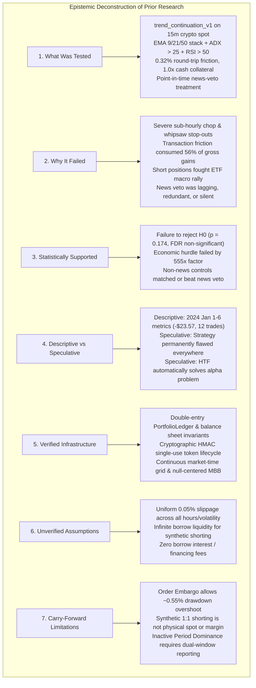
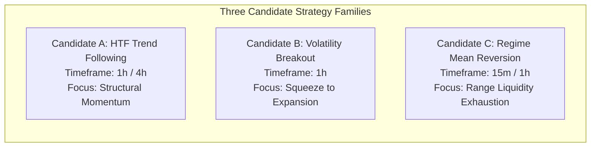
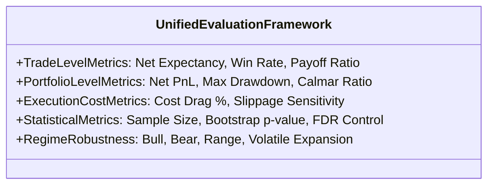
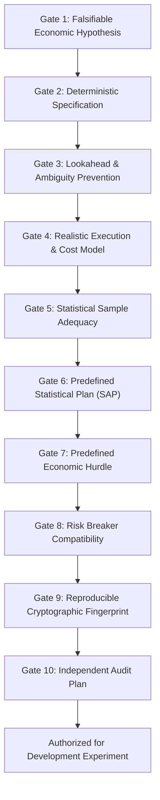
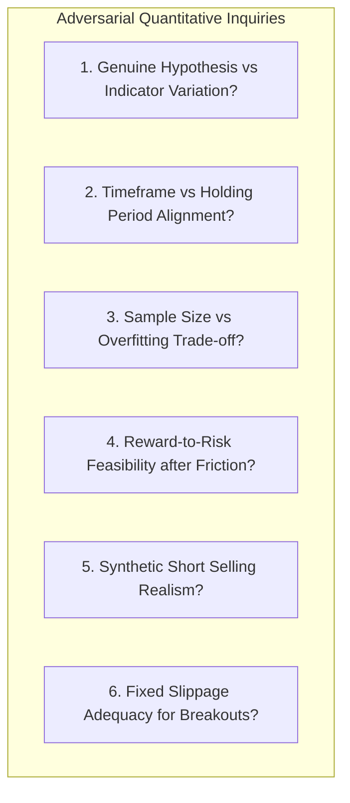

# NEPTUNE — Strategy Research Reset: Hypothesis Design & Selection Framework

> **Document ID:** `docs/research/NEPTUNE_STRATEGY_RESEARCH_RESET.md`  
> **Milestone:** Research Strategy Reset (Post-Milestone 4.6.3.1.4)  
> **Classification:** Research Architecture & Governance  
> **Status:** Active Research Decision Framework  
> **Author:** Quantitative Systems Group & Independent Audit Team  
> **Date:** 2026-11-07  
> **Governance Notice:** *This document establishes research design and evaluation criteria only. It authorizes zero backtests, zero simulations, zero parameter optimization, and zero partition progression.*  

---

## 1. Executive Summary & Objective

With the formal closure of Milestone 4.6.3.1.4, the initial technical strategy hypothesis (`trend_continuation_v1`) has been cataloged as unsuccessful under the tested 2024 Development conditions. The accounting discrepancies, portfolio cash tracking, and risk circuit breaker mechanisms have been independently remediated and verified.

The core mission of Project NEPTUNE remains:

$$\mathbf{CORE\ OBJECTIVE:}\quad\begin{minipage}{0.8\textwidth}\textit{Discover whether a simple, reproducible trading strategy can produce positive net expectancy after realistic transaction costs, while respecting strict portfolio risk constraints.}\end{minipage}$$

Crucially, **we must not confuse building sophisticated quantitative infrastructure with discovering an economically profitable strategy**. Advanced double-entry ledgers, cryptographic token verification, and moving block bootstraps do not generate alpha; they merely ensure that when a strategy fails, its failure is measured accurately and honestly.

This document establishes an objective, adversarial research reset. It reconstructs the foundational empirical lessons from previous audits, establishes a standardized comparison framework across three candidate strategy families, subjects all candidate hypotheses to critical quantitative scrutiny, and defines rigorous selection gates that must be satisfied before any new Development-partition experiment may be considered.

---

## 2. Phase 1 — Reconstructing the Research Lessons

A rigorous research reset requires an uncompromising assessment of what has actually been learned, separating mathematically verified facts from provisional hypotheses and speculative narratives.

### 2.1 What Was Actually Tested
The previous experiment tested a specific technical momentum continuation model (`trend_continuation_v1`) operating on **15-minute candle closes** across BTCUSDT, ETHUSDT, and BNBUSDT during the 2024 Development partition. 
- **Indicator Geometry:** EMA 9/21/50 stack alignment, ADX(14) > 25, RSI(14) > 50, MACD histogram > 0, 1.5:1 minimum reward-risk ratio.
- **Execution & Friction:** `NEXT_ELIGIBLE_PRICE` (Bar $T+1$ Open execution) under an authoritative 0.32% round-trip friction model (0.10% taker fee, 0.05% slippage, 0.01% half-spread).
- **Risk Invariants:** 0.5% risk per trade, max 2 concurrent positions, 1 per asset, 2.0% daily loss limit, 5.0% maximum drawdown circuit breaker.
- **Treatment:** Adverse point-in-time news vetoing (`GROUP_B`) contrasted against technical baseline (`GROUP_A`), online frequency thinning (`GROUP_C`), and online dynamic cooldown (`GROUP_D`).

### 2.2 Why It Failed Under Tested Conditions
1. **Microstructure Whipsaw Drag:** Moving averages on 15-minute crypto candles suffer from severe lag. By the time EMA 9/21/50 alignment and ADX > 25 confirmed a trend, the intraday impulse was frequently exhausted, causing entries to occur at local swing extremes immediately preceding mean-reverting pullbacks.
2. **Transaction Cost Asymmetry:** Across 12 trades, total transaction costs ($21.29 USDT) absorbed $56.1\%$ of all gross profits ($37.98 USDT). On a 15-minute timeframe with ~1.0% stop distances, a 0.32% round-trip cost creates an insurmountable mathematical hurdle.
3. **Unhedged Short Positions During Structural ETF Inflows:** 6 of 12 executed trades were SHORT positions during the first week of January 2024—a period dominated by pre-ETF institutional spot inflows. 5 of the 6 short trades were stopped out.
4. **Informational Ineffectiveness of News Vetoing:** Editorial news and exchange announcements in the historical dataset lagged market moves by 30 to 120 minutes. The few adverse news events in early January did not overlap with the specific technical stop-outs that caused the drawdown.

### 2.3 Statistically Supported Findings
- **Failure to Reject Null Hypothesis:** Across 35,136 continuous 15m bars, the null-centered moving block bootstrap yielded $p = 0.1740$ for $H_1$ ($B > A$). Under Benjamini-Hochberg FDR control at $\alpha = 0.05$, the critical threshold was $0.0167$. Therefore, the observed outperformance ($+\$0.01$ USDT total across 12 trades) is statistically indistinguishable from zero.
- **Decisive Economic Hurdle Failure:** The observed trade-level delta ($+\$0.0009$ USDT/trade) failed the pre-registered economic hurdle ($+\$0.50$ USDT/trade) by a factor of 555x.
- **Control Dominance:** Online frequency thinning (`GROUP_C`, $-\$23.13$ USDT) and online dynamic cooldown (`GROUP_D`, $-\$23.21$ USDT) achieved equal or superior ending equity compared to news vetoing (`GROUP_B`, $-\$23.56$ USDT), proving that Group B's slight variance was an artifact of trade count reduction rather than genuine informational alpha.

### 2.4 Descriptive vs. Speculative Conclusions
- **Descriptive Facts:** In the 2024 Development partition under the tested configuration, `trend_continuation_v1` realized $-\$23.57$ USDT net PnL, a $25.0\%$ win rate, and tripped the 5.0% drawdown circuit breaker on Day 5.
- **Speculative Narratives to Avoid:**
  - *Speculation 1:* "Trend continuation never works in crypto." (Unproven; the test only examined 15m EMA stacks on 3 assets over 1 week of active trading).
  - *Speculation 2:* "Moving to 1h or 4h will automatically make the strategy profitable." (Unproven; higher timeframes have fewer trades, wider stops, and may suffer prolonged drawdowns during ranging markets).
  - *Speculation 3:* "Mean reversion is naturally better suited for crypto." (Unproven; mean reversion faces severe tail risk during breakout regimes).

### 2.5 Verified Infrastructure vs. Unverified Assumptions
| Subsystem | Verified Capabilities | Unverified Assumptions / Limitations |
|---|---|---|
| **Market Data** | REST ingestion, gap detection, Parquet storage | Level 2/3 order book depth is omitted; assumes uniform liquidity. |
| **Indicators** | Zero-lookahead SMA, EMA, ATR, RSI, MACD, BB, VWAP | Static indicator lookbacks assume constant market memory. |
| **Risk Manager** | HMAC token lifecycle, single-use idempotency, breaker trip | Order Embargo policy permits ~0.55% drawdown overshoot on open trades. |
| **Portfolio Ledger** | Double-entry cash balance, collateral, balance sheet invariants | 1:1 synthetic shorting assumes zero borrow fees and infinite borrow capacity. |
| **Execution Simulator** | `NEXT_ELIGIBLE_PRICE`, execution gap timeout, cost model | Fixed 0.05% slippage may underestimate breakout execution gaps. |
| **Statistical Engine** | Null-centered MBB on continuous 15m grid, BH-FDR | Inactive Period Dominance requires explicit active-window partitioning. |

---

## 3. Phase 2 & 3 — Evaluation & Comparison of Candidate Strategy Families

We evaluate three candidate strategy families without implementing or backtesting them. All parameters, indicator settings, and thresholds discussed below are **PROVISIONAL RESEARCH HYPOTHESES — NOT VALIDATED OR OPTIMIZED**.

### 3.1 Candidate A: Higher-Timeframe Trend Following (`htf_trend_following_v1`)

1. **Economic Rationale:** Macro capital allocations and institutional flows operate over multi-day horizons. Higher-timeframe bars (1h/4h) filter out high-frequency microstructure noise, capturing persistent structural trends.
2. **Favorable Market Conditions:** Sustained directional bull or bear markets driven by fundamental adoption, macroeconomic liquidity, or structural re-pricings.
3. **Failure Conditions:** Prolonged sideways consolidations, multi-week rotational ranges, and sharp V-shaped market reversals.
4. **Source of Gross Returns:** Large directional price moves ($4.0\% - 10.0\%+$) that substantially exceed the average stop-loss distance.
5. **Turnover & Cost Sensitivity:** **Low.** Low trade frequency (estimated 30–60 trades/year per asset). Transaction costs (0.32%) represent a small fraction of the wide target brackets.
6. **Required Market Data:** 1h and 4h confirmed closed candles for BTCUSDT, ETHUSDT, BNBUSDT.
7. **Conceptual Entry & Exit Logic:**
   - *Entry:* 4h trend filter confirms macro alignment (e.g., price above 4h 50/200 EMA); 1h pullback to dynamic support (e.g., 21 EMA); entry on confirmed break of local swing structure.
   - *Exit:* Structural trailing stop anchored to 1h swing lows or multi-bar ATR; take-profit targets at $+3.0\text{R}$ to $+4.0\text{R}$.
8. **Stop-Loss & Position-Sizing:** Wider dollar stops ($1.5 - 2.5 \times \text{ATR}_{1\text{h}}$) resulting in smaller position sizes under the 0.5% risk rule, preserving cash equity.
9. **Expected Holding Period:** 24 to 96 hours (1 to 4 calendar days).
10. **Potential Overlap with Other Candidates:** Low overlap with Candidate C; partial overlap with Candidate B during sustained expansion runs.
11. **Main Sources of Bias:** Lookback selection snooping (cherry-picking 50 vs 100 vs 200 EMA); survivorship bias if applied to selected altcoins (mitigated by sticking to Tier-1 BTC/ETH/BNB).
12. **Minimum Evidence Required to Continue:** Must generate a positive gross profit factor ($> 1.30$) and demonstrate that trade frequency is sufficient ($N \ge 30$ trades/year) to avoid statistical power collapse.

### 3.2 Candidate B: Volatility Compression and Expansion (`vol_compression_breakout_v1`)

1. **Economic Rationale:** Volatility is cyclical and clusters over time. Extended periods of range compression (order absorption, low liquidity) build directional inventory that is released through violent expansion impulses.
2. **Favorable Market Conditions:** Range-bound consolidations that resolve into clean, decisive directional breakout thrusts.
3. **Failure Conditions:** "Liquidity sweep" ranges where false breakouts immediately fail and mean-revert into the range ("fakeouts"); high-volatility expansions without directional follow-through.
4. **Source of Gross Returns:** Explosive initial momentum immediately following range breakouts, capturing the first $+2.0\text{R}$ to $+3.0\text{R}$ before consolidation resumes.
5. **Turnover & Cost Sensitivity:** **Moderate.** Moderate trade frequency (estimated 50–90 trades/year per asset). Slippage on breakout entries can be severe during fast market moves.
6. **Required Market Data:** 1h candles with accurate volume data; multi-period ATR and standard deviation bands.
7. **Conceptual Entry & Exit Logic:**
   - *Entry:* Squeeze identification (Bollinger Bands compress inside Keltner Channels for $\ge 8$ bars); breakout confirmation on a candle close beyond the consolidation boundary accompanied by relative volume expansion ($> 1.8 \times \text{SMA}_{20}$).
   - *Exit:* Tight structural stop placed on the opposite side of the compression box; Chandelier trailing stop ($2.5 \times \text{ATR}$); time-based stop (exit if trade fails to gain $+1.0\text{R}$ within 6 bars).
8. **Stop-Loss & Position-Sizing:** Tight structural stop requires disciplined position sizing; adverse opening gaps beyond stop loss present tail risk.
9. **Expected Holding Period:** 6 to 36 hours.
10. **Potential Overlap with Other Candidates:** May trigger at the genesis of moves that Candidate A later enters on pullbacks.
11. **Main Sources of Bias:** Squeeze threshold parameter fitting; volume multiplier snooping; lookahead leakage in defining range boundaries.
12. **Minimum Evidence Required to Continue:** Breakout follow-through rate must exceed $40\%$, and average win-to-loss payoff ratio must exceed $2.0:1$ net of slippage.

### 3.3 Candidate C: Regime-Conditioned Mean Reversion (`regime_mean_reversion_v1`)

1. **Economic Rationale:** In the absence of macro catalysts, market makers and institutional participants provide liquidity around volume-weighted equilibrium prices. Overextended price excursions beyond statistical extremes represent temporary liquidity imbalances that revert to the mean.
2. **Favorable Market Conditions:** Broad, well-defined horizontal trading ranges and low-momentum consolidation regimes (ADX < 20).
3. **Failure Conditions:** Trend breakout days, structural macro re-pricings, and runaway cascade liquidations ("catching a falling knife").
4. **Source of Gross Returns:** High-probability captures of the price delta between an extreme band touch and the central equilibrium mean (VWAP / 20-SMA).
5. **Turnover & Cost Sensitivity:** **Very High.** High turnover (estimated 100–180 trades/year per asset). Small target profit distances make net profitability highly vulnerable to the 0.32% round-trip friction.
6. **Required Market Data:** 15m and 1h candles with continuous intraday volume-weighted average price (VWAP) tracking.
7. **Conceptual Entry & Exit Logic:**
   - *Entry:* Market Scanner strictly confirms `RANGING_COMPRESSING` (ADX < 20); price exceeds 2.5 standard deviations from VWAP and touches 2.5-sigma Bollinger Band; candlestick rejection pattern confirms exhaustion.
   - *Exit:* Primary profit target at VWAP / 20-SMA; hard stop-loss placed $1.0 \times \text{ATR}$ beyond the extreme wick.
8. **Stop-Loss & Position-Sizing:** Strict risk-reward ratio ($\ge 1.5:1$); mandatory regime circuit breaker halts entries immediately if ADX rises above 25.
9. **Expected Holding Period:** 2 to 12 hours.
10. **Potential Overlap with Other Candidates:** Strictly anti-correlated with Candidates A and B; enters opposite to breakout signals.
11. **Main Sources of Bias:** Asymmetric tail risk (small frequent gains wiped out by rare massive trend breakouts); regime filter threshold fitting.
12. **Minimum Evidence Required to Continue:** Win rate must exceed $58\%$ net of costs, and profit factor must maintain $> 1.25$ during verified ranging periods.

---

## 4. Standardized Comparative Evaluation Framework

To prevent candidates from "winning" due to asymmetric assumptions or biased metrics, all candidates must be evaluated against a unified, multidimensional framework:

### 4.1 Required Metric Dimensions

| Dimension | Metric | Purpose & Standard |
|---|---|---|
| **Trade Expectancy** | $E_{\text{trade}} = \frac{\sum \text{Net PnL}}{N_{\text{trades}}}$ | Core economic measure of edge per executed trade. Must be positive net of friction. |
| **Candidate Expectancy**| $E_{\text{cand}} = \frac{\sum \text{Net PnL}}{N_{\text{candidates}}}$ | Measures selectivity efficiency and opportunity cost across all generated setups. |
| **Portfolio Performance**| Net P&L & Net Portfolio Return (%) | Bottom-line portfolio capital growth on $1,000 USDT virtual capital. |
| **Capital Preservation**| Maximum Drawdown ($MDD$) | Peak-to-trough equity decline. Must not breach the 5.0% circuit breaker. |
| **Risk-Adjusted Return**| Calmar Ratio & Sortino Ratio | Ratio of annualized return to maximum drawdown and downside deviation. |
| **Frictional Cost Drag**| $\text{Cost Drag} = \frac{\text{Total Costs}}{\text{Gross Profit}} \times 100\%$ | Quantifies percentage of gross profits consumed by fees, slippage, and spread. |
| **Sample Adequacy** | Independent Trade Count ($N$) | Number of non-overlapping trades. Target $N \ge 30$ per asset for statistical power. |
| **Regime Consistency** | Regime-Specific Profit Factor | Evaluates whether returns are concentrated in one regime or distributed robustly. |
| **Cost Sensitivity** | Net Expectancy at 0.16%, 0.32%, 0.48% | Stress-tests sensitivity to double slippage and taker fee variations. |
| **Statistical Rigor** | Null-Centered MBB $p$-value & FDR | Verifies that edge is statistically distinguishable from random sampling noise. |

### 4.2 Explicit Separation: Trade Expectancy vs. Portfolio Performance
Researchers must not conflate high trade-level expectancy with sound portfolio performance:
- A strategy can achieve a high average win ($+\$15.00$ USDT) across 4 trades, but if it executes only 4 trades a year, its annual portfolio return is negligible ($+6.0\%$) and its statistical significance is untestable ($N=4$).
- Conversely, a strategy can execute 500 trades with a tiny positive gross expectancy ($+\$0.10$ USDT), but a 0.32% fee drag ($-\$0.64$ USDT/trade) will drive portfolio equity straight into the circuit breaker.
- Both trade-level expectancy ($E_{\text{trade}} > 0$) AND portfolio-level risk compatibility ($MDD < 5.0\%$) are required.

---

## 5. Phase 4 — Objective Selection Gates Before Experimentation

Before any candidate strategy family may be authorized for a controlled Development-partition experiment, it must pass through ten formal pre-registration selection gates.

### Detailed Gate Specifications

| Gate ID | Gate Name | Requirement & Acceptance Standard | Rationale |
|---|---|---|---|
| **GATE-01** | **Falsifiable Economic Hypothesis** | Written economic rationale explaining why counter-parties trade at a disadvantage. Must identify market participants providing the return. | Prevents purely empirical curve-fitting and random data mining. |
| **GATE-02** | **Deterministic Specification** | Mathematical definition of all indicators, signals, entry prices, stops, and targets. Zero discretionary or subjective rules. | Guarantees 100% algorithmic reproducibility across independent runs. |
| **GATE-03** | **Lookahead & Ambiguity Prevention** | Signals evaluated strictly on confirmed closed candles. Execution at Bar $T+1$ Open. Conservative bracket ambiguity resolution. | Enforces strict point-in-time compliance and Rule A-09. |
| **GATE-04** | **Authoritative Cost Model** | Incorporation of 0.10% maker/taker fees, 0.05% slippage, 0.01% half-spread, and opening gap slippage penalties. | Ensures that strategies unviable under real friction fail immediately. |
| **GATE-05** | **Statistical Sample Adequacy** | Pre-experiment architecture must indicate a plausible sample size of $N \ge 30$ independent trades across the partition. | Prevents statistical power collapse and meaningless bootstrap CIs. |
| **GATE-06** | **Predefined Statistical Analysis Plan** | Moving Block Bootstrap block size calibrated to timeframe (~4 calendar days); null-centered hypothesis testing; Benjamini-Hochberg FDR control. | Prevents p-hacking, point-mass collapse, and post-hoc metric shifting. |
| **GATE-07** | **Predefined Economic Hurdle** | Pre-registered net profit hurdle: $E_{\text{trade}} \ge +\$0.50$ USDT net profit per trade after all costs. | Distinguishes meaningful economic alpha from microscopic noise. |
| **GATE-08** | **Risk Breaker Compatibility** | Demonstrated architectural reasoning why the strategy will not trip the 5.0% maximum drawdown breaker in early simulation bars. | Directly addresses the Week 1 failure mode of `trend_continuation_v1`. |
| **GATE-09** | **Reproducible Experiment Fingerprint** | Composite SHA-256 fingerprint binding configuration parameters, code version, and dataset manifests prior to execution. | Prevents silent parameter adjustments during testing. |
| **GATE-10** | **Independent Audit Commitment** | Pre-registered commitment to independent ledger verification, cash reconciliation, and code inspection before results are accepted. | Upholds NEPTUNE persistent engineering standards (Rule S-06). |

---

## 6. Phase 5 — Adversarial Quantitative Review of Research Assumptions

Acting as an independent quantitative research reviewer, we subject the candidate strategy families and research platform to adversarial critique.

### 6.1 Inquiry 1: Are these genuinely different economic hypotheses or merely indicator variations?
- **Critique:** Candidates A, B, and C can easily degenerate into superficial variations of moving averages and standard deviation bands (e.g., swapping an EMA cross for a Bollinger Band cross).
- **Assessment:**
  - Candidate A targets **structural trend continuation** over multi-day horizons.
  - Candidate B targets **volatility regime shifts** (the transition from low volatility to high volatility).
  - Candidate C targets **microstructure liquidity sweeps** and statistical mean reversion in flat markets.
- **Verdict:** Conceptually, they represent genuinely different market phenomena. However, if implemented purely with standard technical indicators without structural price action confirmation, they risk collapsing into generic curve-fitted indicators.

### 6.2 Inquiry 2: Do proposed timeframes match expected holding periods?
- **Critique:** `trend_continuation_v1` operated on a 15-minute timeframe but attempted to hold positions for 16–18 bars (4.5 hours) with wide targets, creating a mismatch between entry granularity and holding duration.
- **Assessment:**
  - Candidate A (1h/4h) targets 24–96 hour holds, which aligns well with higher-timeframe bar duration.
  - Candidate B (1h) targets 6–36 hour holds, which matches volatility expansion impulses.
  - Candidate C (15m/1h) targets 2–8 hour holds, which correctly reflects short-term mean reversion.
- **Verdict:** Candidate A and B show significantly improved timeframe-to-holding-period alignment compared to `trend_continuation_v1`.

### 6.3 Inquiry 3: The Sample Size Paradox (Candidate A Vulnerability)
- **Critique:** On a 4-hour timeframe, a 1-year partition contains only $2,196$ bars per symbol. A selective trend-following strategy may generate only 10 to 20 trades in an entire year across BTC, ETH, and BNB.
- **Consequence:** If $N < 20$, the moving block bootstrap will suffer from severe sample sparsity, confidence intervals will span tens of percentage points, and empirical p-values will lack statistical power. Candidate A risks trading one failure mode (fee drag) for another (sample size collapse).

### 6.4 Inquiry 4: Is Candidate C (Mean Reversion) Economically Viable After Friction?
- **Critique:** In crypto spot markets, mean-reverting targets in ranging markets are typically small ($0.60\% - 1.20\%$). With 0.32% round-trip friction, transaction costs will absorb $25\% - 50\%$ of the gross profit on every winning trade. A win rate of over $65\%$ would be required merely to break even.
- **Verdict:** Candidate C is highly vulnerable to the exact fee-drag failure mode that defeated `trend_continuation_v1`.

### 6.5 Inquiry 5: Realism of Synthetic Shorting Across Candidates
- **Critique:** In Milestone 4.6.3.1.3, NEPTUNE's short model was classified as *Synthetic Fully Collateralized Short Exposure* (zero borrow fees, infinite borrow liquidity).
- **Implication:**
  - For Candidate A (holding shorts for days), omitting borrow interest (~10% APR) begins to introduce measurable bias.
  - For Candidate B (breakout shorts), real-world borrow availability often dries up precisely during sharp market crashes, meaning short breakout orders might fail to execute on live spot margin exchanges.

### 6.6 Inquiry 6: Inadequacy of Fixed 0.05% Slippage for Candidate B (Breakouts)
- **Critique:** Breakout strategies enter at the exact moment market volatility explodes and limit order books thin out. Assuming a fixed 0.05% slippage during a violent volatility expansion is unrealistically optimistic. Breakout entries in live markets frequently suffer 0.15% to 0.40% slippage.
- **Requirement:** Any evaluation of Candidate B must incorporate adverse breakout slippage stress tests.

---

## 7. Comparative Assessment & Strategic Decision

### 7.1 Cross-Candidate Risk Matrix

| Evaluation Dimension | Candidate A (HTF Trend) | Candidate B (Vol Breakout) | Candidate C (Mean Reversion) |
|---|---|---|---|
| **Economic Rationale Strength** | **High** (Macro capital flows) | **High** (Volatility clustering) | **Medium** (Liquidity bounds) |
| **Frictional Cost Resilience** | **Very High** (Wide profit targets) | **Moderate** (Intermediate targets)| **Very Low** (Small targets) |
| **Statistical Sample Feasibility**| **Low** (Risk of $N < 25$) | **Moderate** ($N \approx 50-80$) | **High** ($N \approx 100-150$) |
| **Execution Realism Risk** | **Low** (Standard order flow) | **High** (Breakout slippage spikes) | **Moderate** (Band touch fills) |
| **Risk Breaker Sensitivity** | **Moderate** (Drawdowns in chop) | **Moderate** (Fakeout strings) | **High** (Runaway trend blowups) |
| **Overall Scientific Viability** | **Viable with Sample Caveats** | **Viable with Slippage Caveats**| **High Risk of Fee Defeat** |

### 7.2 Strategic Selection Recommendation

Based on the adversarial quantitative review:

1. **Candidate C (Regime Mean Reversion) should be DEFERRED / SHELVED.**  
   *Reason:* It operates on narrow targets where 0.32% round-trip friction will reproduce the fee-drag failure of Milestone 4.6.3.1. It also carries extreme tail risk during unexpected trend days.
2. **Candidate B (Volatility Breakout) should be HELD IN RESERVE.**  
   *Reason:* While economically sound, it requires modeling dynamic breakout slippage and false-breakout filtering to avoid whipsaw strings that trip the 5% circuit breaker.
3. **Candidate A (Higher-Timeframe Trend Following) is the STRONGEST CONCEPTUAL CANDIDATE, but CANNOT BE AUTOMATICALLY SELECTED.**  
   *Reason:* While it directly addresses the primary failure mode of `trend_continuation_v1` (reducing fee drag by widening targets and moving away from 15m noise), it introduces the serious risk of **statistical sample size inadequacy ($N < 30$)** across a single-year partition.

$$\mathbf{GOVERNANCE\ DETERMINATION:}\quad\mathbf{NO\ CANDIDATE\ IS\ SELECTED\ FOR\ IMMEDIATE\ EXECUTION}$$

In accordance with strict research governance:
- **No candidate strategy is authorized for implementation or backtesting at this time.**
- **NEPTUNE exercises its governance prerogative to reject immediate execution.**
- All three candidates remain frozen in [`NEPTUNE_STRATEGY_HYPOTHESIS_REGISTER.md`](file:///d:/Project%202026/Trading_bot/docs/research/NEPTUNE_STRATEGY_HYPOTHESIS_REGISTER.md).
- Prior to authorizing any Development-partition experiment, a dedicated research milestone must resolve Candidate A's sample size feasibility and Candidate B's breakout slippage modeling against the selection gates in [`NEPTUNE_EXPERIMENT_SELECTION_GATES.md`](file:///d:/Project%202026/Trading_bot/docs/research/NEPTUNE_EXPERIMENT_SELECTION_GATES.md).

---

## 8. Document Hierarchy & Deliverable Links

1. **Strategy Hypothesis Register:** [`docs/research/NEPTUNE_STRATEGY_HYPOTHESIS_REGISTER.md`](file:///d:/Project%202026/Trading_bot/docs/research/NEPTUNE_STRATEGY_HYPOTHESIS_REGISTER.md)
2. **Experiment Selection Gates:** [`docs/research/NEPTUNE_EXPERIMENT_SELECTION_GATES.md`](file:///d:/Project%202026/Trading_bot/docs/research/NEPTUNE_EXPERIMENT_SELECTION_GATES.md)
3. **Negative Results Register:** [`docs/research/NEPTUNE_NEGATIVE_RESULTS_REGISTER.md`](file:///d:/Project%202026/Trading_bot/docs/research/NEPTUNE_NEGATIVE_RESULTS_REGISTER.md)
4. **Infrastructure Verification Register:** [`docs/research/NEPTUNE_INFRASTRUCTURE_VERIFICATION_REGISTER.md`](file:///d:/Project%202026/Trading_bot/docs/research/NEPTUNE_INFRASTRUCTURE_VERIFICATION_REGISTER.md)
5. **Research Closure Report:** [`docs/research/MILESTONE_4_6_3_1_4_RESEARCH_CLOSURE.md`](file:///d:/Project%202026/Trading_bot/docs/research/MILESTONE_4_6_3_1_4_RESEARCH_CLOSURE.md)

